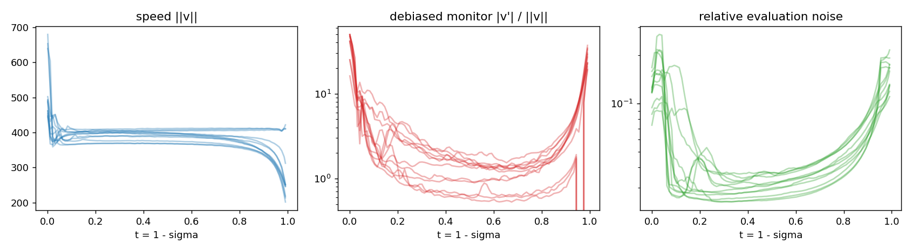
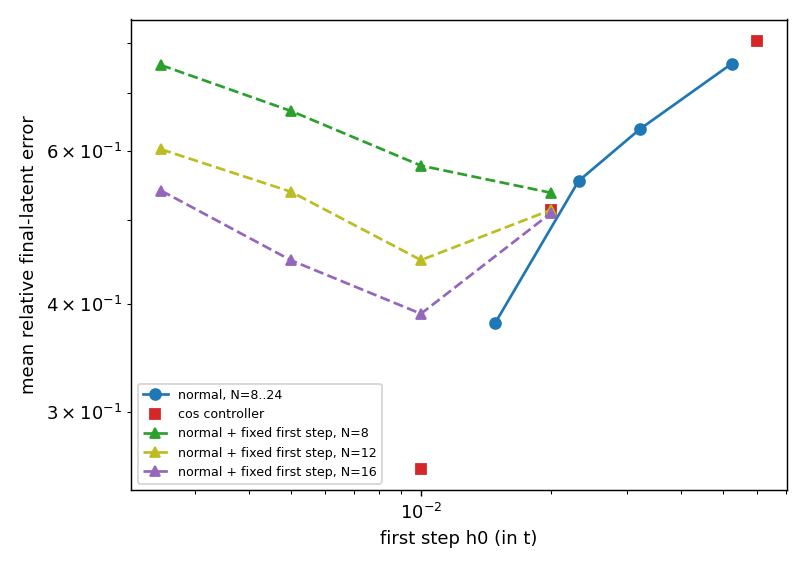
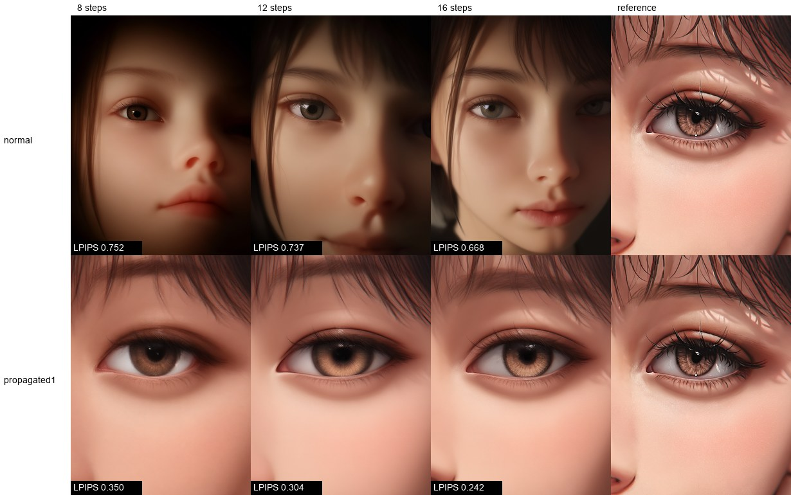
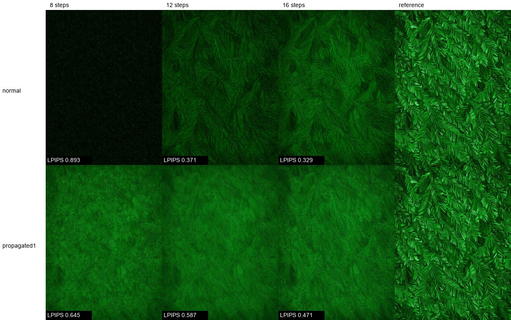

# Zero-cost curvature proxies for adaptive stepping in Flow Matching

**Languages:** **English** · [Русский](README.ru.md) · [中文](README.zh.md) · [Марий](README.mhr.md)

Preprint: [10.5281/zenodo.24143896](https://doi.org/10.5281/zenodo.24143896). Code: [YakovSava/zero-cost-proxy-research](https://github.com/YakovSava/zero-cost-proxy-research).

This file is the original and the authoritative version. The Russian and Chinese files are full
translations of it; the Meadow Mari file is a full machine-assisted translation that has not been reviewed by
a native speaker. Where a translation differs from this file, this file is right.

**Status (2026-11-10): experiments finished except where a section says otherwise.**
Everything below is reproducible from this directory; raw numbers are in `results/*.json`.

Prior art is discussed in Section 8: zero-cost, training-free curvature-adaptive step sizes for flow
matching have been proposed before (CAT-Flow, Li et al., 2026), which I found only after the experiments
were done. What is and is not new here is stated there.

Follow-up to [adaptive-step-samplers](https://github.com/YakovSava/adaptive-step-samplers) (free
error estimate of a predictor-corrector pair), `flow-sde-research` and `flow-wls-research`.
Same conventions: no extra network evaluations, paired comparisons with bootstrap intervals over
units, negative results reported as such.

## Question

A flow-matching sampler integrates `dx/dt = v(x, t)`. A learned `v` is never exactly straight, so
the step size should follow the local curvature. Runge-Kutta-style error control needs extra network
evaluations (NFE). The proposal studied here: estimate the curvature **for free** from the cosine
between consecutive velocities `v(x_n, t_n)` and `v(x_{n-1}, t_{n-1})` that a multistep method has
anyway. Cosine near 1 means a straight path, so enlarge the step; a sharp turn means shrink it.

The work has three parts: (1) a precise statement of what the cosine does and does not measure,
(2) a test of the proxy against the true local error, (3) a test of whether *using* it in a
controller improves the result at equal NFE.

## Short answer

* **The proxy is a sound error predictor.** `E = h/2 * ||v|| * theta` (theta is the angle between
  consecutive velocities) predicts the true next-step Euler error with a median ratio of 0.80-0.84
  and across-sample log-correlation 0.91-0.92 on Anima, for steps from 0.01 to 0.12 in `t`.
* **The cosine alone is not complete in general**: it sees rotation, not change of speed
  (Proposition 1). On Anima speed changes carry 0.3-0.4% of the acceleration energy in the bulk of
  the trajectory but 8-9% (up to 23%) in the first and last 5% of `t`.
* **The idea works, as a static grid, not as an online controller.** Spacing the steps by equal
  turning angle (density proportional to the mean angle rate `||v'|| / ||v||`, exponent 1) lowers the
  final-latent error against the converged solution by 30-43% relative to the default `normal`
  schedule at equal NFE (Euler, 8-24 steps; log-ratios -0.36 to -0.57, intervals exclude zero in
  every cell). Weighting that density by the measured propagation of errors `w(t)` gives 41-50%;
  at 8 steps the error (0.35) is below that of `normal` at 24 steps (0.38).
* **Online adaptivity adds nothing measurable.** A grid taken from a *different* sample's controller
  run gives the same error as the sample's own (log-ratio -0.01 to -0.02, interval about +-0.07), and
  the controller (with a small initial step) equals the static grid it implies, `(w*rate)^1`
  (-0.02, interval -0.09 to +0.04). It is better than the plain exponent-1 grid by 6-15% (log) only
  because its start is more finely graded, not because it adapts. The controller's first step is
  blind (no history), and a poor choice there costs more than everything the controller gains.
* **The result is metric-dependent.** On LPIPS to the converged image the `(w*rate)^1` grid (the
  only one checked on LPIPS) wins on composition-like prompts (`flat`, `face`, `grid`: 39-48% lower
  LPIPS, geometric mean over the three budgets) and loses on the texture prompt `fur` (about 16%
  higher), where latent L2 still improves. It puts its steps early, where the composition is
  decided, and has fewer at the end, where fine texture appears.
* **Evaluation noise.** In bf16 with CFG 5 the velocity carries noise of about 1.7 degrees (3.4
  degrees in the bulk of a 96-step trajectory) that does not shrink with the step and comes from
  rounding, not from the flow. A raw cosine controller with a target angle below this floor
  collapses to its minimum step (Proposition 4).

## 1. Framework

### 1.1 Setting and conventions

`t in [0, T]`, `T = 1 - sigma_min` (`sigma_min = 0.0089` for Anima in ComfyUI), `sigma = 1 - t`,
`x_t = (1 - t) * eps + t * x_1`. ComfyUI hands the sampler the denoised estimate `D`, and the
velocity in `sigma` is `dx/dsigma = (x - D) / sigma`; the velocity in `t` is its negative. A budget
of `N` network evaluations is `N` grid points `0 = t_0 < ... < t_{N-1} = T`; the last evaluation is
read out as `x_hat_1 = x_{t_{N-1}} + sigma_min * v` (identical to `D`). So `N` evaluations buy
`N - 1` integration intervals.

Notation: `s = ||v||`, unit tangent `u = v / s`, acceleration `a = d^2x/dt^2 = dv/dt` along the path,
curvature `kappa = ||(I - u u^T) a|| / s^2`.

Free observables at step `n` (no extra evaluation): `v_n`, `v_{n-1}`, `s_n`, `s_{n-1}`,
`theta_n = angle(v_n, v_{n-1})`, `g_n = ||v_n - v_{n-1}||`.
`theta` is computed from the chord of unit vectors, `theta = 2 asin(||u_n - u_{n-1}|| / 2)`, because
`1 - cos` loses all precision for small angles in single precision.

### 1.2 Proposition 1 (what the cosine sees)

For any two vectors

    ||v_n - v_{n-1}||^2 = (s_n - s_{n-1})^2 + 4 s_n s_{n-1} sin^2(theta_n / 2).

The first term is **stretch**, the second **rotation**. The cosine determines the rotation term and
is blind to stretch. Consequently (also `||a||^2 = (ds/dt)^2 + s^4 kappa^2` along the path):

* A flow with `ds/dt = 0` is fully described by the cosine. A flow with `kappa = 0` and `ds/dt != 0`
  is invisible to it. Example in the tests: the exact velocity field of a single isotropic Gaussian
  (`tests/test_flow.py`) has straight trajectories (cosine = 1 to 1e-9) and a non-zero Euler error.
* The same example produces the opposite failure: the velocity changes sign at
  `t* = 1 / (1 + s^2)` (the variance of `x_t` has an interior minimum), so the cosine reaches -1
  while the local error is small (speed is near zero there).

### 1.3 Proposition 2 (the proxy estimates the Euler error)

For an Euler step of size `h`, the local error is `(h^2 / 2) ||a|| (1 + O(h))`. With `h'` the previous
step, `||v_n - v_{n-1}|| / h' = ||a(t_n - h'/2)|| + O(h'^2)`. Hence

    E_n = (h / 2) * g_n * (h / h')      (Heun-type estimate, free)
        = (h / 2) * (h / h') * s * theta_n    when stretch is negligible.

`E` is the standard predictor-corrector difference (Milne-type estimate, Hairer et al., 1993), obtained without the corrector evaluation
because the evaluation that would be needed is the next step's evaluation anyway (it is lagged by
one interval). Under smoothness the lag introduces a relative error `O(h * |d log||a|| / dt|)`.

### 1.4 Proposition 3 (optimal grid, and what a constant-angle controller does)

For a method of order `p`, minimise the leading-order global error bound
`J = int w(t) |h(t)|^p M_p(t) dt` subject to `int dt / h = N`, where `M_p = ||x^(p+1)|| / (p+1)!` and
`w` is the error-propagation factor. Stationarity gives `h ~ (w M_p)^(-1/(p+1))`: **equidistribution
of `(w M_p)^(1/(p+1))`**. For Euler this is `h ~ ||a||^(-1/2)`.

A controller that holds the turning angle per step constant, `theta_n = kappa s h = theta*`,
chooses `h ~ 1 / (kappa s)`, which is exponent 1 on the curvature, not 1/2. It refines high-curvature
regions more aggressively than the Euler optimum. `h_{n+1} = h_n (theta* / theta_n)^gamma` is a
linear filter in `log h` with pole `1 - gamma`, stable and monotone for `0 < gamma <= 1`.

The exponent 1/2 is the **asymptotic** Euler optimum for the sum of local errors. At the budgets of
interest (8-24 steps, final error of order 0.3-0.8 of the signal) the problem is far from
asymptotic, and the data prefer exponent 1 or higher (Section 4.7). Two reasons are visible. First,
the propagation factor `w(t)` (how an error made at time `t` reaches the end) is not constant; it
falls about four times along the trajectory (Section 4.8), which shifts steps toward the start.
Second, the evaluation noise makes part of the local error first order in `h` (`h * ||xi||`, not
`h^2`), and the optimal density for that part is steeper than 1/2. The second explanation is
consistent with the data but was not isolated.

### 1.5 Proposition 4 (evaluation noise)

If every evaluation carries independent noise `xi` with `E||xi||^2 = sigma^2`, then

* `E theta_n^2 = (kappa s h)^2 + b`, with floor `b = 2 sigma_perp^2 / s^2` independent of `h`;
* the norm of a *derivative estimated from noisy values is biased upward* by the noise power
  (`E||c_hat||^2 = ||c||^2 + tr Cov(c_hat)`); the bias is large in high dimension. It is corrected by
  subtracting the residual variance of the local fit (`monitor.local_fit_statistics`);
* a constant-angle controller has the fixed point `h* = sqrt(theta*^2 - b) / (kappa s)`, which exists
  only for `theta* > sqrt(b)`. **For `theta* < sqrt(b)` the controller collapses to its minimum step**
  (`tests/test_flow.py::test_angle_controller_collapses_below_the_noise_floor`);
* two lags separate rate and floor when the noise is white: `theta_k^2 = a k^2 + b`, so
  `a = (theta_2^2 - theta_1^2) / 3`. This worked in a synthetic test and without CFG on Anima
  (`R^2 = 0.999`), and **failed with CFG 5** (Section 4.3).

### 1.6 Proposition 5 (headroom of adaptivity)

Let `rho_i(t) = M_i(t)^beta` be the optimal density of sample `i`, normalised to unit mass. The best
static grid minimises the mean cost; a per-sample (oracle) grid minimises each. Their gap
`Gamma = E[J_i(static)] - E[J_i(oracle)] >= 0` depends **only on how much the normalised shapes
`rho_i / int rho_i` differ between samples**. Variation of the overall *scale* of `M_i` cancels in the
equidistribution condition and contributes nothing. No online controller, whatever its proxy,
can beat the oracle; so `Gamma` bounds what adaptivity can deliver under that monitor.

## 2. Setup

* **Model:** Anima (`anima_aestheticV11`, bf16), 576x768, CFG 5, 16-channel latent
  (D = 110592). 4 prompt classes (`flat`, `face`, `fur`, `grid`) x 3 seeds (42, 1337, 7) = 12 units.
* **Reference:** Adams-Bashforth 2 on 192 uniform points of `t`; velocities stored at every second
  point (`dumps/reference`, gitignored, 43 MB per unit). Its own error is of the order 5% (AB2 with 96
  points differs from it by 0.14 on one unit and the method is second order), so differences below
  about 0.05 are not resolved.
* **Metric:** relative L2 error of the final latent against the reference. Latent distance, not a
  perceptual metric.
* **Baseline:** ComfyUI `normal` scheduler (shift 3). Euler and AB2.
* **Toy:** exact velocity field of a Gaussian mixture (`gaussian_mixture.py`), D = 64 with 4 modes and
  D = 256 with 8 modes, 48 samples, closed-form reference by RK4.
* **Statistics:** paired log-ratios over units, 95% bootstrap interval (4000 resamples, 12 units).
  With 12 units effects below about 5-8% are not detectable.

Code map: `proxies.py` (angle, stretch, rotation, rates), `grids.py` (equidistribution),
`integrators.py` (Euler, AB2, RK4, adaptive solver), `controllers.py` (angle controller),
`monitor.py` (noise-corrected local derivative norms), `floor.py` (lag fit), `profiles.py`,
`rig.py` and `samplers.py` (ComfyUI), `toy_study.py`, `real_proxy_study.py`, `step_error_study.py`,
`functional_study.py`, `run_*.py` (GPU experiments), `analyze_*.py`, `perceptual_check.py`,
`export_sigmas.py`, `check_stock_euler.py`, `make_figures.py`.
30 tests in `tests/`.

## 3. Hypotheses and provenance

**These hypotheses were not pre-registered.** The study was run in one working session on
2026-11-10. The toy questions T1-T3 existed as task titles before the toy runs, but no hypothesis was
saved to a file with a threshold for "supported" before any measurement, unlike in the sibling studies
(`flow-wls-research`). The real-model hypotheses R1-R6 were formulated after the toy results and after
looking at the velocity statistics of **one** real unit (`flat_s42`); R7-R9 were formulated after the
controller result. The table is therefore a retrospective list of the questions that were asked, with
their verdicts, and must not be read as a registered protocol. The finding in Section 4.6 was **not**
anticipated; it came from a result that initially looked like a bug and is *post hoc*; the control
experiments of Sections 4.6 and 4.7 were designed after it.

| # | Hypothesis | Verdict |
| --- | --- | --- |
| T1 | On the exact toy, `||dv||/h` correlates best with the true local error, the cosine-based angle next, stretch worst | supported (Section 4.1) |
| T2 | Equidistribution with exponent 1/2 beats uniform, shifted grids and exponent 1 for Euler | beats uniform and shifts; exponent 1 vs 1/2 not distinguishable |
| T3 | Per-sample oracle grid is no better than the static optimal grid | supported (gap at most 0.6% for Euler) |
| T4 | Equidistribution with `||x'''||^(1/3)` is optimal for AB2 | **refuted** (worse than uniform at small N) |
| R1 | Zero-cost estimator predicts the true Euler step error on Anima | supported (ratio 0.80-0.84, r = 0.91-0.92) |
| R2 | On Anima the oracle gap is small | supported |
| R3 | Static theory-optimal grid (exponent 1/2) beats `normal` | only at N = 24 (-21%); at N <= 16 not significant |
| R4 | The cosine controller beats `normal` at equal NFE | **refuted** as proposed (initial step 0.06, 20-120% worse); with a small initial step it wins (4.5), but see R8 |
| R7 | A static grid with density proportional to the angle rate (equal angle per step) beats `normal` | **supported**, -30 to -43% error at every N (4.7) |
| R8 | Per-sample adaptation adds nothing beyond the static grid | **supported** (borrowed grids, controller vs static, 4.7) |
| R9 | The gain carries over to image-level distance (LPIPS) | supported for `flat`, `face`, `grid`; **reversed for `fur`** (4.9) |
| R5 | AB2 does not benefit from non-uniform grids | supported; explained by the step ratio at the start (Section 4.4) |
| R6 | The two-lag debiased cosine is a better proxy than the raw one | **refuted** with CFG 5 |

## 4. Results

### 4.1 Toy (exact field)

Within-time log-correlation (across samples, fixed time) of each proxy with the true local Euler
error, 32 steps / 16 steps:

| proxy | D=64, 4 modes | D=256, 8 modes |
| --- | --- | --- |
| `||dv|| / h` | 0.966 / 0.878 | 0.893 / 0.649 |
| rotation only | 0.889 / 0.797 | 0.806 / 0.572 |
| turning angle / h | 0.845 / 0.756 | 0.801 / 0.570 |
| curvature | 0.775 / 0.691 | 0.790 / 0.563 |
| stretch only | 0.069 / 0.185 | -0.293 / -0.030 |

Mean relative final error, Euler, with the oracle gap `log(oracle / static)`:

| N | uniform | shift 3 | exponent 1 | exponent 1/2 (optimal) | oracle | log gap |
| --- | --- | --- | --- | --- | --- | --- |
| 8 | 0.1504 | 0.2650 | 0.1425 | 0.1389 | 0.1388 | -0.002 |
| 24 | 0.0550 | 0.0955 | 0.0538 | 0.0522 | 0.0524 | -0.003 |

For AB2 on the toy the "optimal" `||x'''||^(1/3)` grid is worse than uniform at N = 8-16 and about
equal at N = 24; the best AB2 grid is essentially uniform (a density `||x'''||^0.2` with a uniform
floor gains 3-4% at most).

### 4.2 Structure of the velocity along an Anima trajectory



* `||v||` is nearly constant in the bulk (365-410 depending on the unit) and drops to 200-310 over
  the last 5% of `t`; it is larger in the first step (up to 680 at `t = 0`).
* Share of `||dv||^2` due to speed change: 0.4% (t in 0.05-0.5), 0.3% (0.5-0.9), 2.2% (0.9-0.95),
  **9.4% (t < 0.05, max 23%)**, **7.8% (t > 0.95, max 19%)**.
* The noise-corrected acceleration monitor `||v'|| / ||v||` is U-shaped: about 16-50 per unit `t` at
  the start, about 0.5-3 in the middle, about 20-40 at the end. Uncorrected finite differences give
  a misleading plateau (about 760 in `||v'||`) because their norm is dominated by noise.
* **Evaluation noise.** The angle between `v_k` and `v_{k+m}` has a floor of about 2-3 degrees that
  does not shrink as the lag decreases. A direct test (`floor_origin.py`, unit `face_s42`,
  `sigma = 0.585`): evaluation is deterministic (repeat angle 0), and perturbing the input by a
  relative `1e-5` already changes the velocity by 1.73 degrees; the angle stays at 1.73-1.80 degrees
  from `1e-5` to `1e-3` and only then grows (2.1 degrees at `1e-2`). That is a plateau, the signature of
  rounding noise (bf16), not of a rough field. Without CFG (cfg 1) the floor in the bulk of a
  96-step trajectory is 0.82 degrees against 3.45 degrees at CFG 5: CFG multiplies the noise by about 4.

### 4.3 The proxy against the true local error

True Euler step error from the stored velocities, `e = ||int_t^{t+h} v ds - h v(t)||` (trapezoid), against
`E = h/2 * s * theta` computed from the previous step of equal size (12 units, `step_error.json`):

| h | median E / e | across-unit log-corr | pooled log-corr |
| --- | --- | --- | --- |
| 0.010 | 0.80 | 0.909 | 0.908 |
| 0.021 | 0.79 | 0.909 | 0.862 |
| 0.031 | 0.80 | 0.908 | 0.817 |
| 0.042 | 0.82 | 0.917 | 0.792 |
| 0.062 | 0.84 | 0.922 | 0.746 |

The estimate is stable at 0.8 of the truth, so a calibration constant is enough, and it is
indistinguishable from the Heun estimate `h/2 * ||dv||`. The raw angle rate against the smoothed
monitor is inflated 1.5-2.3 times in the bulk at `h = 0.02` (the noise floor) and 0.7-0.84 times at
`h = 0.083`.

The two-lag debiased angle was **worse** than the raw one in the interior at `h = 0.02-0.04`
(across-unit correlation 0.45-0.48 against 0.89-0.96). With CFG 5 the lag structure is not
`a k^2 + b` (`theta^2` grows roughly linearly in the lag, exponent 0.8-0.95 early and in the middle,
1.25 late; fit `R^2` 0.56-0.93), while at cfg 1 it is (`R^2` 0.977-0.999).

### 4.4 Grids at equal NFE (12 units, Euler, vs `normal`)

Log-ratio of the final error to the `normal` grid at the same N, mean and 95% interval
(negative is better). `normal` mean errors: 0.756, 0.636, 0.554, 0.380 for N = 8, 12, 16, 24.

| N | uniform | static, exponent 1/2 | oracle, exponent 1/2 | roughness-based static |
| --- | --- | --- | --- | --- |
| 8 | +0.18 [+0.10, +0.28] | -0.01 [-0.03, +0.00] | -0.02 [-0.04, +0.01] | -0.05 [-0.08, -0.02] |
| 12 | +0.35 [+0.22, +0.48] | -0.06 [-0.13, +0.01] | -0.09 [-0.16, -0.02] | -0.02 [-0.03, -0.00] |
| 16 | +0.42 [+0.29, +0.55] | -0.08 [-0.21, +0.05] | -0.02 [-0.16, +0.15] | -0.01 [-0.04, +0.02] |
| 24 | +0.59 [+0.46, +0.74] | **-0.23 [-0.36, -0.10]** | **-0.24 [-0.36, -0.12]** | +0.02 [-0.03, +0.06] |

* **Oracle and static are indistinguishable** (differences -0.01, -0.03, +0.06, -0.01). In the
  functional of Proposition 3 the oracle gain is 1-2% (`functional.json`).
* The theory-optimal static grid beats `normal` significantly only at N = 24.
* **AB2:** every non-uniform grid is worse than `normal` (log-ratio +0.05 to +0.75); `normal` is the best
  AB2 grid. AB2 with `normal` beats Euler with `normal` by 6-25%. The ratio of AB2 to Euler error across
  the seven grids correlates with the step growth at the start `r_1 = h_1 / h_0`
  (correlation 0.96, 0.82, 0.74, 0.79 at N = 8, 12, 16, 24): grids with `r_1` near 1 (`normal`,
  uniform) make AB2 better than Euler, grids with `r_1` above 1.4 make it worse (x1.2-2.0).
  The hypothesis "AB2 loses because of white-noise amplification" was checked and **refuted**: the
  white-noise gain of AB2 is highest for `normal` (1.09-1.27) and lowest for uniform (1.01-1.04).

### 4.5 The cosine controller as proposed

Euler with `h_{n+1} = h_n clamp((theta*/theta_n)^gamma, 0.5, 2)`, `gamma` in {1, 0.5},
`theta*` = 5-15 degrees, evaluated at the realised NFE of each unit against the unit's own `normal` curve
(log-log interpolation over N = 8-24). The controller adapts its NFE per unit (e.g. 12-26 at 11
degrees, 15-35 at 8 degrees), and `theta* < 4` degrees triggers the noise-floor collapse of
Proposition 4.

The **mean error does not depend on `theta*`, `gamma` or the NFE** (10 to 76); it depends on the initial
step only:

| initial step h_0 | mean error (all settings) | NFE range |
| --- | --- | --- |
| 0.06 | 0.80 | 8-61 |
| 0.02 | 0.51 | 11-76 |
| 0.01 | 0.25-0.28 | 12-69 |

With `h_0 = 0.06` (my first choice, which looked like a bug because of the constant error) the
controller is worse than `normal` at equal NFE by +0.18 to +0.78 in the log. The first step has no
history, so the controller is blind there, while the curvature is largest.



All Euler grids fit the same picture: at each N the ranking of the seven grids by mean error follows
the ranking by first-step size (N = 24: `static_acc` h_0 = 0.0102 gives 0.296, `normal` 0.0149 gives
0.380, uniform 0.0431 gives 0.706).

### 4.6 First-step control (post hoc finding, control designed afterwards)

`normal` shape with the first step fixed to `h_0` (the remaining N-1 points follow `normal` on
`[h_0, T]`), Euler, 12 units, log-ratio against `normal` at the same N:

| N | h_0 = 0.0025 | 0.005 | 0.01 | 0.02 |
| --- | --- | --- | --- | --- |
| 8 | +0.01 [-0.06, +0.09] | -0.12 [-0.29, +0.07] | -0.23 [-0.48, +0.03] | **-0.31 [-0.45, -0.17]** |
| 12 | -0.05 [-0.08, +0.00] | -0.15 [-0.30, +0.02] | -0.29 [-0.58, +0.01] | -0.18 [-0.28, -0.08] |
| 16 | -0.05 [-0.15, +0.02] | -0.19 [-0.35, -0.05] | **-0.30 [-0.57, -0.02]** | -0.08 [-0.12, -0.04] |

A smaller first step helps up to an optimum (0.01-0.02) and then stops helping: with `h_0 = 0.0025` the
second step becomes large and the error moves there. So the mechanism is the resolution of the whole
start region `t < ~0.1` (a graded start), not one step.

### 4.7 Static grids by angle rate, and what the controller adds

Static grids built from the leave-one-out **mean** profile `||v'|| / ||v||` of the other 11 units,
density `rate^e`, Euler, 12 units. Cells: mean error; log-ratio to `normal` at the same N with its
95% interval (negative is better). `w` is the propagation profile of Section 4.8, which was measured
on two of these 12 units (`flat_s42`, `face_s42`) and is therefore not leave-one-out; the other rows
are.

| grid density | N = 8 | N = 12 | N = 16 | N = 24 |
| --- | --- | --- | --- | --- |
| `normal` mean error | 0.756 | 0.636 | 0.554 | 0.380 |
| exponent 1/2 (Section 4.4) | 0.747; -0.01 [-0.03, +0.00] | 0.585; -0.06 [-0.13, +0.02] | 0.484; -0.08 [-0.21, +0.04] | 0.296; -0.23 [-0.35, -0.11] |
| exponent 0.75 | 0.603; -0.23 [-0.37, -0.10] | 0.450; -0.26 [-0.51, -0.01] | 0.311; -0.51 [-0.67, -0.36] | 0.278; -0.28 [-0.43, -0.14] |
| **exponent 1** (equal angle per step) | 0.488; -0.39 [-0.60, -0.15] | 0.331; -0.56 [-0.75, -0.38] | 0.293; -0.57 [-0.79, -0.36] | 0.257; -0.36 [-0.50, -0.21] |
| exponent 1.5 | 0.410; -0.55 [-0.72, -0.38] | 0.340; -0.53 [-0.75, -0.33] | 0.303; -0.52 [-0.74, -0.31] | 0.264; -0.34 [-0.51, -0.19] |
| `(w * rate)^0.5` | 0.646; -0.17 [-0.26, -0.10] | 0.501; -0.19 [-0.31, -0.07] | 0.358; -0.37 [-0.58, -0.16] | 0.271; -0.33 [-0.46, -0.20] |
| **`(w * rate)^1`** | 0.350; -0.70 [-0.87, -0.53] | 0.296; -0.69 [-0.89, -0.51] | 0.266; -0.66 [-0.90, -0.44] | 0.227; -0.52 [-0.73, -0.32] |
| exponent 1, per-sample oracle | 0.484; -0.40 [-0.61, -0.18] | 0.328; -0.58 [-0.76, -0.41] | 0.280; -0.62 [-0.82, -0.42] | 0.246; -0.42 [-0.56, -0.28] |

* Exponent 1 (equal turning angle per step, which is what a cosine controller with `gamma = 1`
  steers to) is 30-43% better than `normal` in every cell (log-ratio -0.36 to -0.57), and exponent
  1.5 is about as good; the Euler-asymptotic exponent 1/2 is not. The data and the toy disagree here
  (in the exact toy exponents 1/2 and 1 are within 3%).
* Adding the propagation factor gives the best grids: 0.350 at N = 8, 0.296 at N = 12, 0.266 at
  N = 16.
* The per-sample oracle (own profile, exponent 1) is not better than the static grid
  (0.484 against 0.488 at N = 8, 0.328 against 0.331 at N = 12).

**Borrowed grids.** The time grid produced by the controller on unit `v` (`h0 = 0.01`) is applied
unchanged to the next unit `u`, with the controller's NFE:

| controller setting | own grid | borrowed grid | log(borrowed / own) | mean NFE |
| --- | --- | --- | --- | --- |
| gamma 1, theta* 15 deg, h0 0.01 | 0.276 | 0.273 | -0.01 [-0.07, +0.05] | 13.7 |
| gamma 1, theta* 11 deg, h0 0.01 | 0.265 | 0.261 | -0.02 [-0.08, +0.04] | 16.2 |
| gamma 1, theta* 8 deg, h0 0.01 | 0.253 | 0.250 | -0.02 [-0.10, +0.07] | 20.6 |

A grid computed for *another* sample gives the same error as the sample's own adaptive grid. The
adaptation to the individual trajectory carries no measurable information.

**Controller against static grids at the same NFE** (log-ratio of the controller error to the static
family evaluated at the controller's NFE for the same unit; negative: the controller is better):

| controller | normal | exponent 1/2 | exponent 1 | exponent 1.5 | `(w*rate)^1` | oracle, exp. 1 |
| --- | --- | --- | --- | --- | --- | --- |
| theta* 15 deg, h0 0.01 | -0.68 [-0.87, -0.50] | -0.61 [-0.77, -0.46] | -0.15 [-0.26, -0.05] | -0.18 [-0.27, -0.10] | -0.02 [-0.09, +0.03] | -0.11 [-0.16, -0.06] |
| theta* 11 deg, h0 0.01 | -0.61 [-0.79, -0.44] | -0.52 [-0.67, -0.38] | -0.12 [-0.24, -0.01] | -0.16 [-0.27, -0.06] | -0.01 [-0.11, +0.07] | -0.08 [-0.18, -0.01] |
| theta* 8 deg, h0 0.01 | -0.47 [-0.62, -0.32] | -0.36 [-0.52, -0.19] | -0.06 [-0.19, +0.04] | -0.12 [-0.24, -0.01] | +0.03 [-0.11, +0.16] | -0.02 [-0.15, +0.09] |
| theta* 11 deg, h0 0.02 | -0.07 [-0.23, +0.13] | +0.01 [-0.21, +0.28] | +0.37 [+0.14, +0.61] | +0.35 [+0.11, +0.60] | +0.50 [+0.28, +0.75] | +0.41 [+0.18, +0.66] |

With a small initial step the controller beats `normal` and the exponent-1/2 grid by a wide margin,
and is as good as the static grid it implies (`(w*rate)^1`: -0.02, -0.01, +0.03; intervals include
0), slightly better than the plain exponent-1 grid (-0.15 to -0.06). With `h0 = 0.02` it is clearly
worse than the angle-rate grids (+0.37 and +0.50). Its first step is blind, and that single
parameter decides the outcome more than the control law.


### 4.8 Propagation of errors, `w(t)`

A perturbation of relative size `delta` (random direction) is injected into the state at eight
points, both branches are continued with AB2 on the 96-point reference grid, and the gain is
`||final difference|| / ||kick||` (`sensitivity.py`, two units, `sensitivity_large.json`).

* **Small kicks are unusable.** With `delta` of `1e-3` to `3e-3` the final deviation is
  about 0.8-1.4% of `||x||` whatever the kick: any change of the input re-draws the bf16 rounding in
  every later evaluation. For one fork the gain is 7.6 at `1e-3`, 3.9 at `3e-3` and 0.47 at `3e-2`
  (the first version of this experiment, `sensitivity.json`, is floor-dominated and non-monotone).
* **Large kicks give a clean profile** (mean of two units, `delta = 0.03`; `delta = 0.1` is lower but
  has the same shape):

| t | 0.03 | 0.08 | 0.17 | 0.29 | 0.46 | 0.63 | 0.79 | 0.92 |
| --- | --- | --- | --- | --- | --- | --- | --- | --- |
| gain, `delta = 0.03` | 1.71 | 1.42 | 1.69 | 0.87 | 0.70 | 0.39 | 0.39 | 0.47 |
| gain, `delta = 0.1` | 1.27 | 0.91 | 0.69 | 0.59 | 0.39 | 0.29 | 0.38 | 0.61 |

The flow **contracts** large perturbations, increasingly so late; an error made in the first
quarter of `t` weighs about four times more at the end than one made in the last half. Together with
the monitor, which is about 25 times larger at the start than in the middle, the start region carries
`M * w` larger by a factor of order 75. This is the factor missing from the functional of
Section 1.4 and the reason the sum of local errors there (`functional_study.py`) did not predict the
end-to-end ranking of grids. Limits: random directions (the error of a first step is directed along
the acceleration and may be amplified more), two units, AB2 continuation.

### 4.9 Image-level check (LPIPS)

The `(w * rate)^1` grid and `normal`, Euler, N = 8, 12, 16, the same 12 units, decoded with the
Qwen-Image VAE and compared with the decoded converged solution by LPIPS (AlexNet)
(`perceptual_check.py`).

| N | LPIPS `normal` | LPIPS `(w*rate)^1` | log-ratio | wins |
| --- | --- | --- | --- | --- |
| 8 | 0.592 | 0.398 | -0.39 [-0.53, -0.21] | 11/12 |
| 12 | 0.450 | 0.327 | -0.36 [-0.62, -0.08] | 9/12 |
| 16 | 0.403 | 0.267 | -0.43 [-0.71, -0.15] | 9/12 |

Eight steps with the new grid are as close to the converged image as sixteen steps with `normal`
(0.398 against 0.403; log-ratio +0.02 [-0.21, +0.25], 6 of 12 units).

By prompt (mean over three seeds; LPIPS `normal` -> new, then latent L2 `normal` -> new):

| prompt | LPIPS N=8 | LPIPS N=12 | LPIPS N=16 | L2 N=8 | L2 N=12 | L2 N=16 |
| --- | --- | --- | --- | --- | --- | --- |
| flat | 0.302 -> 0.220 | 0.237 -> 0.131 | 0.205 -> 0.127 | 0.38 -> 0.27 | 0.34 -> 0.20 | 0.29 -> 0.20 |
| face | 0.605 -> 0.349 | 0.533 -> 0.293 | 0.475 -> 0.228 | 1.04 -> 0.38 | 0.89 -> 0.31 | 0.75 -> 0.24 |
| fur | 0.730 -> 0.583 | 0.368 -> 0.537 | 0.333 -> 0.416 | 0.57 -> 0.31 | 0.39 -> 0.28 | 0.35 -> 0.25 |
| grid | 0.730 -> 0.441 | 0.663 -> 0.348 | 0.599 -> 0.297 | 1.03 -> 0.44 | 0.93 -> 0.40 | 0.82 -> 0.37 |



For `face_s42` the new grid reaches the composition of the converged image already at 8 steps
(close-up of the eye), while `normal` draws a different framing at 8, 12 and 16 steps: the error is a
drift of the *composition*, decided in the first steps. Every unit where the new grid loses on LPIPS
is a `fur` unit (3 of 3 seeds at N = 12 and 16, 1 of 3 at N = 8), and there latent L2 *improves*:



The two metrics disagree on texture. The new grid matches the low-frequency structure of the
converged solution better, but its image is smoother and flatter; `normal` keeps more fine texture
(even when misaligned) because it spends relatively more steps near the end, where detail appears. This
is the price of the propagation weighting, which treats late errors as cheap: it is right for
alignment and wrong for texture energy. A grid for texture-heavy content would need a perceptual
weight, which this study did not build.

## 5. What this means

1. **The physics in the proposal is right.** The trajectory is curved at both ends, and the angle
   between consecutive velocities is a free, calibrated predictor of the local error (`E ~ 0.8 e`).
2. **The payoff is a static grid, not a controller.** Equal turning angle per step, applied as a grid
   built from the mean angle-rate profile of the model, is 30-43% better than the default schedule at
   equal NFE on Anima (Euler), and reaches at 8 steps what `normal` reaches at 16 (LPIPS) or 24
   (latent L2). It costs nothing at inference time and needs no per-sample control.
3. **Per-sample adaptation has no measurable headroom here.** A grid taken from another sample works
   as well as the sample's own, and a static grid matches the controller. The adaptive loop is a
   (slow) way to construct the static grid.
4. **What matters is the start of the trajectory.** The monitor is about 25 times larger there than
   in the middle, errors made there weigh about four times more at the end, and they decide the
   composition. A start without enough resolution (or a blind first step) costs more than any
   gain from the rest.
5. A raw cosine must not be used with a target below the evaluation-noise floor (about 4-6 degrees for
   bf16 with CFG 5). Derivative norms from raw finite differences in high dimension must have the
   noise power removed before use.
6. Use AB2 only with grids whose step ratio `h_1 / h_0` stays near 1 in the start region; with the
   angle-rate grids (`r_1` about 1.4-2.7) AB2 is worse than Euler. A grid for AB2 was not designed here.
7. For texture-heavy content the propagation-weighted grid is not safe (4.9); the plain exponent-1 grid
   was not evaluated on LPIPS.

## 6. Limits and threats to validity

* One model (Anima), one resolution, one CFG scale, 12 units; effects below 5-8% are not detectable.
  Whether the profile transfers to other flow models (Flux, Qwen-Image, distilled models without CFG)
  is untested.
* The main metric is relative L2 distance of the final latent to a converged solution. LPIPS was
  checked for the best grid only, with `normal` as the single comparison, and the two disagree on
  `fur`.
* The reference has about 5% error of its own and a first step of 0.005.
* The propagation profile `w(t)` was measured on two of the 12 evaluation units, with random
  directions, one solver, and only large kicks are usable because of bf16 noise. Rows that use it
  (`(w*rate)^e`, the perceptual check) are therefore slightly optimistic; the plain angle-rate grids
  (exponent 0.75, 1, 1.5) are leave-one-out and give the headline numbers.
* The first-step finding was **post hoc** (it came from a result that looked like a bug); the
  control experiments designed afterwards (Sections 4.6, 4.7) tested it with 12 units. The exponent-1 result was not
  predicted by my own theory (exponent 1/2) and was found by running the exponent family after the
  controller result; the exponents 0.75, 1 and 1.5 were fixed in advance of running, not tuned after.
* The explanation that first-order evaluation noise makes the optimal exponent steeper than 1/2 is
  consistent with the data but not isolated from the propagation effect.
* **Sensitivity of the output to rounding.** Shifting the interior sigmas by a relative `1e-7` changes the
  final latent of ComfyUI's stock `euler` by 3-10% (`check_stock_euler.py`: 0.100, 0.046, 0.033 on three
  cases; grids from Section 7.1). My own Euler loop and the stock `sample_euler` differ by 1-7% on the same
  sigmas (0.071, 0.033, 0.010), which is inside this floor. The numbers in the tables are therefore
  deterministic for this code but carry an implementation-level scatter of several percent per unit, which
  is not small compared with errors of 0.2-0.4 at 8-12 steps. It is part of the between-unit variance in
  the intervals, but it was measured on three cases only and not for the `normal` grids.
* The noise-corrected monitor over-subtracts at the very ends, where unresolved real curvature is
  counted as noise (spikes to zero in `monitor_profiles.png`).
* bf16 evaluation noise is a property of this inference setup; in fp32 the raw cosine would be a
  cleaner proxy, and the "noise first" part of the story might weaken.
* Euler and AB2 only, deterministic sampling only; no stochastic samplers, no higher-order or
  predictor-corrector methods.

## 7. Reproduction

```
python -m pytest -q                       # 30 tests, CPU
python toy_study.py --study proxy --config d64_m4
python toy_study.py --study grid  --config d64_m4
python run_reference.py                   # GPU, ~22 min, writes dumps/reference
python run_grids.py                       # GPU, ~85 min
python real_proxy_study.py; python step_error_study.py; python functional_study.py
python floor_origin.py
python sensitivity.py; python sensitivity.py --sizes 3e-2 1e-1 --output sensitivity_large.json
python run_adaptive.py; python run_startfix.py; python run_replica.py
python perceptual_check.py
python export_sigmas.py; python check_stock_euler.py
python analyze_grids.py; python analyze_adaptive.py; python analyze_startfix.py
python analyze_replica.py
python make_figures.py
```

Run with the ComfyUI environment (`D:\ComfyUI\venv\Scripts\python.exe`); the GPU scripts take about
5.5 GB of VRAM. `run_replica.py` needs `results/sensitivity_large.json`. Roughly 3.5 hours of GPU time
in total.

### 7.1 Ready-made sigma lists for Anima

`export_sigmas.py` writes `results/anima_sigmas.json`: the grids of Section 4.7 built from the mean of all
12 profiles (in-sample for these 12 units, unlike the leave-one-out grids of the tables). `N` is the number
of network evaluations; the list has `N + 1` entries and ends with `0.0089, 0`, like `normal`. They can be
given to ComfyUI's stock `euler` through a manual-sigmas node. Valid only for Anima at 576x768 with CFG 5, and
tested only with Euler (`check_stock_euler.py`).

* N = 8, exponent 1: `1, 0.98589, 0.9487, 0.83139, 0.59419, 0.22593, 0.04039, 0.0089, 0`
* N = 8, propagated: `1, 0.99196, 0.98106, 0.95543, 0.89484, 0.78472, 0.37647, 0.0089, 0`
* N = 12, exponent 1: `1, 0.99182, 0.98062, 0.95383, 0.90008, 0.80103, 0.65135, 0.43431, 0.19588, 0.06422, 0.02336, 0.0089, 0`
* N = 12, propagated: `1, 0.99489, 0.98977, 0.98216, 0.97056, 0.94867, 0.91128, 0.84776, 0.77047, 0.56357, 0.08742, 0.0089, 0`
* N = 16, exponent 1: `1, 0.994, 0.98718, 0.97727, 0.95623, 0.92345, 0.86305, 0.7851, 0.67653, 0.52764, 0.35185, 0.18278, 0.08018, 0.03578, 0.01896, 0.0089, 0`
* N = 16, propagated: `1, 0.99625, 0.9925, 0.98831, 0.98267, 0.97522, 0.96263, 0.94499, 0.9181, 0.87422, 0.82614, 0.76315, 0.62161, 0.30401, 0.04471, 0.0089, 0`
* N = 24, exponent 1: `1, 0.99609, 0.99217, 0.98757, 0.98169, 0.97299, 0.95852, 0.94027, 0.91314, 0.87226, 0.82452, 0.76924, 0.69878, 0.60798, 0.50608, 0.39197, 0.27277, 0.17067, 0.09956, 0.05854, 0.03456, 0.02264, 0.01476, 0.0089, 0`
* N = 24, propagated: `1, 0.99755, 0.99511, 0.99266, 0.99022, 0.98684, 0.98316, 0.97948, 0.97299, 0.96477, 0.95381, 0.94138, 0.92392, 0.89902, 0.86799, 0.83647, 0.80299, 0.75558, 0.67095, 0.53534, 0.28251, 0.07817, 0.02507, 0.0089, 0`

"Propagated" is the `(w * rate)^1` grid; its propagation profile was measured on two of the 12 units. Its
late steps are large (the last two intervals of the 8-step list cover sigma 0.78 to 0.0089), which is what
makes it the best by latent error and the worst on texture (Section 4.9). The grid of exponent 1 is the safer
choice for texture-heavy content, but it was not evaluated on LPIPS.

## 8. Related work and what is new

**The idea of this study is not new.** Training-free step-size adaptation for flow matching that needs
no extra network evaluations already exists. CAT-Flow (Li et al., 2026; arXiv 2609.01746, posted
2026-09-01) adapts step sizes from a finite-difference estimate of the time derivative of the vector
field (CAT-OT) or from the variance of past values (CAT-OV), without extra evaluations, and reports up
to 40% fewer steps for comparable CLIP, aesthetic and HPSv3 scores on four text-to-image flow models. That
is the same family as the cosine proposal studied here. I found CAT-Flow after the experiments were
finished, I read only its abstract and introduction, and I did **not** implement or compare against it.
Nothing in this file says anything about how CAT-Flow performs.

Other neighbours:

* *Static schedules fitted to a model or to reference trajectories:* Align Your Steps (Sabour et al.,
  2024), Optimal Stepsize Distillation (Pei et al., 2025), Bespoke Solvers (Shaul et al., 2024), the
  shifted schedule of SD3 (Esser et al., 2024) and the EDM schedule (Karras et al., 2022). The static
  grid of Section 4.7 belongs to this family; it differs by being built from the zero-cost proxy without
  training or optimisation, and it is not shown to be better than these methods (it was not compared with
  them).
* *Free use of past evaluations:* CAB (Roy & Nair, 2026) corrects the Adams-Bashforth predictor with past
  velocities; AdaptiveDiffusion (Ye et al., 2024) skips network evaluations using third-order differences
  of the latents.
* *Classical step-size control:* embedded Runge-Kutta pairs (Dormand & Prince, 1980; Hairer et al., 1993),
  PI control (Gustafsson et al., 1988; Söderlind, 2002), the equidistribution principle (de Boor, 1973;
  Eriksson et al., 1995), and adaptive solvers for generative models (Jolicoeur-Martineau et al., 2021).
* *Curvature of generative trajectories as a source of truncation error:* Lee et al. (2023), who reduce it
  by training instead of controlling the step.

What this study adds, as far as I can tell from the sources I read:

1. An exact decomposition of what the cosine measures (rotation) and misses (change of speed), with a
   measurement of how large the missed part is on a real model (Proposition 1, Section 4.2).
2. A calibration of the zero-cost estimator against the true local error computed from a converged
   trajectory on a real model, not only against a downstream quality metric (Section 4.3).
3. A measurement of the evaluation-noise floor of the velocity in bf16 with CFG, its origin (rounding),
   and the consequence for a raw cosine controller (Proposition 4, Section 4.2).
4. A direct test of how much per-sample adaptation adds beyond a static grid built from the average
   profile: borrowed grids and an oracle (Sections 4.4, 4.7). A comparison of a controller against a
   fixed default schedule cannot answer this question. As far as I could determine from the part I read,
   CAT-Flow is compared with default and heuristic schedules, not with a static grid fitted to the model's
   average profile; I do not know what such a comparison would show for it.
5. The role of the first step and of the start region, and the failure of the asymptotic exponent 1/2 in
   the 8-24 step regime (Sections 4.5-4.7).

What is **not** new or not shown: the idea of curvature-adaptive steps; zero-cost estimators of it; the
equidistribution principle; static optimised schedules. All results are for one model with 12 units (Section 6).

## 9. References

The full list in APA 7 style, with the level of verification of each entry and a map of where each source
is cited, is in [`publication/references_apa.md`](publication/references_apa.md). Sources cited in this
file: Dormand & Prince (1980); de Boor (1973); Eriksson et al. (1995); Esser et al. (2024); Gustafsson
et al. (1988); Hairer et al. (1993); Jolicoeur-Martineau et al. (2021); Karras et al. (2022); Lee et al.
(2023); Li et al. (2026); Pei et al. (2025); Roy & Nair (2026); Sabour et al. (2024); Shaul et al.
(2024); Söderlind (2002); Ye et al. (2024).
