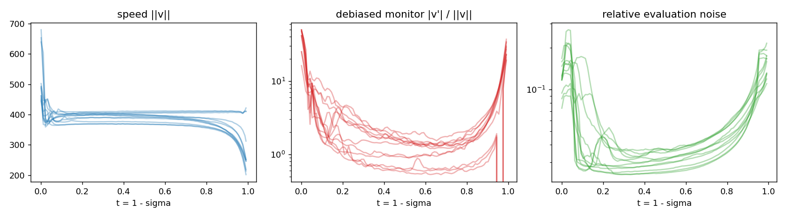
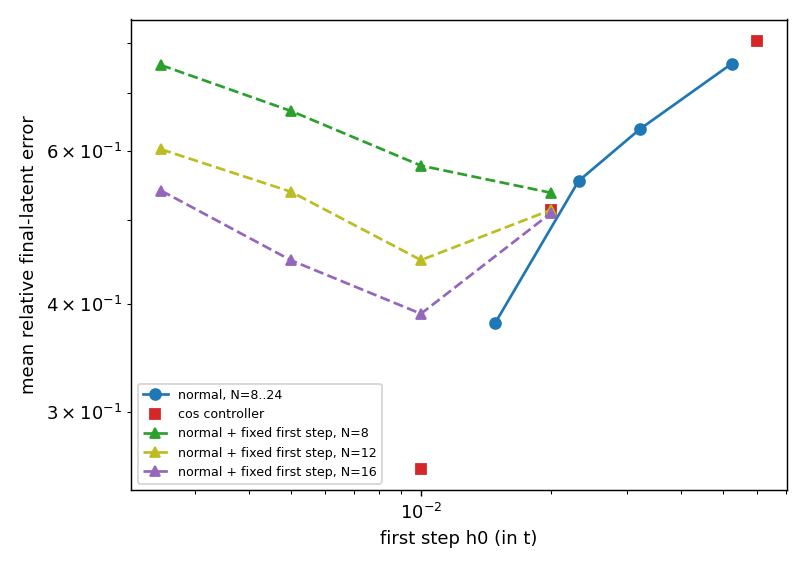
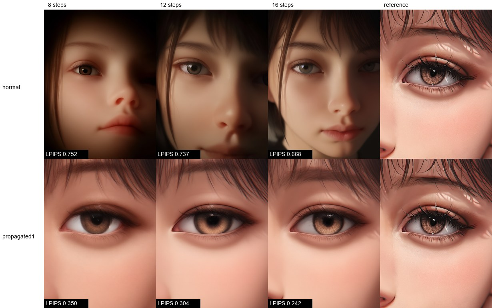
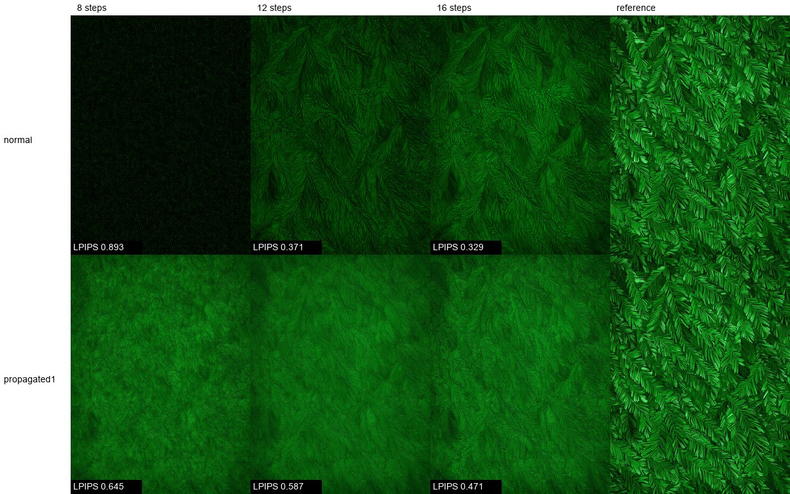

# Flow Matching-ыште адаптивный ошкылым сайлаш бесплатный кривизна прокси

**Йылме:** [English](README.md) · [Русский](README.ru.md) · [中文](README.zh.md) · **Марий**

Препринт: [10.5281/zenodo.24143896](https://doi.org/10.5281/zenodo.24143896). Код: [YakovSava/zero-cost-proxy-research](https://github.com/YakovSava/zero-cost-proxy-research).

> *Note: machine-assisted full translation into Meadow Mari, not reviewed by a native speaker. Technical terms are kept in Russian or English, as in the sibling repositories. Please have it checked before relying on it. Перевод сделан с помощью ИИ и носителем языка не проверен.*
> Тиде текстым ИИ дене возымо. Тудым кучылтмо деч ончыч марий йылме дене ойлышо еҥ ончен лукташ кӱлеш.

Тиде англичан [README.md](README.md)-ын тичмаш кусарымаш. Англичан файл — тӱҥ оригинал: тӱрлык лиеш гын, англичан файл верный.

**Статус (2026-11-10): экспериментла пытыш, ужашыштыже вес семын возымо огыл гын.**
Тышке возымо чыла тиде папкыште эше гана ыштен лиеш; сырой шотла `results/*.json` файлыште улыт.

Ончычсо паша нерген 8-ше ужашыште ойлымо: flow matching-лан обучений деч посна да сетьым ешартыш гана ӱжде кривизна почеш ошкылым вашталтымаш ончыч предложитлыме (CAT-Flow, Li и др., 2026). Мемнан тиде пашам экспериментла пытымеке муна. Тышке мо у, мо уке, тудымак тушто возымо.

Тиде паша [adaptive-step-samplers](https://github.com/YakovSava/adaptive-step-samplers) (предиктор-корректор пар йоҥылышым бесплатно шотлымаш), `flow-sde-research` да `flow-wls-research` пашалан продолжений.
Икгай условийла: сетьын эше вычислений уке, юнитла почеш бутстреп интервалан парный сравнений, негативный результатым негативный семын возымо.

## Йодыш

Flow matching сэмплер `dx/dt = v(x, t)` уравненийым ойла. Тунемме `v` нигунам чын прямой огыл, садлан ошкылын кугытшо локальный кривизна почеш вашталтын кӱлеш. Рунге-Кутта семын йоҥылышым контролироватлымаш сетьын ешартыш вычисленийжым (NFE) кӱлеш. Тиде паша тергыме предложений: кривизнам **бесплатно** шотлаш, многошаговый метод шкеак аралыме кок вашлиймаш скорость `v(x_n, t_n)` да `v(x_{n-1}, t_{n-1})` коклашт косинус дене. Косинус 1-ым лишемеш гын, корно прямой, ошкылым кугемдена; направлений чот вашталтеш гын, ошкылым изирак ыштена.

Паша кум ужашан: (1) косинус мом чын ойла да мом огыл — точный формулировка, (2) прокси чын локальный йоҥылыш дене тергымаш, (3) NFE ик гай годым контроллерыште кучылтмаш результатым сайемда мо — тиде тергымаш.

## Кӱчык вашмут

* **Прокси — йоҥылышым сайын ончыктышо предсказатель.** `E = h/2 * ||v|| * theta` (theta — кок вашлиймаш скорость коклаште угол) Эйлер вес ошкылын чын йоҥылышым ончыкта: Anima-ште `t` почеш 0,01 гыч 0,12 марте ошкыл годым медианный отношений 0,80-0,84, образецла коклаште логарифмла корреляций 0,91-0,92.
* **Косинус ик семынак кеч-мо годым тичмаш огыл**: тудо поворотым ужеш, но скоростьын кужытшо (длина) вашталтмашыжым ок уж (утверждений 1). Anima-ште скоростьын вашталтмаш траекторийын тӱҥ ужашыштыже ускоренийын энергийжын 0,3-0,4 % гына, а `t`-н икымше да пытартыш 5 %-ыштыже 8-9 % (макс. 23 %).
* **Идей статический сетка семын пашам ышта, онлайн контроллер семын огыл.** Ошкылым ик угол почеш пуымаш (плотность темпыш `||v'|| / ||v||` пропорциональный, показатель 1) NFE ик гай годым стандартный `normal` расписаний деч финальный латентын сошедшийся решений дене йоҥылышыжым 30-43 % изирак ышта (Эйлер, 8-24 ошкыл; лог-отношений -0,36 гыч -0,57 марте, интервал кажне ячейкыште 0-ым ок кучо). Тиде плотностьым йоҥылыш распространений `w(t)` дене взвешиваний ыштымеке — 41-50 %; 8 ошкылеш йоҥылыш (0,35) `normal` 24 ошкылеш йоҥылыш деч (0,38) изирак.
* **Онлайн адаптивность нимом измеритлыме ок ешаре.** *Вес* образецлан контроллер лукмо сетка тиде образецын шке сеткаже дене ик гай йоҥылышым пуа (лог-отношений -0,01 гыч -0,02, интервал около +-0,07), да контроллер (изи икымше ошкыл дене) шкеж подразумевайтлыме статический сетка `(w*rate)^1` дене ик гай (-0,02, интервал -0,09 гыч +0,04). Тудо ик показатель 1 сетка деч 6-15 % сайрак (логарифм почеш) тудын старт сайын градуироватлыме дене гына, а адаптироватлыме дене огыл. Контроллерын икымше ошкылжо слепой (историй уке), да тушто йоҥылыш цена контроллер моло гыч налме выигрыш деч кугурак.
* **Результат метрика дене кылдалтын.** Сошедшийся сурет дене LPIPS почеш `(w*rate)^1` сетка (LPIPS дене ик гына тергыме) композиций промптыште (`flat`, `face`, `grid`: LPIPS 39-48 % изирак, кум бюджет почеш среднее геометрическое) сайрак, а текстур промпт `fur`-ыште осалрак (около 16 % кугурак), тушто латент L2 сайемеш. Тудо ошкылым ончыч ышта, композиций тушто ойыралтеш, да пытартышыште ошкыл изирак, тушто изи текстур ужалтеш.
* **Вычислений шум.** bf16 да CFG 5 годым скорость около 1,7 градус шумым нала (96 ошкылан траекторийын тӱҥ ужашыштыже 3,4 градус), тудо ошкыл дене ок изиме да потокын огыл, а округленийын гына лектеш. Сырой косинус дене контроллер, цель угол тиде пол деч изирак гын, эн изи ошкылыш вочеш (утверждений 4).

## 1. Теоретический негиз

### 1.1 Постановка да условийла

`t in [0, T]`, `T = 1 - sigma_min` (ComfyUI-ште Anima-лан `sigma_min = 0.0089`), `sigma = 1 - t`, `x_t = (1 - t) * eps + t * x_1`. ComfyUI сэмплерлан расшумленный оценке `D`-ым пуа, `sigma` почеш скорость `dx/dsigma = (x - D) / sigma`; `t` почеш скорость тудын деч обратный знакан. `N` сетьын вычислений бюджет — `0 = t_0 < ... < t_{N-1} = T` `N` сетка точка; пытартыш вычисленийым `x_hat_1 = x_{t_{N-1}} + sigma_min * v` семын лудыт (`D` дене ик гай). Тыге `N` вычислений `N - 1` интегрирований интервалым пуа.

Обозначенийла: `s = ||v||`, единичный касательный `u = v / s`, корно почеш ускорений `a = d^2x/dt^2 = dv/dt`, кривизна `kappa = ||(I - u u^T) a|| / s^2`.

`n` ошкылыште бесплатный наблюдаемыла (ешартыш вычислений деч посна): `v_n`, `v_{n-1}`, `s_n`, `s_{n-1}`, `theta_n = angle(v_n, v_{n-1})`, `g_n = ||v_n - v_{n-1}||`.
`theta`-м единичный векторла хорда гыч шотлат, `theta = 2 asin(||u_n - u_{n-1}|| / 2)`, молан манын, `1 - cos` ик точностьан вычислений годым изи углала чыла точностьым йомдара.

### 1.2 Утверждений 1 (косинус мом ужеш)

Кеч-могай кок вектор дене

    ||v_n - v_{n-1}||^2 = (s_n - s_{n-1})^2 + 4 s_n s_{n-1} sin^2(theta_n / 2).

Икымше ужаш — **растяжений**, кокымшо — **поворот**. Косинус поворот ужашым ойыра да растяжений деч слепой. Тышеч лектеш (корно почеш эше `||a||^2 = (ds/dt)^2 + s^4 kappa^2`):

* `ds/dt = 0` потокым косинус тичмашын ойла. `kappa = 0` да `ds/dt != 0` поток тудылан уж огыл. Тестыште пример: ик изотропный гауссианын точный скорость поле (`tests/test_flow.py`) прямой траекторийым пуа (косинус 1 дене 1e-9 марте) да Эйлерын нулевой огыл йоҥылышыжым.
* Тиде пример обратный сбойым эше пуа: скорость `t* = 1 / (1 + s^2)` годым знакым вашталта (`x_t` дисперсийын внутренний минимум уло), садлан косинус -1-ым шуэш, а локальный йоҥылыш изи (тушто скорость нулышко лишемеш).

### 1.3 Утверждений 2 (прокси Эйлерын йоҥылышым шотла)

`h` кугытан Эйлер ошкылын локальный йоҥылышыже `(h^2 / 2) ||a|| (1 + O(h))`. `h'` ончычсо ошкыл гын, `||v_n - v_{n-1}|| / h' = ||a(t_n - h'/2)|| + O(h'^2)`. Тыге

    E_n = (h / 2) * g_n * (h / h')      (Хойн тӱрлык оценке, бесплатный)
        = (h / 2) * (h / h') * s * theta_n    растяжений кӧра изи гын.

`E` — стандартный предиктор-корректор разность (Милн тӱрлык оценке, Hairer и др., 1993), корректор вычислений деч посна налме, молан манын, тудлан кӱлеш вычислений тугеат следующий ошкылын вычислений (тудо ик интервал дене запаздывайта). Гладкость годым запаздывайме относительный йоҥылыш `O(h * |d log||a|| / dt|)`-ым пуа.

### 1.4 Утверждений 3 (оптимальный сетка да постоянный угол контроллер мом ышта)

`p` порядокан метод лан `int dt / h = N` условий дене глобальный йоҥылыш оценкын тӱҥ членже `J = int w(t) |h(t)|^p M_p(t) dt` изимдена, тушто `M_p = ||x^(p+1)|| / (p+1)!`, а `w` — йоҥылыш распространений коэффициент. Стационарность условий `h ~ (w M_p)^(-1/(p+1))`-ым пуа: **`(w M_p)^(1/(p+1))` равнораспределений (equidistribution)**. Эйлерлан тиде `h ~ ||a||^(-1/2)`.

Ошкыл дене угол поворотым ик семын кучышо контроллер, `theta_n = kappa s h = theta*`, `h ~ 1 / (kappa s)`-ым сайла, тиде кривизна почеш показатель 1, а 1/2 огыл. Тудо кугу кривизна ужашым Эйлерын оптимум деч чотрак изимда. `h_{n+1} = h_n (theta* / theta_n)^gamma` — `log h` почеш `1 - gamma` полюсан линейный фильтр, `0 < gamma <= 1` годым устойчивый да монотонный.

Показатель 1/2 — локальный йоҥылышла сумман **асимптотический** Эйлер оптимум. Мемнан кӱлеш бюджетла годым (8-24 ошкыл, пытартыш йоҥылыш сигналын 0,3-0,8 порядок) задач асимптотика деч чот посна, да шотла показатель 1 але тудын деч кугурак кӱлеш ойла (4.7 ужаш). Кок амал ужалтеш. Икымше: распространений коэффициент `w(t)` (`t` годым ыштыме йоҥылыш пытартышыш кузе шуэш) ик гай огыл; тудо траекторий почеш около ныл гана волгалта (4.8 ужаш), тидын дене ошкыл тӱҥалтышыш кусна. Кокымшо: вычислений шум локальный йоҥылышын ик ужашыжым `h` почеш икымше порядокан ышта (`h * ||xi||`, а `h^2` огыл), да тиде ужашлан оптимальный плотность 1/2 деч кугурак. Кокымшо ойлымаш шотла дене келша, но ойыралтен огыл.

### 1.5 Утверждений 4 (вычислений шум)

Кажне вычислений `E||xi||^2 = sigma^2` дене независимый `xi` шумым нала гын, тыге

* `E theta_n^2 = (kappa s h)^2 + b`, `b = 2 sigma_perp^2 / s^2` пол `h` дене ок кылдалт;
* *шуман значенийла гыч шотлыме производный норма* шумын мощностьшо дене кӱшыкӧ смещенный (`E||c_hat||^2 = ||c||^2 + tr Cov(c_hat)`); кугу размерностьыште смещений кугу. Тудым локальный подгонкын остаточный дисперсийым кудалтымо дене тӧрлатат (`monitor.local_fit_statistics`);
* постоянный угол контроллерлан неподвижный точка `h* = sqrt(theta*^2 - b) / (kappa s)` уло, тудо `theta* > sqrt(b)` годым гына лиеш. **`theta* < sqrt(b)` годым контроллер эн изи ошкылыш вочеш** (`tests/test_flow.py::test_angle_controller_collapses_below_the_noise_floor`);
* шум белый годым кок лаг темпым да полым ойырат: `theta_k^2 = a k^2 + b`, тыгыйже `a = (theta_2^2 - theta_1^2) / 3`. Тиде синтетический тестыште да Anima-ште CFG деч посна пашам ыштыш (`R^2 = 0,999`), но **CFG 5 годым ыш келше** (4.3 ужаш).

### 1.6 Утверждений 5 (адаптивностьын мӧҥгӧ)

`rho_i(t) = M_i(t)^beta` — `i` образецын оптимальный плотностьшо, единичный массыш нормироватлыме. Эн сай статический сетка шотлымо стоимостьым изимда; образец почеш (оракул) сетка кажне образецым изимда. Нунын коклаштыже `Gamma = E[J_i(static)] - E[J_i(oracle)] >= 0` **нормироватлыме `rho_i / int rho_i` формыла образецла коклаште кузе тӱрлык, тидын гына кӧра**. `M_i`-ын общий *масштабшын* вашталтмаш равнораспределений условийыште йомеш да нимом ок пу. Кеч-могай онлайн контроллер, тудын прокси кеч-могай, оракул деч сайрак лийын ок керт; садлан `Gamma` тиде монитор дене адаптивность мом пуаш лиеш, тудын ограничений.

## 2. Эксперименталын постановкыже

* **Модель:** Anima (`anima_aestheticV11`, bf16), 576x768, CFG 5, 16 каналан латент (D = 110592). Промптын 4 класс (`flat`, `face`, `fur`, `grid`) x 3 seed (42, 1337, 7) = 12 юнит.
* **Эталон:** `t`-н 192 икгай точкыжо почеш Adams-Bashforth 2; скорость кажне кокымшо точкыште аралыме (`dumps/reference`, gitignore-ыште, ик юнитлан 43 МБ). Тудын шке йоҥылышыже 5 % порядок (96 точкан AB2 ик юнитыште тудын деч 0,14 дене ойыра, метод кокымшо порядокан), садлан 0,05 деч изирак тӱрлык ойыралтын огыл.
* **Метрика:** финальный латентын эталон дене относительный L2 йоҥылышыже. Латент почеш расстояний, перцептивный метрика огыл.
* **Сравнений база:** ComfyUI `normal` планировщик (shift 3). Эйлер да AB2.
* **Игрушечный задача:** гауссовый смесьын точный скорость поле (`gaussian_mixture.py`), D = 64 (4 мода) да D = 256 (8 мода), 48 образец, RK4 дене закрытый форма эталон.
* **Статистика:** юнитла почеш парный лог-отношенийла, 95 % бутстреп интервал (4000 перевыборка, 12 юнит). 12 юнит годым 5-8 % деч изирак эффектым ок ужаш.

Код карта: `proxies.py` (угол, растяжений, поворот, темпла), `grids.py` (равнораспределений), `integrators.py` (Эйлер, AB2, RK4, адаптивный решатель), `controllers.py` (угол контроллер), `monitor.py` (шумым кудалтыме локальный производный нормыла), `floor.py` (лаг почеш подгонка), `profiles.py`, `rig.py` да `samplers.py` (ComfyUI), `toy_study.py`, `real_proxy_study.py`, `step_error_study.py`, `functional_study.py`, `run_*.py` (GPU-ыште экспериментла), `analyze_*.py`, `perceptual_check.py`, `export_sigmas.py`, `check_stock_euler.py`, `make_figures.py`.
`tests/` папкыште 30 тест.

## 3. Гипотезыла да нунын лекмышышт

**Тиде гипотезым ончыч регистрироватлен огыл.** Тергымаш ик рабочий сессийыште 2026-11-10 ыштыме. Игрушечный йодышла T1-T3 игрушечный запускла деч ончыч задачын заголовкыжо семын улыт ыле, но икгай гипотезат «подтвержден» порог дене файлыш измерений деч ончыч возымо ыш лий — тидын деч ойыра вес соседний тергымашла (`flow-wls-research`). Чын моделилан гипотезыла R1-R6 игрушечный результатла деч вара да **ик** чын юнит (`flat_s42`) скорость статистикым ончымеке ыштыме; R7-R9 контроллер результат деч вара ыштыме. Садлан таблица — йодышла нерген вара возымо список да нунын вердиктышт, тудым регистрироватлыме протокол семын лудаш ок лий. 4.6 ужашын находка **ончыч ыш палыме**; тудо баг семын ужалтыш результат гыч лектын да *post hoc*; 4.6 да 4.7 ужашла контрольный эксперименталым тидын деч вара ыштыме.

| # | Гипотеза | Вердикт |
| --- | --- | --- |
| T1 | Точный игрушечный задачыште `||dv||/h` чын локальный йоҥылыш дене эн сайын кылдалтеш, тудын деч вара косинус почеш угол, эн осал — растяжений | подтвержден (4.1 ужаш) |
| T2 | Эйлерлан 1/2 показатель дене равнораспределений равномерный сетка, сдвинутый сеткала да показатель 1 деч сайрак | равномерный да сдвинутый деч сайрак; показатель 1 да 1/2 ойыралтын огыл |
| T3 | Образец почеш оракул сетка статический оптимальный сетка деч сайрак огыл | подтвержден (Эйлерлан ойыртем 0,6 % деч кугурак огыл) |
| T4 | `||x'''||^(1/3)` почеш равнораспределений AB2-лан оптимальный | **опровергнут** (изи N годым равномерный деч осалрак) |
| R1 | Бесплатный оценке Anima-ште Эйлер ошкылын чын йоҥылышым ончыкта | подтвержден (отношений 0,80-0,84, r = 0,91-0,92) |
| R2 | Anima-ште оракул ойыртем изи | подтвержден |
| R3 | Статический теоретически оптимальный сетка (показатель 1/2) `normal` деч сайрак | N = 24 годым гына (-21 %); N <= 16 годым значимо огыл |
| R4 | Косинус контроллер NFE ик гай годым `normal` деч сайрак | ончыктымо семын **опровергнут** (икымше ошкыл 0,06, 20-120 % осалрак); изи икымше ошкыл дене сайрак (4.5), но R8-ым ончыза |
| R7 | Плотность темпыш пропорциональный статический сетка (ошкыл дене ик угол) `normal` деч сайрак | **подтвержден**, кажне N годым йоҥылыш -30 гыч -43 % (4.7) |
| R8 | Образец почеш адаптаций статический сетка деч нимом ок ешаре | **подтвержден** (заимствованный сетка, контроллер статический деч, 4.7) |
| R9 | Выигрыш сурет почеш расстояний (LPIPS)-ыш кусна | `flat`, `face`, `grid` лан подтвержден; `fur` лан **ваш семын** (4.9) |
| R5 | AB2 неравномерный сетка гыч пайдам ок нал | подтвержден; тӱҥалтышыште ошкыл отношений дене ойлымо (4.4 ужаш) |
| R6 | Кок лаг дене смещенийым кудалтыме косинус сырой деч сайрак прокси | CFG 5 годым **опровергнут** |

## 4. Результатла

### 4.1 Игрушечный задача (точный поле)

Кажне прокси чын локальный Эйлер йоҥылыш дене жап внутрийыште лог-корреляций (образецла коклаште, фиксироватлыме жапыште), 32 ошкыл / 16 ошкыл:

| прокси | D=64, 4 мода | D=256, 8 мода |
| --- | --- | --- |
| `||dv|| / h` | 0,966 / 0,878 | 0,893 / 0,649 |
| поворот гына | 0,889 / 0,797 | 0,806 / 0,572 |
| поворот угол / h | 0,845 / 0,756 | 0,801 / 0,570 |
| кривизна | 0,775 / 0,691 | 0,790 / 0,563 |
| растяжений гына | 0,069 / 0,185 | -0,293 / -0,030 |

Эйлер, оракул ойыртем `log(oracle / static)` дене пытартыш относительный йоҥылышын шотшо:

| N | равномерный | shift 3 | показатель 1 | показатель 1/2 (оптимальный) | оракул | лог-ойыртем |
| --- | --- | --- | --- | --- | --- | --- |
| 8 | 0,1504 | 0,2650 | 0,1425 | 0,1389 | 0,1388 | -0,002 |
| 24 | 0,0550 | 0,0955 | 0,0538 | 0,0522 | 0,0524 | -0,003 |

Игрушечный задачыште AB2-лан «оптимальный» `||x'''||^(1/3)` сетка N = 8-16 годым равномерный деч осалрак да N = 24 годым икгай; AB2-лан эн сай сетка кеч-могай равномерный (`||x'''||^0.2` плотность равномерный подложка дене 3-4 % деч кугурак ок пу).

### 4.2 Anima траекторий почеш скоростьын структурыже



* `||v||` тӱҥ ужашыште почти постоянный (юнит почеш 365-410) да `t`-н пытартыш 5 %-ыштыже 200-310 марте волгалтеш; икымше ошкылыште кугурак (`t = 0` годым 680 марте).
* `||dv||^2`-ын скорость вашталтме дене лукмо долях: 0,4 % (t 0,05-0,5), 0,3 % (0,5-0,9), 2,2 % (0,9-0,95), **9,4 % (t < 0,05, макс. 23 %)**, **7,8 % (t > 0,95, макс. 19 %)**.
* Шумым кудалтыме ускорений монитор `||v'|| / ||v||` U семын: тӱҥалтышыште `t` ик единицылан около 16-50, кокла ужашыште около 0,5-3, пытартышыште около 20-40. Кудалтыде конечный разностьла ложный плато (`||v'||` около 760) пуат, молан манын, нунын нормышт шум дене ойыралтеш.
* **Вычислений шум.** `v_k` да `v_{k+m}` коклаште угол около 2-3 градус пол дене, тудо лаг изимме годым ок изиме. Прямой тест (`floor_origin.py`, юнит `face_s42`, `sigma = 0.585`): вычислений детерминированный (повтор угол 0), да ӱшан относительный `1e-5` дене вашталтмашак скоростьым 1,73 градус дене вашталта; угол `1e-5` гыч `1e-3` марте 1,73-1,80 градус годым кодеш да тидын деч вара гына кугемеш (`1e-2` годым 2,1 градус). Тиде плато, округленийын (bf16) палыже, шероховатый поле огыл. CFG деч посна (cfg 1) 96 ошкылан траекторийын тӱҥ ужашыштыже пол 0,82 градус, CFG 5 годым 3,45 градус: CFG шумым около 4 гана кугемда.

### 4.3 Прокси чын локальный йоҥылыш дене

Аралыме скорость почеш Эйлер ошкылын чын йоҥылышыже, `e = ||int_t^{t+h} v ds - h v(t)||` (трапеций), ончычсо ик гай кугытан ошкыл гыч шотлыме `E = h/2 * s * theta` дене (12 юнит, `step_error.json`):

| h | E / e медиана | юнитла коклаште лог-корр. | чыла точка почеш лог-корр. |
| --- | --- | --- | --- |
| 0,010 | 0,80 | 0,909 | 0,908 |
| 0,021 | 0,79 | 0,909 | 0,862 |
| 0,031 | 0,80 | 0,908 | 0,817 |
| 0,042 | 0,82 | 0,917 | 0,792 |
| 0,062 | 0,84 | 0,922 | 0,746 |

Оценке чын шотын 0,8-шыже кӧра ик семын кодеш, садлан калибровочный константе тичмаш, да тудо Хойн оценке `h/2 * ||dv||` деч ойыралтын огыл. Сырой угол темп гладкий монитор дене `h = 0,02` годым тӱҥ ужашыште 1,5-2,3 гана кугемдыме (шум пол), а `h = 0,083` годым 0,7-0,84 гана.

Кок лаг дене смещенийым кудалтыме угол `h = 0,02-0,04` годым внутренний ужашыште сырой угол деч **осалрак** (юнитла коклаште корреляций 0,45-0,48, 0,89-0,96 ваштареш). CFG 5 годым лаг структур `a k^2 + b` огыл (`theta^2` лаг почеш около линейно кугемеш, показатель тӱҥалтышыште да кокла ужашыште 0,8-0,95, пытартышыште 1,25; подгонкын `R^2` 0,56-0,93), а cfg 1 годым — уло (`R^2` 0,977-0,999).

### 4.4 NFE ик гай годым сеткала (12 юнит, Эйлер, `normal` дене)

Ик гай N годым финальный йоҥылышын `normal` сетка дене лог-отношенийже, среднее да 95 % интервал (минус — сайрак). `normal` средний йоҥылыш: N = 8, 12, 16, 24 годым 0,756, 0,636, 0,554, 0,380.

| N | равномерный | статический, показатель 1/2 | оракул, показатель 1/2 | шероховатость почеш статический |
| --- | --- | --- | --- | --- |
| 8 | +0,18 [+0,10, +0,28] | -0,01 [-0,03, +0,00] | -0,02 [-0,04, +0,01] | -0,05 [-0,08, -0,02] |
| 12 | +0,35 [+0,22, +0,48] | -0,06 [-0,13, +0,01] | -0,09 [-0,16, -0,02] | -0,02 [-0,03, -0,00] |
| 16 | +0,42 [+0,29, +0,55] | -0,08 [-0,21, +0,05] | -0,02 [-0,16, +0,15] | -0,01 [-0,04, +0,02] |
| 24 | +0,59 [+0,46, +0,74] | **-0,23 [-0,36, -0,10]** | **-0,24 [-0,36, -0,12]** | +0,02 [-0,03, +0,06] |

* **Оракул да статический сетка ойыралтын огыл** (ойыртемла -0,01, -0,03, +0,06, -0,01). Утверждений 3 функционалыште оракул выигрыш 1-2 % (`functional.json`).
* Теоретически оптимальный статический сетка `normal` деч значимо N = 24 годым гына сайрак.
* **AB2:** кеч-могай неравномерный сетка `normal` деч осалрак (лог-отношений +0,05 гыч +0,75 марте); `normal` — AB2-лан эн сай сетка. `normal` дене AB2 `normal` дене Эйлер деч 6-25 % сайрак. Колмыт сетка почеш AB2 да Эйлер йоҥылышын отношенийже тӱҥалтышыште ошкыл кугемме `r_1 = h_1 / h_0` дене кылдалтеш (корреляций N = 8, 12, 16, 24 годым 0,96, 0,82, 0,74, 0,79): `r_1` 1-ым лишыл сеткала (`normal`, равномерный) AB2-м Эйлер деч сайрак ыштат, `r_1` 1,4 деч кугурак сеткала тудым осалрак ыштат (x1,2-2,0). «AB2 белый шумым кугемдыме дене шылын» гипотезым тергыме да **опровергнута**: AB2-н белый шум усиленийже `normal` годым эн кугу (1,09-1,27) да равномерный сеткалан эн изи (1,01-1,04).

### 4.5 Косинус контроллер ончыктымо семын

Эйлер, `h_{n+1} = h_n clamp((theta*/theta_n)^gamma, 0.5, 2)`, `gamma` {1, 0,5} гыч, `theta*` = 5-15 градус, кажне юнитын чын NFE годым тудын шке `normal` кривыйже дене тергымо (N = 8-24 почеш лог-лог интерполяций). Контроллер NFE-жым юнитлан келыштара (пример, 11 градус годым 12-26, 8 градус годым 15-35), да `theta* < 4` градус утверждений 4-ын шум пол почеш схлопыванийым пуа.

**Средний йоҥылыш `theta*`, `gamma` да NFE дене ок кылдалт** (10 гыч 76 марте); тудо икымше ошкыл дене гына кылдалтеш:

| икымше ошкыл h_0 | средний йоҥылыш (чыла настройке) | NFE диапазон |
| --- | --- | --- |
| 0,06 | 0,80 | 8-61 |
| 0,02 | 0,51 | 11-76 |
| 0,01 | 0,25-0,28 | 12-69 |

`h_0 = 0,06` годым (мемнан икымше сайлымаш, тудо постоянный йоҥылыш дене баг семын ужалтыш) контроллер NFE ик гай годым `normal` деч лог почеш +0,18 гыч +0,78 осалрак. Икымше ошкылыште историй уке, садлан контроллер тушто слепой, а кривизна тушто эн кугу.



Чыла Эйлер сеткала ик гай картинышко келшат: кажне N годым шым сеткан средний йоҥылыш почеш ранжирований икымше ошкыл кугыт почеш ранжирований дене ик гай (N = 24: `static_acc` h_0 = 0,0102 дене 0,296, `normal` 0,0149 дене 0,380, равномерный 0,0431 дене 0,706).

### 4.6 Икымше ошкыл контроль (post hoc находка, контроль тидын деч вара ыштыме)

`normal` форма, икымше ошкыл `h_0`-ыш фиксироватлыме (вес N-1 точка `[h_0, T]`-ыште `normal` почеш), Эйлер, 12 юнит, ик гай N годым `normal` дене лог-отношений:

| N | h_0 = 0,0025 | 0,005 | 0,01 | 0,02 |
| --- | --- | --- | --- | --- |
| 8 | +0,01 [-0,06, +0,09] | -0,12 [-0,29, +0,07] | -0,23 [-0,48, +0,03] | **-0,31 [-0,45, -0,17]** |
| 12 | -0,05 [-0,08, +0,00] | -0,15 [-0,30, +0,02] | -0,29 [-0,58, +0,01] | -0,18 [-0,28, -0,08] |
| 16 | -0,05 [-0,15, +0,02] | -0,19 [-0,35, -0,05] | **-0,30 [-0,57, -0,02]** | -0,08 [-0,12, -0,04] |

Изирак икымше ошкыл оптимум марте (0,01-0,02) полшыш да тидын деч вара полшымым чарна: `h_0 = 0,0025` годым кокымшо ошкыл кугу лиеш да йоҥылыш тушко куснен. Тыге механизм — ик ошкыл огыл, а чыла тӱҥалтыш область `t < ~0,1`-ын разрешенийже (градуироватлыме старт).

### 4.7 Поворот темп почеш статический сеткала да контроллер мом ешара

Статический сеткала моло 11 юнитын leave-one-out **средний** профиль `||v'|| / ||v||` почеш ыштыме, плотность `rate^e`, Эйлер, 12 юнит. Ячейкыла: средний йоҥылыш; ик гай N годым `normal` дене лог-отношений да тудын 95 % интервалже (минус — сайрак). `w` — 4.8 ужашын распространений профиль, тудо тиде 12 юнит гыч кок юнитыште (`flat_s42`, `face_s42`) измеритлыме да садлан leave-one-out огыл; моло рядла — leave-one-out.

| сетка плотность | N = 8 | N = 12 | N = 16 | N = 24 |
| --- | --- | --- | --- | --- |
| `normal` средний йоҥылыш | 0,756 | 0,636 | 0,554 | 0,380 |
| показатель 1/2 (4.4 ужаш) | 0,747; -0,01 [-0,03, +0,00] | 0,585; -0,06 [-0,13, +0,02] | 0,484; -0,08 [-0,21, +0,04] | 0,296; -0,23 [-0,35, -0,11] |
| показатель 0,75 | 0,603; -0,23 [-0,37, -0,10] | 0,450; -0,26 [-0,51, -0,01] | 0,311; -0,51 [-0,67, -0,36] | 0,278; -0,28 [-0,43, -0,14] |
| **показатель 1** (ошкыл дене ик угол) | 0,488; -0,39 [-0,60, -0,15] | 0,331; -0,56 [-0,75, -0,38] | 0,293; -0,57 [-0,79, -0,36] | 0,257; -0,36 [-0,50, -0,21] |
| показатель 1,5 | 0,410; -0,55 [-0,72, -0,38] | 0,340; -0,53 [-0,75, -0,33] | 0,303; -0,52 [-0,74, -0,31] | 0,264; -0,34 [-0,51, -0,19] |
| `(w * rate)^0.5` | 0,646; -0,17 [-0,26, -0,10] | 0,501; -0,19 [-0,31, -0,07] | 0,358; -0,37 [-0,58, -0,16] | 0,271; -0,33 [-0,46, -0,20] |
| **`(w * rate)^1`** | 0,350; -0,70 [-0,87, -0,53] | 0,296; -0,69 [-0,89, -0,51] | 0,266; -0,66 [-0,90, -0,44] | 0,227; -0,52 [-0,73, -0,32] |
| показатель 1, образец почеш оракул | 0,484; -0,40 [-0,61, -0,18] | 0,328; -0,58 [-0,76, -0,41] | 0,280; -0,62 [-0,82, -0,42] | 0,246; -0,42 [-0,56, -0,28] |

* Показатель 1 (ошкыл дене ик угол поворот, `gamma = 1` дене косинус контроллер тудо ошкылым тидлан келыштара) кажне ячейкыште `normal` деч 30-43 % сайрак (лог-отношений -0,36 гыч -0,57), показатель 1,5 около тыгак сай; Эйлерын асимптотический показатель 1/2 — огыл. Тышке данные да игрушечный задач ик гай огыл (точный игрушечный задачыште показатель 1/2 да 1 коклаште ойыртем 3 % деч кугурак огыл).
* Распространений коэффициентым ешарымеке эн сай сеткала лектыт: N = 8 годым 0,350, N = 12 годым 0,296, N = 16 годым 0,266.
* Образец почеш оракул (шке профиль, показатель 1) статический сетка деч сайрак огыл (N = 8 годым 0,484 да 0,488, N = 12 годым 0,328 да 0,331).

**Заимствованный сеткала.** `v` юнитыште контроллер лукмо жап сетка (`h0 = 0.01`) вашталтыде следующий `u` юнитыш контроллерын NFE дене кучылтыме:

| контроллер настройке | шке сетка | заимствованный сетка | log(заимствованный / шке) | средний NFE |
| --- | --- | --- | --- | --- |
| gamma 1, theta* 15 град., h0 0,01 | 0,276 | 0,273 | -0,01 [-0,07, +0,05] | 13,7 |
| gamma 1, theta* 11 град., h0 0,01 | 0,265 | 0,261 | -0,02 [-0,08, +0,04] | 16,2 |
| gamma 1, theta* 8 град., h0 0,01 | 0,253 | 0,250 | -0,02 [-0,10, +0,07] | 20,6 |

*Весе* образецлан шотлыме сетка тиде образецын шке адаптивный сеткаже дене ик гай йоҥылышым пуа. Ик траекторийлан адаптаций измеритлыме информацийым ок нал.

**Контроллер статический сеткала дене ик гай NFE годым** (контроллер йоҥылышын статический семейство дене лог-отношенийже, тудо тиде юнитлан контроллерын NFE годым тергыме; минус: контроллер сайрак):

| контроллер | normal | показатель 1/2 | показатель 1 | показатель 1,5 | `(w*rate)^1` | оракул, показатель 1 |
| --- | --- | --- | --- | --- | --- | --- |
| theta* 15 град., h0 0,01 | -0,68 [-0,87, -0,50] | -0,61 [-0,77, -0,46] | -0,15 [-0,26, -0,05] | -0,18 [-0,27, -0,10] | -0,02 [-0,09, +0,03] | -0,11 [-0,16, -0,06] |
| theta* 11 град., h0 0,01 | -0,61 [-0,79, -0,44] | -0,52 [-0,67, -0,38] | -0,12 [-0,24, -0,01] | -0,16 [-0,27, -0,06] | -0,01 [-0,11, +0,07] | -0,08 [-0,18, -0,01] |
| theta* 8 град., h0 0,01 | -0,47 [-0,62, -0,32] | -0,36 [-0,52, -0,19] | -0,06 [-0,19, +0,04] | -0,12 [-0,24, -0,01] | +0,03 [-0,11, +0,16] | -0,02 [-0,15, +0,09] |
| theta* 11 град., h0 0,02 | -0,07 [-0,23, +0,13] | +0,01 [-0,21, +0,28] | +0,37 [+0,14, +0,61] | +0,35 [+0,11, +0,60] | +0,50 [+0,28, +0,75] | +0,41 [+0,18, +0,66] |

Изи икымше ошкыл дене контроллер `normal` да показатель 1/2 сетка деч чот сайрак да шкеж подразумевайтлыме статический сетка дене ик гай сай (`(w*rate)^1`: -0,02, -0,01, +0,03; интервалла 0-ым кучат), обычный показатель 1 сетка деч изиш сайрак (-0,15 гыч -0,06 марте). `h0 = 0,02` годым тудо поворот темп сеткала деч ончылно осалрак (+0,37 да +0,50). Тудын икымше ошкылжо слепой, да тиде ик параметр управлений законым деч чотрак результатым ойла.


### 4.8 Йоҥылыш распространений, `w(t)`

`delta` относительный кугытан ӱшан (случайный направлений) кандашаш точкыште состояний шкыш пурталтеш, кок ветвь 96 точкан эталон сеткаште AB2 дене шуйнен, да усилений — `||итоговый ойыртем|| / ||ӱшан||` (`sensitivity.py`, кок юнит, `sensitivity_large.json`).

* **Изи ӱшанла кучылтмаш огыл.** `delta` `1e-3` гыч `3e-3` марте годым итоговый отклонений ӱшан кугыт дене кылдалтде `||x||`-ын около 0,8-1,4 %: ӱшан входын кеч-могай вашталтмаш вес вычисленийла чыла bf16 округленийым эше гана шотла. Ик ветвление точкылан усилений `1e-3` годым 7,6, `3e-3` годым 3,9, `3e-2` годым 0,47 (тиде экспериментын икымше версийже, `sensitivity.json`, шум пол дене ойлалтеш да монотонный огыл).
* **Кугу ӱшанла чистый профильым пуат** (кок юнит средний, `delta = 0,03`; `delta = 0,1` годым изирак, но форма икгай):

| t | 0,03 | 0,08 | 0,17 | 0,29 | 0,46 | 0,63 | 0,79 | 0,92 |
| --- | --- | --- | --- | --- | --- | --- | --- | --- |
| усилений, `delta = 0,03` | 1,71 | 1,42 | 1,69 | 0,87 | 0,70 | 0,39 | 0,39 | 0,47 |
| усилений, `delta = 0,1` | 1,27 | 0,91 | 0,69 | 0,59 | 0,39 | 0,29 | 0,38 | 0,61 |

Поток кугу ӱшанлам **сжимайта**, вара — чотрак; `t`-н икымше ныл ужаштыже ыштыме йоҥылыш пытартышыште кокымшо половинаште ыштыме йоҥылыш деч около ныл гана кугурак. Тӱҥалтышыште монитор кокла ужашыштыже деч около 25 гана кугурак дене пырля тӱҥалтыш область `M * w` около 75 гана кугурак. Тиде 1.4 ужашын функционалыште уке множитель да тушто локальный йоҥылыш сумма (`functional_study.py`) сеткала конец-в-конец ранжированийым молан ыш ончыкто, тидын амалже. Ограничений: случайный направленийла (икымше ошкылын йоҥылышыже ускорений дене направленный да чотрак кугемдалташ лиеш), кок юнит, AB2 дене шуйнымаш.

### 4.9 Сурет уровеньыште тергымаш (LPIPS)

`(w * rate)^1` сетка да `normal`, Эйлер, N = 8, 12, 16, икгай 12 юнит, Qwen-Image VAE дене декодироватлыме да декодироватлыме сошедшийся решений дене LPIPS (AlexNet) почеш сравнитлыме (`perceptual_check.py`).

| N | LPIPS `normal` | LPIPS `(w*rate)^1` | лог-отношений | выигрыш |
| --- | --- | --- | --- | --- |
| 8 | 0,592 | 0,398 | -0,39 [-0,53, -0,21] | 11/12 |
| 12 | 0,450 | 0,327 | -0,36 [-0,62, -0,08] | 9/12 |
| 16 | 0,403 | 0,267 | -0,43 [-0,71, -0,15] | 9/12 |

У сетка дене кандаш ошкыл сошедшийся суретлан `normal` дене кандаш ошкыл гай лишыл (0,398 да 0,403; лог-отношений +0,02 [-0,21, +0,25], 12 юнит гыч 6).

Промпт почеш (кум seed средний; LPIPS `normal` -> у, вара латент L2 `normal` -> у):

| промпт | LPIPS N=8 | LPIPS N=12 | LPIPS N=16 | L2 N=8 | L2 N=12 | L2 N=16 |
| --- | --- | --- | --- | --- | --- | --- |
| flat | 0,302 -> 0,220 | 0,237 -> 0,131 | 0,205 -> 0,127 | 0,38 -> 0,27 | 0,34 -> 0,20 | 0,29 -> 0,20 |
| face | 0,605 -> 0,349 | 0,533 -> 0,293 | 0,475 -> 0,228 | 1,04 -> 0,38 | 0,89 -> 0,31 | 0,75 -> 0,24 |
| fur | 0,730 -> 0,583 | 0,368 -> 0,537 | 0,333 -> 0,416 | 0,57 -> 0,31 | 0,39 -> 0,28 | 0,35 -> 0,25 |
| grid | 0,730 -> 0,441 | 0,663 -> 0,348 | 0,599 -> 0,297 | 1,03 -> 0,44 | 0,93 -> 0,40 | 0,82 -> 0,37 |



`face_s42` лан у сетка сошедшийся сурет композицийжым кандаш ошкылеш шуэш (шинча крупный план), а `normal` 8, 12 да 16 ошкылеш весе кадр ышта: йоҥылыш — икымше ошкылеш ойыралтше *композиций* дрейф. LPIPS почеш у сетка осалрак лийше кажне юнит — `fur` юнит (N = 12 да 16 годым 3 гыч 3 seed, N = 8 годым 3 гыч 1), да тушто латент L2 *сайемеш*:



Кок метрика текстурыште ик гай огыл. У сетка сошедшийся решенийын низкочастотный структурым сайрак келыштара, но тудын сурет гладкий да плоский; `normal` изи текстурым чотрак аралыш (смещений годымат), молан манын, тудо пытартыш деталла ужалтше вер деке относительно шукырак ошкылым кучылтеш. Тиде распространений дене взвешиваний цена, тудо пытартыш йоҥылышым дешевый шотла: выравнивайтлымашлан тиде чын, текстур энергийлан — йоҥылыш. Текстур контентлан перцептивный вес кӱлеш ыле, тиде тергымашыште тудым ыштен огына.

## 5. Тиде мом ойла

1. **Предложенийын физикыже чын.** Траекторий кок пытартышыште искривленный, да кок вашлиймаш скорость коклаште угол — локальный йоҥылышын бесплатный калибровочный предсказатель (`E ~ 0,8 e`).
2. **Выигрыш — статический сетка, контроллер огыл.** Ошкыл дене ик угол поворот, моделин средний поворот темп профиль почеш ыштыме сетка семын кучылтмо, Anima-ште (Эйлер) NFE ик гай годым стандартный расписаний деч 30-43 % сайрак да 8 ошкылеш `normal` 16 ошкылеш (LPIPS) але 24 ошкылеш (латент L2) мом пуа, тудым шуэш. Тудо инференс годым нимом ок кӱл да образец почеш правитлымашым ок кӱл.
3. **Образец почеш адаптаций тышке измеритлыме мӧҥгӧ уке.** Весе образец гыч налме сетка шке сетка гай сай ышта, да статический сетка контроллер дене икгай. Адаптивный цикл — статический сетка ыштыме (шоҥго) корно.
4. **Траекторийын тӱҥалтышыже кӱлеш.** Монитор тушто кокла ужашыштыже деч около 25 гана кугурак, тушто ыштыме йоҥылыш пытартышыште около ныл гана кугурак да композицийым ойла. Старт разрешений ситен огыл (але слепой икымше ошкыл) моло ужаш гыч кеч-могай выигрыш деч чотрак шуэш.
5. Сырой косинусым вычислений шум пол деч изирак цель дене кучылтмо ок лий (bf16 да CFG 5 годым около 4-6 градус). Кугу размерностьыште сырой конечный разностьла гыч производный нормым кучылтме деч ончыч шум мощностьым кудалташ кӱлеш.
6. AB2-м `h_1 / h_0` ошкыл отношений тӱҥалтыш областьыште 1-ым лишыл кодшо сеткала дене гына кучылтза; поворот темп сеткала дене (`r_1` около 1,4-2,7) AB2 Эйлер деч осалрак. AB2-лан сетка тышке ыштыме огыл.
7. Текстур контентлан распространений дене взвешенный сетка шанчыкан огыл (4.9); обычный показатель 1 сетка LPIPS дене ончыме огыл.

## 6. Ограничений да валидностьын угрозыжо

* Ик модель (Anima), ик разрешений, ик CFG масштаб, 12 юнит; 5-8 % деч изирак эффектым ок ужаш. Профиль вес flow-моделилан (Flux, Qwen-Image, CFG деч посна дистиллированный модельла) кусна мо, тидым тергыме огыл.
* Тӱҥ метрика — итоговый латентын сошедшийся решений дене относительный L2 расстояний. LPIPS-ым эн сай сетка лан гына, `normal` дене ик гына сравнений дене ончыме, да кок метрика `fur`-ыште ик гай огыл.
* Эталонын шке йоҥылышыже около 5 % да икымше ошкылжо 0,005.
* Распространений профиль `w(t)` 12 оценочный юнит гыч кок юнитыште, случайный направленийла дене, ик решатель дене измеритлыме, да bf16 шум кӧра кугу ӱшанла гына кучылтлалтыт. Садлан тудым кучылтше рядла (`(w*rate)^e`, перцептивный тергымаш) изиш оптимистичный; чистый поворот темп сеткала (показатель 0,75, 1, 1,5) leave-one-out да тӱҥ шотлам пуат.
* Икымше ошкыл нерген находка **post hoc** ыле (тудо баг семын ужалтше результат гыч лектыш); тидын деч вара ыштыме контрольный эксперименталым (4.6, 4.7 ужашла) 12 юнитыште тергыме. Показатель 1 результатым мемнан теорий (показатель 1/2) ончыч ыш ойло да тудым контроллер результат деч вара показательла семействым ыштымеке муна; 0,75, 1 да 1,5 показательла запуск деч ончыч фиксироватлыме ыле, вара подбиратлыме огыл.
* Первый порядокан вычислений шум оптимальный показательым 1/2 деч кугурак ыштыме нерген ойлымаш шотла дене келша, но распространений эффект деч ойыралтен огыл.
* **Выходын округленийлан шижмашыже.** Внутренний сигмым `1e-7` относительный дене сдвигым ыштымаш ComfyUI-ын стандартный `euler`-ын итоговый латентшым 3-10 % вашта (`check_stock_euler.py`: кум случайыште 0,100, 0,046, 0,033; сеткала 7.1 ужашыште). Мемнан шке Эйлер цикл да стандартный `sample_euler` икгай сигмаште 1-7 % дене ойыра (0,071, 0,033, 0,010), тиде тиде пол кӧргыштӧ. Садлан таблицыште шотла тиде кодлан детерминированный, но юнитлан реализаций уровеньыште изи процентла разброс уло, тудо 8-12 ошкылеш 0,2-0,4 йоҥылыш дене сравнитлыме годым изи огыл. Тудо интервалыште юнитла коклаште дисперсий ужашыш пура, но кум случайыште гына измеритлыме да `normal` сеткалан огыл.
* Шумым кудалтыме монитор моло деч чот пытартыш кок вере чот кудалта: тушто ойыралтын огыл чын кривизна шум семын шотлалтеш (`monitor_profiles.png`-ште нулыш лектше всплескла).
* bf16 вычислений шум — тиде инференс конфигурацийын свойствыже; fp32-ыште сырой косинус чистырак прокси лиеш ыле, да «ончыч шум» историй ужашыже изирак лиеш ыле.
* Эйлер да AB2 гына, детерминированный выборка гына; стохастический сэмплерла, кугурак порядокан методла да предиктор-корректор методла уке.

## 7. Эше гана ыштымаш

```
python -m pytest -q                       # 30 tests, CPU
python toy_study.py --study proxy --config d64_m4
python toy_study.py --study grid  --config d64_m4
python run_reference.py                   # GPU, ~22 min, writes dumps/reference
python run_grids.py                       # GPU, ~85 min
python real_proxy_study.py; python step_error_study.py; python functional_study.py
python floor_origin.py
python sensitivity.py; python sensitivity.py --sizes 3e-2 1e-1 --output sensitivity_large.json
python run_adaptive.py; python run_startfix.py; python run_replica.py
python perceptual_check.py
python export_sigmas.py; python check_stock_euler.py
python analyze_grids.py; python analyze_adaptive.py; python analyze_startfix.py
python analyze_replica.py
python make_figures.py
```

ComfyUI окружений дене ышташ (`D:\ComfyUI\venv\Scripts\python.exe`); GPU скриптла около 5,5 ГБ видеопамятьым кучылтыт. `run_replica.py`-лан `results/sensitivity_large.json` кӱлеш. Чыла GPU жап около 3,5 час.

### 7.1 Anima-лан готовый сигма списокла

`export_sigmas.py` `results/anima_sigmas.json` файлым возен: 4.7 ужашын сеткала, чыла 12 профильын средний почеш ыштыме (тиде 12 юнитлан in-sample, таблицыште leave-one-out сеткала деч ойыра). `N` — сетьын вычислений шотшо; списокышто `N + 1` элемент уло да `0.0089, 0` дене пыта, `normal` гай. Нуным ручной сигма node-ышко ComfyUI-ын стандартный `euler`-лан пуаш лиеш. Anima-лан 576x768 да CFG 5 годым гына чын, да Эйлер дене гына тергыме (`check_stock_euler.py`).

* N = 8, показатель 1: `1, 0.98589, 0.9487, 0.83139, 0.59419, 0.22593, 0.04039, 0.0089, 0`
* N = 8, распространений дене: `1, 0.99196, 0.98106, 0.95543, 0.89484, 0.78472, 0.37647, 0.0089, 0`
* N = 12, показатель 1: `1, 0.99182, 0.98062, 0.95383, 0.90008, 0.80103, 0.65135, 0.43431, 0.19588, 0.06422, 0.02336, 0.0089, 0`
* N = 12, распространений дене: `1, 0.99489, 0.98977, 0.98216, 0.97056, 0.94867, 0.91128, 0.84776, 0.77047, 0.56357, 0.08742, 0.0089, 0`
* N = 16, показатель 1: `1, 0.994, 0.98718, 0.97727, 0.95623, 0.92345, 0.86305, 0.7851, 0.67653, 0.52764, 0.35185, 0.18278, 0.08018, 0.03578, 0.01896, 0.0089, 0`
* N = 16, распространений дене: `1, 0.99625, 0.9925, 0.98831, 0.98267, 0.97522, 0.96263, 0.94499, 0.9181, 0.87422, 0.82614, 0.76315, 0.62161, 0.30401, 0.04471, 0.0089, 0`
* N = 24, показатель 1: `1, 0.99609, 0.99217, 0.98757, 0.98169, 0.97299, 0.95852, 0.94027, 0.91314, 0.87226, 0.82452, 0.76924, 0.69878, 0.60798, 0.50608, 0.39197, 0.27277, 0.17067, 0.09956, 0.05854, 0.03456, 0.02264, 0.01476, 0.0089, 0`
* N = 24, распространений дене: `1, 0.99755, 0.99511, 0.99266, 0.99022, 0.98684, 0.98316, 0.97948, 0.97299, 0.96477, 0.95381, 0.94138, 0.92392, 0.89902, 0.86799, 0.83647, 0.80299, 0.75558, 0.67095, 0.53534, 0.28251, 0.07817, 0.02507, 0.0089, 0`

«Распространений дене» — `(w * rate)^1` сетка; тудын распространений профильжо 12 юнит гыч кок юнитыште измеритлыме. Тудын пытартыш ошкылжо кугу (8 ошкылан списокын пытартыш кок интервалже sigma 0,78 гыч 0,0089 марте), тидын дене тудо латент йоҥылыш почеш эн сай да текстур почеш эн осал (4.9 ужаш). Показатель 1 сетка текстур контентлан шанчыкрак, но LPIPS дене ончыме огыл.

## 8. Родственный пашала да мо у

**Тиде тергымашын идейжо у огыл.** Обучений деч посна, сетьын ешартыш вычисленийым ок кӱл flow matching-лан ошкыл адаптаций ончыч улыт. CAT-Flow (Li и др., 2026; arXiv 2609.01746, 2026-09-01 савыктымо) ошкылым вектор полын жап почеш производный конечный разность оценке (CAT-OT) але ончычсо значенийла дисперсий (CAT-OV) почеш келыштара, ешартыш вычислений деч посна, да ныл text-to-image flow-модельыште CLIP, эстетика да HPSv3 келшыше оценкыла годым ошкыл 40 % марте изирак ойла. Тиде косинус предложений дене ик семейство. Мемнан CAT-Flow-ым экспериментла пытымеке муна, тудын аннотацийым да введенийым гына лудна да тудым реализоватлен да сравнитлен огына ыште. Тиде файлыште нимо CAT-Flow кузе пашам ышта, тидым ок ойло.

Моло лишыл пашала:

* *Модель але эталон траекторийла дене келыштарыме статический расписанийла:* Align Your Steps (Sabour и др., 2024), Optimal Stepsize Distillation (Pei и др., 2025), Bespoke Solvers (Shaul и др., 2024), SD3-ын сдвинутый расписаний (Esser и др., 2024) да EDM расписаний (Karras и др., 2022). 4.7 ужашын статический сетка тиде семействыш пура; тудо бесплатный прокси дене обучений да оптимизаций деч посна ыштыме дене ойыра, да тудо тиде методла деч сайрак шотлалтын огыл (нунын дене сравнитлыме огыл).
* *Ончычсо вычисленийым бесплатно кучылтмаш:* CAB (Roy & Nair, 2026) Adams-Bashforth предикторым ончычсо скоростьла дене корректироватла; AdaptiveDiffusion (Ye и др., 2024) латентын кумшо порядокан разностьла дене сетьын вычисленийжым ок ыште.
* *Классический ошкыл контроль:* вложенный Рунге-Кутта парла (Dormand & Prince, 1980; Hairer и др., 1993), PI-управлений (Gustafsson и др., 1988; Söderlind, 2002), равнораспределений принцип (de Boor, 1973; Eriksson и др., 1995) да генеративный моделилан адаптивный решательла (Jolicoeur-Martineau и др., 2021).
* *Генеративный траекторийын кривизнаже — усечений йоҥылышын источник:* Lee и др. (2023), нуно тудым ошкылым правитлымаш дене огыл, а обучений дене изимдат.

Тиде тергымаш мом ешара, мый лудмо источникла почеш мом шонем:

1. Косинус мом измеритла (поворот) да мом ок уж (скорость вашталтмаш) нерген точный разложений, да чын моделиште ойыралтын огыл ужашын кугытшо нерген измерений (утверждений 1, 4.2 ужаш).
2. Бесплатный оценкым чын модельыште сошедшийся траекторий гыч шотлыме чын локальный йоҥылыш дене калибровкым, а итоговый качество метрика дене гына огыл (4.3 ужаш).
3. bf16 да CFG годым скорость вычислений шум полым, тудын лекмыш амалым (округлений) да сырой косинус контроллерлан следствийым измерений (утверждений 4, 4.2 ужаш).
4. Образец почеш адаптаций средний профиль почеш ыштыме статический сетка деч посна мом ешара, тидым прямой тергымаш: заимствованный сеткала да оракул (4.4, 4.7 ужашла). Контроллерым стандартный фиксироватлыме расписаний дене сравнитлымаш тиде йодышлан вашмутым ок пу. Мый лудмо ужашыш почеш CAT-Flow стандартный да эвристический расписанийла дене сравнитлалтеш, а моделин средний профиль почеш келыштарыме статический сетка дене огыл; тыгай сравнений тудылан мом ончыкта ыле, тидым ом пале.
5. Икымше ошкылын да тӱҥалтыш областьын рольшо, да 8-24 ошкыл режимыште асимптотический показатель 1/2-ын ок келшымыжо (4.5-4.7 ужашла).

**У огыл** але ончыктыме огыл: кривизна почеш адаптивный ошкылын идейже; тудын бесплатный оценкыже; равнораспределений принцип; статический оптимизироватлыме расписанийла. Чыла результатла ик модель да 12 юнит дене (6 ужаш).

## 9. Источникла

APA 7 стильыште тичмаш список, кажне записьын тергымо уровень да кажне источник кушто цитироватлалтме карта дене [`publication/references_apa.md`](publication/references_apa.md) файлыште. Тиде файлыште цитироватлыме источникла: Dormand & Prince (1980); de Boor (1973); Eriksson и др. (1995); Esser и др. (2024); Gustafsson и др. (1988); Hairer и др. (1993); Jolicoeur-Martineau и др. (2021); Karras и др. (2022); Lee и др. (2023); Li и др. (2026); Pei и др. (2025); Roy & Nair (2026); Sabour и др. (2024); Shaul и др. (2024); Söderlind (2002); Ye и др. (2024).
