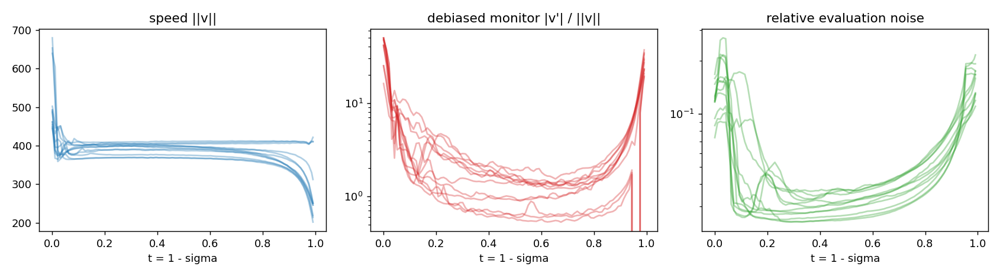
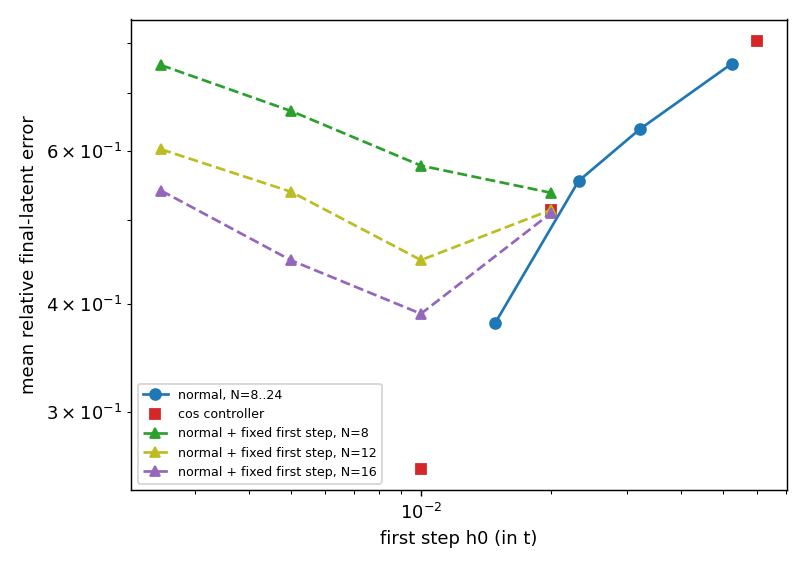
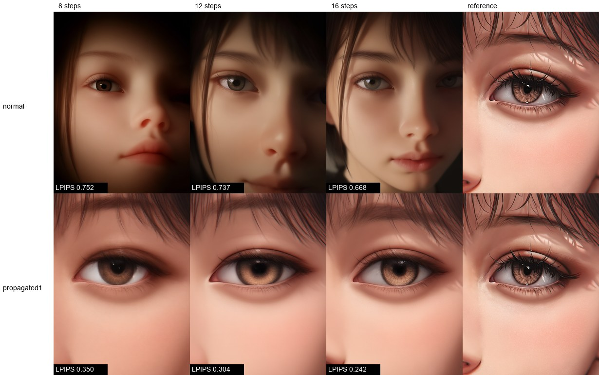
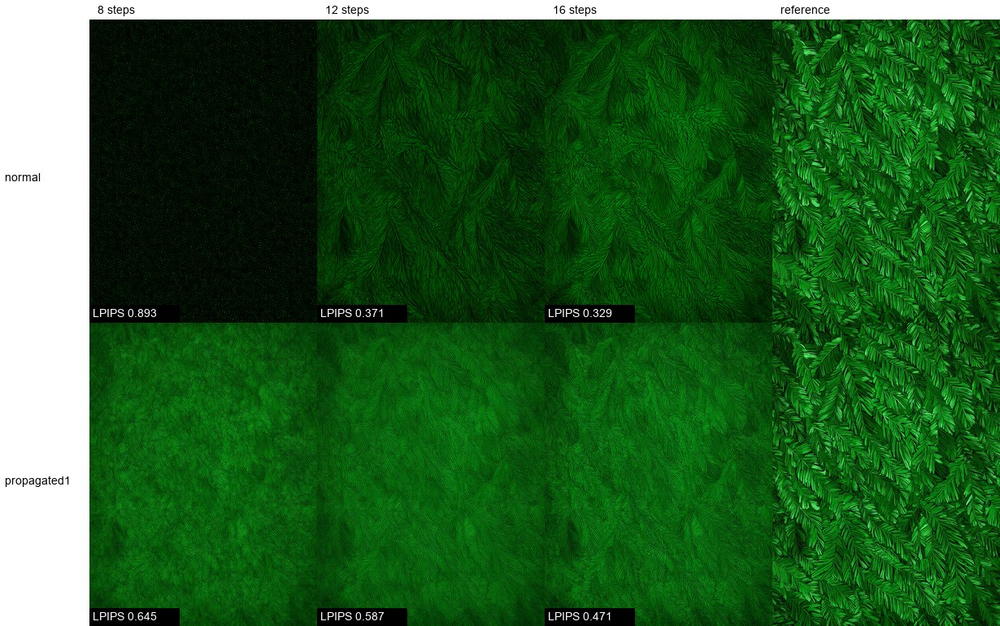

# Бесплатные прокси кривизны для адаптивного шага в Flow Matching

**Язык:** [English](README.md) · **Русский** · [中文](README.zh.md) · [Марий](README.mhr.md)

Препринт: [10.5281/zenodo.24143896](https://doi.org/10.5281/zenodo.24143896). Код: [YakovSava/zero-cost-proxy-research](https://github.com/YakovSava/zero-cost-proxy-research).

Это полный перевод английского [README.md](README.md). Английский файл остаётся оригиналом: при любом расхождении верен он.

**Статус (2026-11-10): эксперименты завершены, кроме случаев, где в разделе сказано иначе.**
Всё ниже воспроизводится из этой папки; сырые числа лежат в `results/*.json`.

Предшествующие работы обсуждаются в разделе 8: бесплатный, не требующий обучения адаптивный по кривизне шаг для flow matching уже предлагался (CAT-Flow, Li и др., 2026), и я нашёл эту работу только после того, как эксперименты были закончены. Что здесь новое, а что нет, сказано там же.

Продолжение работ [adaptive-step-samplers](https://github.com/YakovSava/adaptive-step-samplers) (бесплатная оценка ошибки пары «предиктор-корректор»), `flow-sde-research` и `flow-wls-research`.
Те же соглашения: никаких дополнительных вычислений сети, парные сравнения с бутстреп-интервалами по юнитам, негативные результаты описываются как негативные.

## Вопрос

Сэмплер flow matching интегрирует `dx/dt = v(x, t)`. Выученное `v` никогда не бывает идеально прямым, поэтому шаг должен следовать локальной кривизне. Контроль ошибки по типу Рунге-Кутты требует дополнительных вычислений сети (NFE). Предложение, которое здесь изучается: оценивать кривизну **бесплатно** по косинусу между соседними скоростями `v(x_n, t_n)` и `v(x_{n-1}, t_{n-1})`, которые многошаговый метод и так хранит. Косинус около 1 означает прямой путь, и шаг можно увеличить; резкий поворот означает, что шаг нужно уменьшить.

Работа состоит из трёх частей: (1) точная формулировка того, что косинус измеряет и чего не измеряет, (2) проверка прокси по истинной локальной ошибке, (3) проверка того, улучшает ли результат его *использование* в контроллере при равном NFE.

## Краткий ответ

* **Прокси является надёжным предсказателем ошибки.** `E = h/2 * ||v|| * theta` (theta это угол между соседними скоростями) предсказывает истинную ошибку следующего шага Эйлера с медианным отношением 0,80-0,84 и корреляцией логарифмов между образцами 0,91-0,92 на Anima при шагах от 0,01 до 0,12 по `t`.
* **Один косинус в общем случае неполон**: он видит поворот, но не изменение длины скорости (утверждение 1). На Anima изменение скорости несёт 0,3-0,4% энергии ускорения на большей части траектории, но 8-9% (до 23%) в первых и последних 5% `t`.
* **Идея работает как статическая сетка, а не как онлайн-контроллер.** Расстановка шагов по равному углу поворота (плотность пропорциональна среднему темпу поворота `||v'|| / ||v||`, показатель 1) снижает ошибку финального латента относительно сошедшегося решения на 30-43% по сравнению со стандартным расписанием `normal` при равном NFE (Эйлер, 8-24 шага; лог-отношения от -0,36 до -0,57, интервалы исключают ноль в каждой ячейке). Если взвесить эту плотность по измеренному распространению ошибок `w(t)`, выигрыш составляет 41-50%; при 8 шагах ошибка (0,35) ниже, чем у `normal` при 24 шагах (0,38).
* **Онлайн-адаптивность не даёт ничего измеримого.** Сетка, полученная в прогоне контроллера для *другого* образца, даёт ту же ошибку, что и собственная сетка образца (лог-отношение от -0,01 до -0,02, интервал около +-0,07), а контроллер (с малым начальным шагом) равен статической сетке, которую он подразумевает, `(w*rate)^1` (-0,02, интервал от -0,09 до +0,04). Он лучше обычной сетки с показателем 1 на 6-15% (по логарифму) только потому, что у него более тонко градуирован старт, а не потому, что он адаптируется. Первый шаг контроллера слепой (истории нет), и неудачный выбор там стоит больше, чем контроллер выигрывает на всём остальном.
* **Результат зависит от метрики.** По LPIPS до сошедшегося изображения сетка `(w*rate)^1` (единственная, проверенная по LPIPS) выигрывает на композиционных промптах (`flat`, `face`, `grid`: LPIPS ниже на 39-48%, среднее геометрическое по трём бюджетам) и проигрывает на текстурном промпте `fur` (примерно на 16% выше), где L2 по латенту всё равно улучшается. Она ставит шаги рано, где решается композиция, и меньше шагов в конце, где проступает мелкая текстура.
* **Шум вычисления.** В bf16 при CFG 5 скорость несёт шум около 1,7 градуса (3,4 градуса на большей части траектории из 96 шагов), который не уменьшается с шагом и происходит от округления, а не от потока. Контроллер по сырому косинусу с целевым углом ниже этого пола схлопывается до минимального шага (утверждение 4).

## 1. Теоретическая основа

### 1.1 Постановка и соглашения

`t in [0, T]`, `T = 1 - sigma_min` (`sigma_min = 0.0089` для Anima в ComfyUI), `sigma = 1 - t`, `x_t = (1 - t) * eps + t * x_1`. ComfyUI передаёт сэмплеру оценку «расшумлённого» `D`, и скорость по `sigma` равна `dx/dsigma = (x - D) / sigma`; скорость по `t` ей противоположна по знаку. Бюджет из `N` вычислений сети это `N` точек сетки `0 = t_0 < ... < t_{N-1} = T`; последнее вычисление считывается как `x_hat_1 = x_{t_{N-1}} + sigma_min * v` (совпадает с `D`). Итак, `N` вычислений дают `N - 1` интервалов интегрирования.

Обозначения: `s = ||v||`, единичная касательная `u = v / s`, ускорение `a = d^2x/dt^2 = dv/dt` вдоль пути, кривизна `kappa = ||(I - u u^T) a|| / s^2`.

Бесплатные наблюдаемые на шаге `n` (без дополнительных вычислений): `v_n`, `v_{n-1}`, `s_n`, `s_{n-1}`, `theta_n = angle(v_n, v_{n-1})`, `g_n = ||v_n - v_{n-1}||`.
`theta` считается через хорду единичных векторов, `theta = 2 asin(||u_n - u_{n-1}|| / 2)`, потому что `1 - cos` теряет всю точность при малых углах в одинарной точности.

### 1.2 Утверждение 1 (что видит косинус)

Для любых двух векторов

    ||v_n - v_{n-1}||^2 = (s_n - s_{n-1})^2 + 4 s_n s_{n-1} sin^2(theta_n / 2).

Первое слагаемое это **растяжение**, второе **поворот**. Косинус определяет слагаемое поворота и слеп к растяжению. Отсюда (а также `||a||^2 = (ds/dt)^2 + s^4 kappa^2` вдоль пути):

* Поток с `ds/dt = 0` полностью описывается косинусом. Поток с `kappa = 0` и `ds/dt != 0` для него невидим. Пример из тестов: точное поле скоростей одной изотропной гауссианы (`tests/test_flow.py`) имеет прямые траектории (косинус равен 1 с точностью до 1e-9) и ненулевую ошибку Эйлера.
* Тот же пример даёт и обратный сбой: скорость меняет знак при `t* = 1 / (1 + s^2)` (у дисперсии `x_t` есть внутренний минимум), так что косинус достигает -1, хотя локальная ошибка мала (там скорость близка к нулю).

### 1.3 Утверждение 2 (прокси оценивает ошибку Эйлера)

Для шага Эйлера размера `h` локальная ошибка равна `(h^2 / 2) ||a|| (1 + O(h))`. Если `h'` предыдущий шаг, то `||v_n - v_{n-1}|| / h' = ||a(t_n - h'/2)|| + O(h'^2)`. Следовательно

    E_n = (h / 2) * g_n * (h / h')      (оценка типа Хойна, бесплатная)
        = (h / 2) * (h / h') * s * theta_n    когда растяжением можно пренебречь.

`E` это стандартная разность «предиктор-корректор» (оценка типа Милна, Hairer и др., 1993), полученная без вычисления корректора, потому что нужное для него вычисление всё равно понадобится на следующем шаге (оно запаздывает на один интервал). При гладкости запаздывание вносит относительную ошибку `O(h * |d log||a|| / dt|)`.

### 1.4 Утверждение 3 (оптимальная сетка и что делает контроллер постоянного угла)

Для метода порядка `p` минимизируем главный член оценки глобальной ошибки `J = int w(t) |h(t)|^p M_p(t) dt` при условии `int dt / h = N`, где `M_p = ||x^(p+1)|| / (p+1)!`, а `w` это коэффициент распространения ошибки. Условие стационарности даёт `h ~ (w M_p)^(-1/(p+1))`: **равнораспределение (equidistribution) величины `(w M_p)^(1/(p+1))`**. Для Эйлера это `h ~ ||a||^(-1/2)`.

Контроллер, который удерживает угол поворота на шаг постоянным, `theta_n = kappa s h = theta*`, выбирает `h ~ 1 / (kappa s)`, то есть показатель 1 по кривизне, а не 1/2. Он измельчает области высокой кривизны агрессивнее, чем оптимум для Эйлера. `h_{n+1} = h_n (theta* / theta_n)^gamma` это линейный фильтр по `log h` с полюсом `1 - gamma`, устойчивый и монотонный при `0 < gamma <= 1`.

Показатель 1/2 это **асимптотический** оптимум Эйлера для суммы локальных ошибок. При интересующих нас бюджетах (8-24 шага, итоговая ошибка порядка 0,3-0,8 от сигнала) задача далека от асимптотики, и данные предпочитают показатель 1 или выше (раздел 4.7). Видны две причины. Во-первых, коэффициент распространения `w(t)` (как ошибка, сделанная в момент `t`, доходит до конца) непостоянен: он падает примерно в четыре раза вдоль траектории (раздел 4.8), что смещает шаги к началу. Во-вторых, шум вычисления делает часть локальной ошибки первого порядка по `h` (`h * ||xi||`, а не `h^2`), и оптимальная плотность для этой части круче, чем 1/2. Второе объяснение согласуется с данными, но не было выделено отдельно.

### 1.5 Утверждение 4 (шум вычисления)

Если каждое вычисление несёт независимый шум `xi` с `E||xi||^2 = sigma^2`, то

* `E theta_n^2 = (kappa s h)^2 + b`, где пол `b = 2 sigma_perp^2 / s^2` не зависит от `h`;
* норма *производной, оценённой по зашумлённым значениям, смещена вверх* на мощность шума (`E||c_hat||^2 = ||c||^2 + tr Cov(c_hat)`); в высокой размерности смещение велико. Оно исправляется вычитанием остаточной дисперсии локальной подгонки (`monitor.local_fit_statistics`);
* у контроллера постоянного угла есть неподвижная точка `h* = sqrt(theta*^2 - b) / (kappa s)`, существующая только при `theta* > sqrt(b)`. **При `theta* < sqrt(b)` контроллер схлопывается до минимального шага** (`tests/test_flow.py::test_angle_controller_collapses_below_the_noise_floor`);
* два лага разделяют темп и пол, когда шум белый: `theta_k^2 = a k^2 + b`, откуда `a = (theta_2^2 - theta_1^2) / 3`. Это сработало в синтетическом тесте и без CFG на Anima (`R^2 = 0,999`), но **не сработало при CFG 5** (раздел 4.3).

### 1.6 Утверждение 5 (запас улучшения от адаптивности)

Пусть `rho_i(t) = M_i(t)^beta` оптимальная плотность образца `i`, нормированная на единичную массу. Лучшая статическая сетка минимизирует среднюю стоимость; поэлементная (оракульная) сетка минимизирует стоимость каждого образца. Их разрыв `Gamma = E[J_i(static)] - E[J_i(oracle)] >= 0` зависит **только от того, насколько нормированные формы `rho_i / int rho_i` различаются между образцами**. Изменение общего *масштаба* `M_i` сокращается в условии равнораспределения и ничего не вносит. Никакой онлайн-контроллер, каков бы ни был его прокси, не может превзойти оракул; поэтому `Gamma` ограничивает то, что адаптивность способна дать при данном мониторе.

## 2. Постановка эксперимента

* **Модель:** Anima (`anima_aestheticV11`, bf16), 576x768, CFG 5, латент из 16 каналов (D = 110592). 4 класса промптов (`flat`, `face`, `fur`, `grid`) x 3 сида (42, 1337, 7) = 12 юнитов.
* **Эталон:** Адамс-Башфорт 2 по 192 равномерным точкам `t`; скорости сохранены в каждой второй точке (`dumps/reference`, в gitignore, 43 МБ на юнит). Собственная ошибка эталона порядка 5% (AB2 с 96 точками отличается от него на 0,14 на одном юните, и метод второго порядка), поэтому различия ниже примерно 0,05 не разрешаются.
* **Метрика:** относительная L2-ошибка финального латента относительно эталона. Расстояние по латенту, а не перцептивная метрика.
* **База сравнения:** планировщик ComfyUI `normal` (shift 3). Эйлер и AB2.
* **Игрушечная задача:** точное поле скоростей гауссовой смеси (`gaussian_mixture.py`), D = 64 с 4 модами и D = 256 с 8 модами, 48 образцов, эталон в замкнутой форме через RK4.
* **Статистика:** парные лог-отношения по юнитам, 95%-й бутстреп-интервал (4000 перевыборок, 12 юнитов). При 12 юнитах эффекты ниже примерно 5-8% не обнаруживаются.

Карта кода: `proxies.py` (угол, растяжение, поворот, темпы), `grids.py` (равнораспределение), `integrators.py` (Эйлер, AB2, RK4, адаптивный решатель), `controllers.py` (контроллер угла), `monitor.py` (локальные нормы производных с поправкой на шум), `floor.py` (подгонка по лагам), `profiles.py`, `rig.py` и `samplers.py` (ComfyUI), `toy_study.py`, `real_proxy_study.py`, `step_error_study.py`, `functional_study.py`, `run_*.py` (эксперименты на GPU), `analyze_*.py`, `perceptual_check.py`, `export_sigmas.py`, `check_stock_euler.py`, `make_figures.py`.
30 тестов в `tests/`.

## 3. Гипотезы и происхождение

**Эти гипотезы не были зарегистрированы заранее.** Исследование выполнено за одну рабочую сессию 2026-11-10. Игрушечные вопросы T1-T3 существовали как заголовки задач до игрушечных запусков, но ни одна гипотеза не была сохранена в файл с порогом «подтверждено» до какого-либо измерения, в отличие от соседних исследований (`flow-wls-research`). Гипотезы для реальной модели R1-R6 сформулированы после игрушечных результатов и после просмотра статистики скоростей **одного** реального юнита (`flat_s42`); R7-R9 сформулированы после результата контроллера. Поэтому таблица это ретроспективный список заданных вопросов с их вердиктами, и её нельзя читать как зарегистрированный протокол. Находка раздела 4.6 **не** была предвидена; она возникла из результата, который сначала выглядел как ошибка, и является *post hoc*; контрольные эксперименты разделов 4.6 и 4.7 были спроектированы после неё.

| # | Гипотеза | Вердикт |
| --- | --- | --- |
| T1 | На точной игрушечной задаче `||dv||/h` лучше всего коррелирует с истинной локальной ошибкой, затем угол на основе косинуса, хуже всего растяжение | подтверждена (раздел 4.1) |
| T2 | Равнораспределение с показателем 1/2 лучше равномерной сетки, сдвинутых сеток и показателя 1 для Эйлера | лучше равномерной и сдвинутых; показатель 1 и 1/2 не различимы |
| T3 | Поэлементная оракульная сетка не лучше статической оптимальной | подтверждена (разрыв не больше 0,6% для Эйлера) |
| T4 | Равнораспределение по `||x'''||^(1/3)` оптимально для AB2 | **опровергнута** (хуже равномерной при малых N) |
| R1 | Бесплатная оценка предсказывает истинную ошибку шага Эйлера на Anima | подтверждена (отношение 0,80-0,84, r = 0,91-0,92) |
| R2 | На Anima оракульный разрыв мал | подтверждена |
| R3 | Статическая теоретически оптимальная сетка (показатель 1/2) лучше `normal` | только при N = 24 (-21%); при N <= 16 незначимо |
| R4 | Косинусный контроллер лучше `normal` при равном NFE | **опровергнута** в предложенном виде (начальный шаг 0,06, хуже на 20-120%); с малым начальным шагом выигрывает (4.5), но см. R8 |
| R7 | Статическая сетка с плотностью, пропорциональной темпу поворота (равный угол на шаг), лучше `normal` | **подтверждена**, от -30 до -43% ошибки при каждом N (4.7) |
| R8 | Поэлементная адаптация не добавляет ничего к статической сетке | **подтверждена** (заимствованные сетки, контроллер против статической, 4.7) |
| R9 | Выигрыш переносится на расстояние на уровне изображений (LPIPS) | подтверждена для `flat`, `face`, `grid`; **обратная для `fur`** (4.9) |
| R5 | AB2 не выигрывает от неравномерных сеток | подтверждена; объясняется отношением шагов в начале (раздел 4.4) |
| R6 | Двухлаговый скорректированный косинус является лучшим прокси, чем сырой | **опровергнута** при CFG 5 |

## 4. Результаты

### 4.1 Игрушечная задача (точное поле)

Лог-корреляция внутри момента времени (между образцами при фиксированном времени) каждого прокси с истинной локальной ошибкой Эйлера, 32 шага / 16 шагов:

| прокси | D=64, 4 моды | D=256, 8 мод |
| --- | --- | --- |
| `||dv|| / h` | 0,966 / 0,878 | 0,893 / 0,649 |
| только поворот | 0,889 / 0,797 | 0,806 / 0,572 |
| угол поворота / h | 0,845 / 0,756 | 0,801 / 0,570 |
| кривизна | 0,775 / 0,691 | 0,790 / 0,563 |
| только растяжение | 0,069 / 0,185 | -0,293 / -0,030 |

Средняя относительная итоговая ошибка, Эйлер, с оракульным разрывом `log(oracle / static)`:

| N | равномерная | shift 3 | показатель 1 | показатель 1/2 (оптимальный) | оракул | лог-разрыв |
| --- | --- | --- | --- | --- | --- | --- |
| 8 | 0,1504 | 0,2650 | 0,1425 | 0,1389 | 0,1388 | -0,002 |
| 24 | 0,0550 | 0,0955 | 0,0538 | 0,0522 | 0,0524 | -0,003 |

Для AB2 на игрушечной задаче «оптимальная» сетка по `||x'''||^(1/3)` хуже равномерной при N = 8-16 и примерно равна ей при N = 24; лучшая сетка для AB2 по существу равномерная (плотность `||x'''||^0.2` с равномерной подложкой выигрывает не более 3-4%).

### 4.2 Структура скорости вдоль траектории Anima



* `||v||` почти постоянна на большей части траектории (365-410 в зависимости от юнита) и падает до 200-310 на последних 5% `t`; на первом шаге она больше (до 680 при `t = 0`).
* Доля `||dv||^2`, приходящаяся на изменение скорости: 0,4% (t в 0,05-0,5), 0,3% (0,5-0,9), 2,2% (0,9-0,95), **9,4% (t < 0,05, макс. 23%)**, **7,8% (t > 0,95, макс. 19%)**.
* Монитор ускорения `||v'|| / ||v||` с поправкой на шум имеет U-образную форму: около 16-50 на единицу `t` в начале, около 0,5-3 в середине, около 20-40 в конце. Конечные разности без поправки дают обманчивое плато (около 760 по `||v'||`), потому что их норма определяется шумом.
* **Шум вычисления.** Угол между `v_k` и `v_{k+m}` имеет пол около 2-3 градусов, который не уменьшается при уменьшении лага. Прямой тест (`floor_origin.py`, юнит `face_s42`, `sigma = 0.585`): вычисление детерминировано (угол при повторе равен 0), а возмущение входа на относительные `1e-5` уже меняет скорость на 1,73 градуса; угол остаётся на уровне 1,73-1,80 градуса от `1e-5` до `1e-3` и лишь затем растёт (2,1 градуса при `1e-2`). Это плато, признак шума округления (bf16), а не шероховатого поля. Без CFG (cfg 1) пол на большей части траектории из 96 шагов равен 0,82 градуса против 3,45 градуса при CFG 5: CFG умножает шум примерно в 4 раза.

### 4.3 Прокси против истинной локальной ошибки

Истинная ошибка шага Эйлера по сохранённым скоростям, `e = ||int_t^{t+h} v ds - h v(t)||` (трапеции), против `E = h/2 * s * theta`, вычисленной по предыдущему шагу такого же размера (12 юнитов, `step_error.json`):

| h | медиана E / e | корр. логарифмов между юнитами | корр. логарифмов по всем точкам |
| --- | --- | --- | --- |
| 0,010 | 0,80 | 0,909 | 0,908 |
| 0,021 | 0,79 | 0,909 | 0,862 |
| 0,031 | 0,80 | 0,908 | 0,817 |
| 0,042 | 0,82 | 0,917 | 0,792 |
| 0,062 | 0,84 | 0,922 | 0,746 |

Оценка стабильно составляет 0,8 от истины, так что достаточно калибровочной константы, и она неотличима от оценки Хойна `h/2 * ||dv||`. Темп сырого угла относительно сглаженного монитора завышен в 1,5-2,3 раза на большей части траектории при `h = 0,02` (пол шума) и в 0,7-0,84 раза при `h = 0,083`.

Двухлаговый скорректированный угол оказался **хуже** сырого во внутренней части при `h = 0,02-0,04` (корреляция между юнитами 0,45-0,48 против 0,89-0,96). При CFG 5 структура лагов не имеет вида `a k^2 + b` (`theta^2` растёт примерно линейно по лагу, показатель 0,8-0,95 в начале и в середине, 1,25 в конце; `R^2` подгонки 0,56-0,93), а при cfg 1 имеет (`R^2` 0,977-0,999).

### 4.4 Сетки при равном NFE (12 юнитов, Эйлер, против `normal`)

Лог-отношение итоговой ошибки к сетке `normal` при том же N, среднее и 95%-й интервал (отрицательное значение лучше). Средние ошибки `normal`: 0,756, 0,636, 0,554, 0,380 при N = 8, 12, 16, 24.

| N | равномерная | статическая, показатель 1/2 | оракул, показатель 1/2 | статическая по шероховатости |
| --- | --- | --- | --- | --- |
| 8 | +0,18 [+0,10, +0,28] | -0,01 [-0,03, +0,00] | -0,02 [-0,04, +0,01] | -0,05 [-0,08, -0,02] |
| 12 | +0,35 [+0,22, +0,48] | -0,06 [-0,13, +0,01] | -0,09 [-0,16, -0,02] | -0,02 [-0,03, -0,00] |
| 16 | +0,42 [+0,29, +0,55] | -0,08 [-0,21, +0,05] | -0,02 [-0,16, +0,15] | -0,01 [-0,04, +0,02] |
| 24 | +0,59 [+0,46, +0,74] | **-0,23 [-0,36, -0,10]** | **-0,24 [-0,36, -0,12]** | +0,02 [-0,03, +0,06] |

* **Оракул и статическая сетка неразличимы** (разности -0,01, -0,03, +0,06, -0,01). В функционале утверждения 3 выигрыш оракула составляет 1-2% (`functional.json`).
* Теоретически оптимальная статическая сетка значимо лучше `normal` только при N = 24.
* **AB2:** любая неравномерная сетка хуже `normal` (лог-отношение от +0,05 до +0,75); `normal` лучшая сетка для AB2. AB2 с `normal` лучше Эйлера с `normal` на 6-25%. Отношение ошибки AB2 к ошибке Эйлера по семи сеткам коррелирует с ростом шага в начале `r_1 = h_1 / h_0` (корреляция 0,96, 0,82, 0,74, 0,79 при N = 8, 12, 16, 24): сетки с `r_1` около 1 (`normal`, равномерная) делают AB2 лучше Эйлера, сетки с `r_1` выше 1,4 делают его хуже (x1,2-2,0). Гипотеза «AB2 проигрывает из-за усиления белого шума» проверена и **опровергнута**: коэффициент усиления белого шума у AB2 наибольший для `normal` (1,09-1,27) и наименьший для равномерной сетки (1,01-1,04).

### 4.5 Косинусный контроллер в предложенном виде

Эйлер с `h_{n+1} = h_n clamp((theta*/theta_n)^gamma, 0.5, 2)`, `gamma` из {1, 0,5}, `theta*` = 5-15 градусов, оценка при фактическом NFE каждого юнита против собственной кривой `normal` этого юнита (лог-лог интерполяция по N = 8-24). Контроллер подстраивает свой NFE под юнит (например, 12-26 при 11 градусах, 15-35 при 8 градусах), а `theta* < 4` градусов запускает схлопывание на уровне шума из утверждения 4.

**Средняя ошибка не зависит от `theta*`, `gamma` и NFE** (от 10 до 76); она зависит только от начального шага:

| начальный шаг h_0 | средняя ошибка (все настройки) | диапазон NFE |
| --- | --- | --- |
| 0,06 | 0,80 | 8-61 |
| 0,02 | 0,51 | 11-76 |
| 0,01 | 0,25-0,28 | 12-69 |

При `h_0 = 0,06` (мой первый выбор, который из-за постоянной ошибки выглядел как баг) контроллер хуже `normal` при равном NFE на +0,18…+0,78 по логарифму. У первого шага нет истории, поэтому контроллер там слеп, а кривизна как раз наибольшая.



Все сетки для Эйлера укладываются в ту же картину: при каждом N ранжирование семи сеток по средней ошибке повторяет ранжирование по размеру первого шага (N = 24: `static_acc` с h_0 = 0,0102 даёт 0,296, `normal` с 0,0149 даёт 0,380, равномерная с 0,0431 даёт 0,706).

### 4.6 Контроль первого шага (находка post hoc, контроль спроектирован позже)

Форма `normal` с первым шагом, зафиксированным равным `h_0` (остальные N-1 точек следуют `normal` на `[h_0, T]`), Эйлер, 12 юнитов, лог-отношение против `normal` при том же N:

| N | h_0 = 0,0025 | 0,005 | 0,01 | 0,02 |
| --- | --- | --- | --- | --- |
| 8 | +0,01 [-0,06, +0,09] | -0,12 [-0,29, +0,07] | -0,23 [-0,48, +0,03] | **-0,31 [-0,45, -0,17]** |
| 12 | -0,05 [-0,08, +0,00] | -0,15 [-0,30, +0,02] | -0,29 [-0,58, +0,01] | -0,18 [-0,28, -0,08] |
| 16 | -0,05 [-0,15, +0,02] | -0,19 [-0,35, -0,05] | **-0,30 [-0,57, -0,02]** | -0,08 [-0,12, -0,04] |

Меньший первый шаг помогает вплоть до оптимума (0,01-0,02), а затем перестаёт помогать: при `h_0 = 0,0025` второй шаг становится большим, и ошибка переходит туда. Значит, механизм это разрешение всей начальной области `t < ~0,1` (градуированный старт), а не один шаг.

### 4.7 Статические сетки по темпу поворота и что добавляет контроллер

Статические сетки, построенные по **среднему** профилю `||v'|| / ||v||` остальных 11 юнитов (leave-one-out), плотность `rate^e`, Эйлер, 12 юнитов. Ячейки: средняя ошибка; лог-отношение к `normal` при том же N с 95%-м интервалом (отрицательное значение лучше). `w` это профиль распространения из раздела 4.8, измеренный на двух из этих 12 юнитов (`flat_s42`, `face_s42`), поэтому он не leave-one-out; остальные строки leave-one-out.

| плотность сетки | N = 8 | N = 12 | N = 16 | N = 24 |
| --- | --- | --- | --- | --- |
| средняя ошибка `normal` | 0,756 | 0,636 | 0,554 | 0,380 |
| показатель 1/2 (раздел 4.4) | 0,747; -0,01 [-0,03, +0,00] | 0,585; -0,06 [-0,13, +0,02] | 0,484; -0,08 [-0,21, +0,04] | 0,296; -0,23 [-0,35, -0,11] |
| показатель 0,75 | 0,603; -0,23 [-0,37, -0,10] | 0,450; -0,26 [-0,51, -0,01] | 0,311; -0,51 [-0,67, -0,36] | 0,278; -0,28 [-0,43, -0,14] |
| **показатель 1** (равный угол на шаг) | 0,488; -0,39 [-0,60, -0,15] | 0,331; -0,56 [-0,75, -0,38] | 0,293; -0,57 [-0,79, -0,36] | 0,257; -0,36 [-0,50, -0,21] |
| показатель 1,5 | 0,410; -0,55 [-0,72, -0,38] | 0,340; -0,53 [-0,75, -0,33] | 0,303; -0,52 [-0,74, -0,31] | 0,264; -0,34 [-0,51, -0,19] |
| `(w * rate)^0.5` | 0,646; -0,17 [-0,26, -0,10] | 0,501; -0,19 [-0,31, -0,07] | 0,358; -0,37 [-0,58, -0,16] | 0,271; -0,33 [-0,46, -0,20] |
| **`(w * rate)^1`** | 0,350; -0,70 [-0,87, -0,53] | 0,296; -0,69 [-0,89, -0,51] | 0,266; -0,66 [-0,90, -0,44] | 0,227; -0,52 [-0,73, -0,32] |
| показатель 1, поэлементный оракул | 0,484; -0,40 [-0,61, -0,18] | 0,328; -0,58 [-0,76, -0,41] | 0,280; -0,62 [-0,82, -0,42] | 0,246; -0,42 [-0,56, -0,28] |

* Показатель 1 (равный угол поворота на шаг, к чему и стремится косинусный контроллер с `gamma = 1`) лучше `normal` на 30-43% в каждой ячейке (лог-отношение от -0,36 до -0,57), а показатель 1,5 примерно так же хорош; асимптотический показатель Эйлера 1/2 нет. Здесь данные и игрушечная задача расходятся (на точной игрушечной задаче показатели 1/2 и 1 различаются не более чем на 3%).
* Добавление коэффициента распространения даёт лучшие сетки: 0,350 при N = 8, 0,296 при N = 12, 0,266 при N = 16.
* Поэлементный оракул (собственный профиль, показатель 1) не лучше статической сетки (0,484 против 0,488 при N = 8, 0,328 против 0,331 при N = 12).

**Заимствованные сетки.** Временная сетка, выданная контроллером на юните `v` (`h0 = 0.01`), без изменений применяется к следующему юниту `u` с NFE контроллера:

| настройка контроллера | собственная сетка | заимствованная сетка | log(заимствованная / собственная) | средний NFE |
| --- | --- | --- | --- | --- |
| gamma 1, theta* 15 град., h0 0,01 | 0,276 | 0,273 | -0,01 [-0,07, +0,05] | 13,7 |
| gamma 1, theta* 11 град., h0 0,01 | 0,265 | 0,261 | -0,02 [-0,08, +0,04] | 16,2 |
| gamma 1, theta* 8 град., h0 0,01 | 0,253 | 0,250 | -0,02 [-0,10, +0,07] | 20,6 |

Сетка, вычисленная для *другого* образца, даёт ту же ошибку, что и собственная адаптивная сетка образца. Адаптация к отдельной траектории не несёт измеримой информации.

**Контроллер против статических сеток при том же NFE** (лог-отношение ошибки контроллера к статическому семейству, оценённому при NFE контроллера для того же юнита; отрицательное значение: контроллер лучше):

| контроллер | normal | показатель 1/2 | показатель 1 | показатель 1,5 | `(w*rate)^1` | оракул, показатель 1 |
| --- | --- | --- | --- | --- | --- | --- |
| theta* 15 град., h0 0,01 | -0,68 [-0,87, -0,50] | -0,61 [-0,77, -0,46] | -0,15 [-0,26, -0,05] | -0,18 [-0,27, -0,10] | -0,02 [-0,09, +0,03] | -0,11 [-0,16, -0,06] |
| theta* 11 град., h0 0,01 | -0,61 [-0,79, -0,44] | -0,52 [-0,67, -0,38] | -0,12 [-0,24, -0,01] | -0,16 [-0,27, -0,06] | -0,01 [-0,11, +0,07] | -0,08 [-0,18, -0,01] |
| theta* 8 град., h0 0,01 | -0,47 [-0,62, -0,32] | -0,36 [-0,52, -0,19] | -0,06 [-0,19, +0,04] | -0,12 [-0,24, -0,01] | +0,03 [-0,11, +0,16] | -0,02 [-0,15, +0,09] |
| theta* 11 град., h0 0,02 | -0,07 [-0,23, +0,13] | +0,01 [-0,21, +0,28] | +0,37 [+0,14, +0,61] | +0,35 [+0,11, +0,60] | +0,50 [+0,28, +0,75] | +0,41 [+0,18, +0,66] |

При малом начальном шаге контроллер с большим запасом обходит `normal` и сетку с показателем 1/2 и столь же хорош, как подразумеваемая им статическая сетка (`(w*rate)^1`: -0,02, -0,01, +0,03; интервалы включают 0), и немного лучше обычной сетки с показателем 1 (от -0,15 до -0,06). При `h0 = 0,02` он заметно хуже сеток по темпу поворота (+0,37 и +0,50). Его первый шаг слепой, и этот единственный параметр определяет исход сильнее, чем закон управления.


### 4.8 Распространение ошибок, `w(t)`

Возмущение относительного размера `delta` (случайное направление) вносится в состояние в восьми точках, обе ветви продолжаются методом AB2 на эталонной сетке из 96 точек, а коэффициент усиления равен `||итоговая разность|| / ||возмущение||` (`sensitivity.py`, два юнита, `sensitivity_large.json`).

* **Малые возмущения непригодны.** При `delta` от `1e-3` до `3e-3` итоговое отклонение составляет около 0,8-1,4% от `||x||` независимо от размера возмущения: любое изменение входа заново разыгрывает округление bf16 во всех последующих вычислениях. Для одной точки ветвления усиление равно 7,6 при `1e-3`, 3,9 при `3e-3` и 0,47 при `3e-2` (первая версия этого эксперимента, `sensitivity.json`, определяется полом шума и немонотонна).
* **Большие возмущения дают чистый профиль** (среднее по двум юнитам, `delta = 0,03`; при `delta = 0,1` значения ниже, но форма та же):

| t | 0,03 | 0,08 | 0,17 | 0,29 | 0,46 | 0,63 | 0,79 | 0,92 |
| --- | --- | --- | --- | --- | --- | --- | --- | --- |
| усиление, `delta = 0,03` | 1,71 | 1,42 | 1,69 | 0,87 | 0,70 | 0,39 | 0,39 | 0,47 |
| усиление, `delta = 0,1` | 1,27 | 0,91 | 0,69 | 0,59 | 0,39 | 0,29 | 0,38 | 0,61 |

Поток **сжимает** большие возмущения, причём тем сильнее, чем позже; ошибка, сделанная в первой четверти `t`, весит в конце примерно в четыре раза больше, чем сделанная во второй половине. Вместе с монитором, который в начале примерно в 25 раз больше, чем в середине, начальная область несёт `M * w`, больший примерно в 75 раз. Это тот множитель, которого не хватает в функционале раздела 1.4, и причина того, почему сумма локальных ошибок там (`functional_study.py`) не предсказала итоговое ранжирование сеток. Ограничения: случайные направления (ошибка первого шага направлена вдоль ускорения и может усиливаться сильнее), два юнита, продолжение методом AB2.

### 4.9 Проверка на уровне изображений (LPIPS)

Сетка `(w * rate)^1` и `normal`, Эйлер, N = 8, 12, 16, те же 12 юнитов, декодированные VAE Qwen-Image и сравнённые с декодированным сошедшимся решением по LPIPS (AlexNet) (`perceptual_check.py`).

| N | LPIPS `normal` | LPIPS `(w*rate)^1` | лог-отношение | победы |
| --- | --- | --- | --- | --- |
| 8 | 0,592 | 0,398 | -0,39 [-0,53, -0,21] | 11/12 |
| 12 | 0,450 | 0,327 | -0,36 [-0,62, -0,08] | 9/12 |
| 16 | 0,403 | 0,267 | -0,43 [-0,71, -0,15] | 9/12 |

Восемь шагов с новой сеткой так же близки к сошедшемуся изображению, как шестнадцать шагов с `normal` (0,398 против 0,403; лог-отношение +0,02 [-0,21, +0,25], 6 из 12 юнитов).

По промптам (среднее по трём сидам; LPIPS `normal` -> новая, затем L2 по латенту `normal` -> новая):

| промпт | LPIPS N=8 | LPIPS N=12 | LPIPS N=16 | L2 N=8 | L2 N=12 | L2 N=16 |
| --- | --- | --- | --- | --- | --- | --- |
| flat | 0,302 -> 0,220 | 0,237 -> 0,131 | 0,205 -> 0,127 | 0,38 -> 0,27 | 0,34 -> 0,20 | 0,29 -> 0,20 |
| face | 0,605 -> 0,349 | 0,533 -> 0,293 | 0,475 -> 0,228 | 1,04 -> 0,38 | 0,89 -> 0,31 | 0,75 -> 0,24 |
| fur | 0,730 -> 0,583 | 0,368 -> 0,537 | 0,333 -> 0,416 | 0,57 -> 0,31 | 0,39 -> 0,28 | 0,35 -> 0,25 |
| grid | 0,730 -> 0,441 | 0,663 -> 0,348 | 0,599 -> 0,297 | 1,03 -> 0,44 | 0,93 -> 0,40 | 0,82 -> 0,37 |



Для `face_s42` новая сетка достигает композиции сошедшегося изображения уже за 8 шагов (крупный план глаза), тогда как `normal` рисует другой кадр при 8, 12 и 16 шагах: ошибка это дрейф *композиции*, которая решается на первых шагах. Каждый юнит, где новая сетка проигрывает по LPIPS, это юнит `fur` (3 из 3 сидов при N = 12 и 16, 1 из 3 при N = 8), и там L2 по латенту *улучшается*:



Две метрики расходятся на текстуре. Новая сетка лучше согласует низкочастотную структуру сошедшегося решения, но её изображение более гладкое и плоское; `normal` сохраняет больше мелкой текстуры (даже при смещении), потому что тратит относительно больше шагов ближе к концу, где появляются детали. Это цена взвешивания по распространению, которое считает поздние ошибки дешёвыми: оно верно для выравнивания и неверно для энергии текстуры. Для текстурного контента нужен был бы перцептивный вес, который в этом исследовании не строился.

## 5. Что это значит

1. **Физика в предложении верна.** Траектория искривлена на обоих концах, а угол между соседними скоростями это бесплатный откалиброванный предсказатель локальной ошибки (`E ~ 0,8 e`).
2. **Выигрыш даёт статическая сетка, а не контроллер.** Равный угол поворота на шаг, применённый как сетка, построенная по среднему профилю темпа поворота модели, на Anima (Эйлер) лучше стандартного расписания на 30-43% при равном NFE и за 8 шагов достигает того, чего `normal` достигает за 16 (LPIPS) или 24 (L2 по латенту). Она ничего не стоит при инференсе и не требует управления по образцу.
3. **Поэлементная адаптация здесь не имеет измеримого запаса.** Сетка от другого образца работает так же хорошо, как собственная, а статическая сетка равна контроллеру. Адаптивный цикл это (медленный) способ построить статическую сетку.
4. **Важно начало траектории.** Монитор там примерно в 25 раз больше, чем в середине, сделанные там ошибки весят в конце примерно вчетверо больше и определяют композицию. Недостаточное разрешение старта (или слепой первый шаг) стоит больше, чем любой выигрыш на остальном.
5. Сырой косинус нельзя использовать с целью ниже пола шума вычисления (около 4-6 градусов для bf16 с CFG 5). Нормы производных по сырым конечным разностям в высокой размерности нужно очищать от мощности шума до использования.
6. Используйте AB2 только с сетками, у которых отношение шагов `h_1 / h_0` остаётся около 1 в начальной области; с сетками по темпу поворота (`r_1` около 1,4-2,7) AB2 хуже Эйлера. Сетка для AB2 здесь не проектировалась.
7. Для текстурного контента сетка со взвешиванием по распространению небезопасна (4.9); обычная сетка с показателем 1 по LPIPS не оценивалась.

## 6. Ограничения и угрозы валидности

* Одна модель (Anima), одно разрешение, один масштаб CFG, 12 юнитов; эффекты ниже 5-8% не обнаруживаются. Переносится ли профиль на другие flow-модели (Flux, Qwen-Image, дистиллированные модели без CFG), не проверено.
* Основная метрика это относительное L2-расстояние итогового латента до сошедшегося решения. LPIPS проверен только для лучшей сетки, с `normal` как единственным сравнением, и две метрики расходятся на `fur`.
* У эталона собственная ошибка около 5% и первый шаг 0,005.
* Профиль распространения `w(t)` измерен на двух из 12 оценочных юнитов, со случайными направлениями, одним решателем, и из-за шума bf16 пригодны только большие возмущения. Поэтому строки, которые его используют (`(w*rate)^e`, перцептивная проверка), слегка оптимистичны; чистые сетки по темпу поворота (показатели 0,75, 1, 1,5) leave-one-out и дают основные цифры.
* Находка про первый шаг была **post hoc** (она возникла из результата, выглядевшего как баг); контрольные эксперименты, спроектированные позже (разделы 4.6, 4.7), проверили её на 12 юнитах. Результат для показателя 1 не был предсказан моей теорией (показатель 1/2) и найден прогоном семейства показателей после результата контроллера; показатели 0,75, 1 и 1,5 были зафиксированы до запуска, а не подбирались после.
* Объяснение, что шум вычисления первого порядка делает оптимальный показатель круче 1/2, согласуется с данными, но не отделено от эффекта распространения.
* **Чувствительность выхода к округлению.** Сдвиг внутренних сигм на относительные `1e-7` меняет итоговый латент штатного `euler` ComfyUI на 3-10% (`check_stock_euler.py`: 0,100, 0,046, 0,033 в трёх случаях; сетки из раздела 7.1). Мой собственный цикл Эйлера и штатный `sample_euler` расходятся на 1-7% на тех же сигмах (0,071, 0,033, 0,010), что лежит внутри этого пола. Поэтому числа в таблицах детерминированы для этого кода, но несут разброс на уровне реализации в несколько процентов на юнит, что немало по сравнению с ошибками 0,2-0,4 при 8-12 шагах. Он входит в межъюнитную дисперсию в интервалах, но был измерен лишь в трёх случаях и не для сеток `normal`.
* Монитор с поправкой на шум занижает значения на самых концах, где неразрешённая реальная кривизна засчитывается как шум (всплески до нуля в `monitor_profiles.png`).
* Шум вычисления bf16 свойство данной конфигурации инференса; в fp32 сырой косинус был бы более чистым прокси, и часть истории про «сначала шум» могла бы ослабнуть.
* Только Эйлер и AB2, только детерминированная выборка; никаких стохастических сэмплеров, методов более высокого порядка и «предиктор-корректор».

## 7. Воспроизведение

```
python -m pytest -q                       # 30 tests, CPU
python toy_study.py --study proxy --config d64_m4
python toy_study.py --study grid  --config d64_m4
python run_reference.py                   # GPU, ~22 min, writes dumps/reference
python run_grids.py                       # GPU, ~85 min
python real_proxy_study.py; python step_error_study.py; python functional_study.py
python floor_origin.py
python sensitivity.py; python sensitivity.py --sizes 3e-2 1e-1 --output sensitivity_large.json
python run_adaptive.py; python run_startfix.py; python run_replica.py
python perceptual_check.py
python export_sigmas.py; python check_stock_euler.py
python analyze_grids.py; python analyze_adaptive.py; python analyze_startfix.py
python analyze_replica.py
python make_figures.py
```

Запускайте в окружении ComfyUI (`D:\ComfyUI\venv\Scripts\python.exe`); скриптам на GPU нужно около 5,5 ГБ видеопамяти. Для `run_replica.py` нужен `results/sensitivity_large.json`. Всего примерно 3,5 часа времени GPU.

### 7.1 Готовые списки сигм для Anima

`export_sigmas.py` записывает `results/anima_sigmas.json`: сетки раздела 4.7, построенные по среднему всех 12 профилей (in-sample для этих 12 юнитов, в отличие от leave-one-out сеток в таблицах). `N` это число вычислений сети; в списке `N + 1` элемент, и он заканчивается на `0.0089, 0`, как у `normal`. Их можно подать штатному `euler` ComfyUI через узел ручных сигм. Верно только для Anima при 576x768 и CFG 5, и проверено только с Эйлером (`check_stock_euler.py`).

* N = 8, показатель 1: `1, 0.98589, 0.9487, 0.83139, 0.59419, 0.22593, 0.04039, 0.0089, 0`
* N = 8, с распространением: `1, 0.99196, 0.98106, 0.95543, 0.89484, 0.78472, 0.37647, 0.0089, 0`
* N = 12, показатель 1: `1, 0.99182, 0.98062, 0.95383, 0.90008, 0.80103, 0.65135, 0.43431, 0.19588, 0.06422, 0.02336, 0.0089, 0`
* N = 12, с распространением: `1, 0.99489, 0.98977, 0.98216, 0.97056, 0.94867, 0.91128, 0.84776, 0.77047, 0.56357, 0.08742, 0.0089, 0`
* N = 16, показатель 1: `1, 0.994, 0.98718, 0.97727, 0.95623, 0.92345, 0.86305, 0.7851, 0.67653, 0.52764, 0.35185, 0.18278, 0.08018, 0.03578, 0.01896, 0.0089, 0`
* N = 16, с распространением: `1, 0.99625, 0.9925, 0.98831, 0.98267, 0.97522, 0.96263, 0.94499, 0.9181, 0.87422, 0.82614, 0.76315, 0.62161, 0.30401, 0.04471, 0.0089, 0`
* N = 24, показатель 1: `1, 0.99609, 0.99217, 0.98757, 0.98169, 0.97299, 0.95852, 0.94027, 0.91314, 0.87226, 0.82452, 0.76924, 0.69878, 0.60798, 0.50608, 0.39197, 0.27277, 0.17067, 0.09956, 0.05854, 0.03456, 0.02264, 0.01476, 0.0089, 0`
* N = 24, с распространением: `1, 0.99755, 0.99511, 0.99266, 0.99022, 0.98684, 0.98316, 0.97948, 0.97299, 0.96477, 0.95381, 0.94138, 0.92392, 0.89902, 0.86799, 0.83647, 0.80299, 0.75558, 0.67095, 0.53534, 0.28251, 0.07817, 0.02507, 0.0089, 0`

«С распространением» это сетка `(w * rate)^1`; её профиль распространения измерен на двух из 12 юнитов. Её поздние шаги велики (последние два интервала 8-шагового списка покрывают sigma от 0,78 до 0,0089), из-за чего она лучшая по ошибке латента и худшая на текстуре (раздел 4.9). Сетка с показателем 1 безопаснее для текстурного контента, но по LPIPS не оценивалась.

## 8. Родственные работы и что здесь новое

**Идея этого исследования не новая.** Адаптация шага без обучения для flow matching, не требующая дополнительных вычислений сети, уже существует. CAT-Flow (Li и др., 2026; arXiv 2609.01746, опубликован 2026-09-01) подбирает размеры шагов по оценке конечной разностью производной поля скоростей по времени (CAT-OT) или по дисперсии прошлых значений (CAT-OV), без дополнительных вычислений, и сообщает об экономии до 40% шагов при сопоставимых оценках CLIP, эстетики и HPSv3 на четырёх text-to-image flow-моделях. Это то же семейство, что и косинусное предложение, изучаемое здесь. Я нашёл CAT-Flow после окончания экспериментов, прочитал только его аннотацию и введение и **не** реализовывал и не сравнивал с ним. Ничто в этом файле не говорит о том, как CAT-Flow работает.

Другие соседние работы:

* *Статические расписания, подогнанные под модель или под эталонные траектории:* Align Your Steps (Sabour и др., 2024), Optimal Stepsize Distillation (Pei и др., 2025), Bespoke Solvers (Shaul и др., 2024), сдвинутое расписание SD3 (Esser и др., 2024) и расписание EDM (Karras и др., 2022). Статическая сетка раздела 4.7 принадлежит к этому семейству; отличается тем, что построена по бесплатному прокси без обучения и оптимизации, и не показано, что она лучше этих методов (с ними она не сравнивалась).
* *Бесплатное использование прошлых вычислений:* CAB (Roy & Nair, 2026) корректирует предиктор Адамса-Башфорта по прошлым скоростям; AdaptiveDiffusion (Ye и др., 2024) пропускает вычисления сети по разностям третьего порядка латентов.
* *Классический контроль шага:* вложенные пары Рунге-Кутты (Dormand & Prince, 1980; Hairer и др., 1993), PI-управление (Gustafsson и др., 1988; Söderlind, 2002), принцип равнораспределения (de Boor, 1973; Eriksson и др., 1995) и адаптивные решатели для генеративных моделей (Jolicoeur-Martineau и др., 2021).
* *Кривизна генеративных траекторий как источник ошибки усечения:* Lee и др. (2023), которые снижают её обучением, а не управлением шагом.

Что добавляет это исследование, насколько я могу судить по прочитанным источникам:

1. Точное разложение того, что косинус измеряет (поворот) и чего не видит (изменение скорости), с измерением того, насколько велика невидимая часть на реальной модели (утверждение 1, раздел 4.2).
2. Калибровка бесплатной оценки по истинной локальной ошибке, вычисленной по сошедшейся траектории на реальной модели, а не только по итоговой метрике качества (раздел 4.3).
3. Измерение пола шума вычисления скорости в bf16 с CFG, его происхождения (округление) и следствия для сырого косинусного контроллера (утверждение 4, раздел 4.2).
4. Прямая проверка того, сколько поэлементная адаптация добавляет сверх статической сетки, построенной по среднему профилю: заимствованные сетки и оракул (разделы 4.4, 4.7). Сравнение контроллера со стандартным фиксированным расписанием на этот вопрос ответить не может. Насколько я смог определить по прочитанной части, CAT-Flow сравнивается со стандартными и эвристическими расписаниями, а не со статической сеткой, подогнанной под средний профиль модели; что показало бы такое сравнение для него, я не знаю.
5. Роль первого шага и начальной области, а также несостоятельность асимптотического показателя 1/2 в режиме 8-24 шагов (разделы 4.5-4.7).

Что **не** ново или не показано: идея адаптивных по кривизне шагов; бесплатные оценки для неё; принцип равнораспределения; статические оптимизированные расписания. Все результаты получены на одной модели с 12 юнитами (раздел 6).

## 9. Источники

Полный список в стиле APA 7 с уровнем проверки каждой записи и картой того, где каждый источник цитируется, находится в [`publication/references_apa.md`](publication/references_apa.md). Источники, процитированные в этом файле: Dormand & Prince (1980); de Boor (1973); Eriksson и др. (1995); Esser и др. (2024); Gustafsson и др. (1988); Hairer и др. (1993); Jolicoeur-Martineau и др. (2021); Karras и др. (2022); Lee и др. (2023); Li и др. (2026); Pei и др. (2025); Roy & Nair (2026); Sabour и др. (2024); Shaul и др. (2024); Söderlind (2002); Ye и др. (2024).
