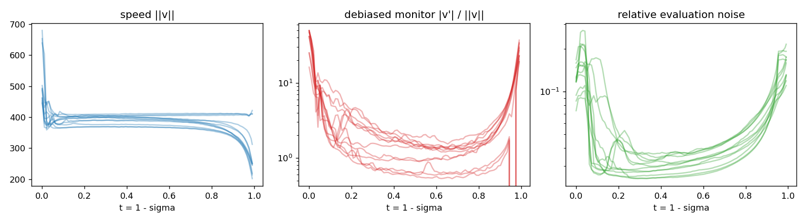
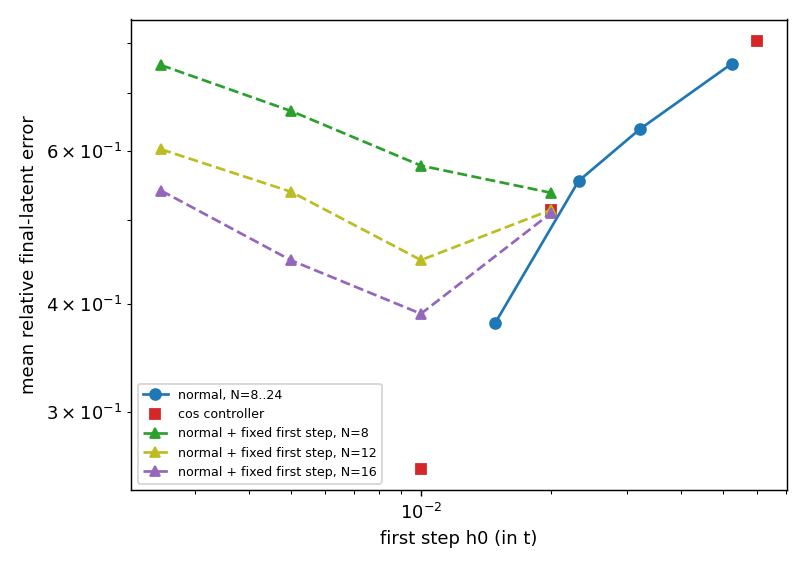
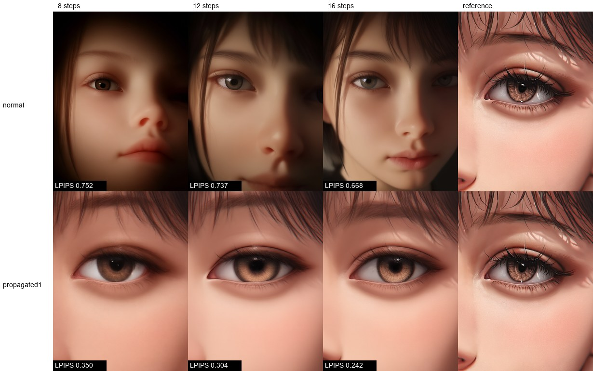
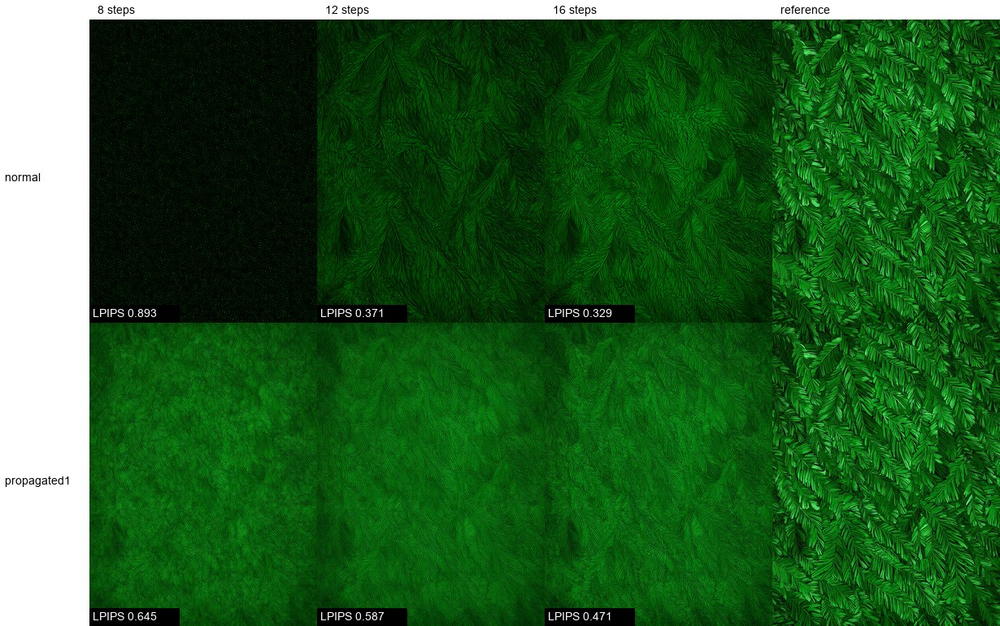

# Flow Matching 自适应步长的零成本曲率代理

**语言：** [English](README.md) · [Русский](README.ru.md) · **中文** · [Марий](README.mhr.md)

预印本：[10.5281/zenodo.24143896](https://doi.org/10.5281/zenodo.24143896)。代码：[YakovSava/zero-cost-proxy-research](https://github.com/YakovSava/zero-cost-proxy-research)。

本文是英文 [README.md](README.md) 的完整翻译。英文文件仍是原文：两者有任何出入，以英文为准。

**状态（2026-11-10）：除各节另有说明外，实验均已完成。**
下文所有内容都可在本目录中复现；原始数字在 `results/*.json` 中。

第 8 节讨论了已有工作：面向 flow matching 的、无需训练、零额外成本的曲率自适应步长此前已有人提出（CAT-Flow，Li 等，2026），我是在实验做完之后才发现的。本研究哪些是新的、哪些不是，在那一节里写明。

本文是 [adaptive-step-samplers](https://github.com/YakovSava/adaptive-step-samplers)（预测-校正对的免费误差估计）、`flow-sde-research` 和 `flow-wls-research` 的后续。
遵循同样的约定：不增加任何网络评估；在各单元（unit）上做带自助法（bootstrap）区间的配对比较；负面结果如实报告。

## 问题

Flow matching 采样器求解 `dx/dt = v(x, t)`。学到的 `v` 不可能完全是直线，所以步长应当跟随局部曲率。Runge-Kutta 式的误差控制需要额外的网络评估（NFE）。本文研究的提议是：用多步方法本来就保存的相邻两次速度 `v(x_n, t_n)` 与 `v(x_{n-1}, t_{n-1})` 之间的余弦，**免费**估计曲率。余弦接近 1 表示路径是直的，可以加大步长；急转弯则要缩小步长。

研究分三部分：(1) 精确说明余弦测量什么、不测量什么；(2) 用真实局部误差检验这个代理；(3) 检验在 NFE 相同时，在控制器中*使用*它是否改善结果。

## 简短回答

* **该代理是可靠的误差预测量。** `E = h/2 * ||v|| * theta`（theta 为相邻速度之间的夹角）预测欧拉下一步的真实误差：在 Anima 上，步长 0.01 到 0.12（以 `t` 计）时，中位数比值为 0.80-0.84，样本之间的对数相关系数为 0.91-0.92。
* **仅靠余弦在一般情况下并不完整**：它看到旋转，看不到速度模长的变化（命题 1）。在 Anima 上，速度变化在轨迹的主体部分只占加速度能量的 0.3-0.4%，但在 `t` 的最初和最后 5% 内占 8-9%（最高 23%）。
* **这个想法以静态网格的形式有效，而不是以在线控制器的形式。** 按等转角排布步长（密度与平均转向速率 `||v'|| / ||v||` 成正比，指数 1），在 NFE 相同时，最终潜变量相对收敛解的误差比默认的 `normal` 调度低 30-43%（欧拉法，8-24 步；对数比为 -0.36 到 -0.57，每个单元格的区间都不含零）。再用测得的误差传播 `w(t)` 对该密度加权，降幅为 41-50%；8 步时的误差（0.35）低于 `normal` 在 24 步时的误差（0.38）。
* **在线自适应没有带来任何可测量的收益。** 取自*另一个*样本的控制器运行所得的网格，给出的误差与该样本自己的网格相同（对数比 -0.01 到 -0.02，区间约 +-0.07）；而（初始步长较小的）控制器等于它所隐含的静态网格 `(w*rate)^1`（-0.02，区间 -0.09 到 +0.04）。它比普通的指数 1 网格好 6-15%（按对数），只是因为它的起始段分级更细，而不是因为它能自适应。控制器的第一步是盲的（没有历史），在这里选错的代价超过控制器在其余部分获得的全部收益。
* **结果取决于指标。** 以 LPIPS 对收敛图像衡量，`(w*rate)^1` 网格（唯一检查过 LPIPS 的网格）在偏构图的提示词上更好（`flat`、`face`、`grid`：LPIPS 低 39-48%，三个预算的几何平均），在纹理提示词 `fur` 上更差（约高 16%），而那里潜变量 L2 仍然改善。它把步长放在早期（构图在此决定），在末期（精细纹理出现处）步数更少。
* **评估噪声。** 在 bf16 和 CFG 5 下，速度带有约 1.7 度的噪声（96 步轨迹主体部分约 3.4 度），它不随步长减小，来自舍入而非流本身。目标角度低于这个下限的原始余弦控制器会退化为最小步长（命题 4）。

## 1. 理论框架

### 1.1 设定与约定

`t in [0, T]`，`T = 1 - sigma_min`（ComfyUI 中 Anima 的 `sigma_min = 0.0089`），`sigma = 1 - t`，`x_t = (1 - t) * eps + t * x_1`。ComfyUI 把去噪估计 `D` 交给采样器，`sigma` 方向上的速度为 `dx/dsigma = (x - D) / sigma`；`t` 方向上的速度是它的相反数。`N` 次网络评估的预算对应 `N` 个网格点 `0 = t_0 < ... < t_{N-1} = T`；最后一次评估的读出为 `x_hat_1 = x_{t_{N-1}} + sigma_min * v`（与 `D` 相同）。因此 `N` 次评估只换来 `N - 1` 个积分区间。

记号：`s = ||v||`，单位切向量 `u = v / s`，沿路径的加速度 `a = d^2x/dt^2 = dv/dt`，曲率 `kappa = ||(I - u u^T) a|| / s^2`。

第 `n` 步的免费可观测量（无需额外评估）：`v_n`、`v_{n-1}`、`s_n`、`s_{n-1}`、`theta_n = angle(v_n, v_{n-1})`、`g_n = ||v_n - v_{n-1}||`。
`theta` 通过单位向量的弦计算，`theta = 2 asin(||u_n - u_{n-1}|| / 2)`，因为在单精度下 `1 - cos` 对小角度会丢失全部精度。

### 1.2 命题 1（余弦看到什么）

对任意两个向量，

    ||v_n - v_{n-1}||^2 = (s_n - s_{n-1})^2 + 4 s_n s_{n-1} sin^2(theta_n / 2).

第一项是**拉伸**，第二项是**旋转**。余弦决定旋转项，对拉伸是盲的。由此（沿路径还有 `||a||^2 = (ds/dt)^2 + s^4 kappa^2`）：

* `ds/dt = 0` 的流完全由余弦描述。`kappa = 0` 且 `ds/dt != 0` 的流对它是不可见的。测试中的例子：单个各向同性高斯的精确速度场（`tests/test_flow.py`）轨迹是直线（余弦在 1e-9 精度内等于 1），而欧拉误差不为零。
* 同一个例子也产生相反的失效：速度在 `t* = 1 / (1 + s^2)` 处变号（`x_t` 的方差有一个内部极小值），于是余弦达到 -1，而局部误差很小（那里速度接近零）。

### 1.3 命题 2（该代理估计欧拉误差）

对步长为 `h` 的欧拉步，局部误差为 `(h^2 / 2) ||a|| (1 + O(h))`。设 `h'` 为上一步的步长，则 `||v_n - v_{n-1}|| / h' = ||a(t_n - h'/2)|| + O(h'^2)`。因此

    E_n = (h / 2) * g_n * (h / h')      （Heun 型估计，免费）
        = (h / 2) * (h / h') * s * theta_n    当拉伸可以忽略时。

`E` 就是标准的预测-校正差（Milne 型估计，Hairer 等，1993），它无需校正器评估，因为所需的那次评估本来就是下一步要做的评估（只是滞后一个区间）。在光滑条件下，滞后引入的相对误差为 `O(h * |d log||a|| / dt|)`。

### 1.4 命题 3（最优网格，以及等角度控制器做了什么）

对 `p` 阶方法，在约束 `int dt / h = N` 下最小化全局误差界的首项 `J = int w(t) |h(t)|^p M_p(t) dt`，其中 `M_p = ||x^(p+1)|| / (p+1)!`，`w` 为误差传播因子。驻点条件给出 `h ~ (w M_p)^(-1/(p+1))`：**对 `(w M_p)^(1/(p+1))` 做等分布（equidistribution）**。对欧拉法，即 `h ~ ||a||^(-1/2)`。

保持每步转角恒定的控制器，`theta_n = kappa s h = theta*`，选取 `h ~ 1 / (kappa s)`，即对曲率取指数 1，而不是 1/2。它比欧拉最优更激进地细化高曲率区域。`h_{n+1} = h_n (theta* / theta_n)^gamma` 是 `log h` 上极点为 `1 - gamma` 的线性滤波器，在 `0 < gamma <= 1` 时稳定且单调。

指数 1/2 是局部误差之和的**渐近**欧拉最优。在我们关心的预算下（8-24 步，最终误差约为信号的 0.3-0.8），问题远不是渐近的，数据更倾向于指数 1 或更高（第 4.7 节）。可见两个原因。第一，传播因子 `w(t)`（时刻 `t` 产生的误差如何传到终点）不是常数；它沿轨迹下降约四倍（第 4.8 节），这会把步长推向起始端。第二，评估噪声使一部分局部误差对 `h` 是一阶的（`h * ||xi||`，而不是 `h^2`），这一部分的最优密度比 1/2 更陡。第二种解释与数据一致，但没有被单独分离出来。

### 1.5 命题 4（评估噪声）

若每次评估都带有独立噪声 `xi`，`E||xi||^2 = sigma^2`，则

* `E theta_n^2 = (kappa s h)^2 + b`，下限 `b = 2 sigma_perp^2 / s^2` 与 `h` 无关；
* *由带噪声的值估计出的导数，其范数被噪声功率向上偏置*（`E||c_hat||^2 = ||c||^2 + tr Cov(c_hat)`）；在高维下偏差很大。通过减去局部拟合的残差方差来修正（`monitor.local_fit_statistics`）；
* 等角度控制器的不动点为 `h* = sqrt(theta*^2 - b) / (kappa s)`，仅当 `theta* > sqrt(b)` 时存在。**当 `theta* < sqrt(b)` 时，控制器退化为最小步长**（`tests/test_flow.py::test_angle_controller_collapses_below_the_noise_floor`）；
* 噪声为白噪声时，两个滞后可以分离速率和下限：`theta_k^2 = a k^2 + b`，故 `a = (theta_2^2 - theta_1^2) / 3`。这在合成测试和 Anima 无 CFG 时有效（`R^2 = 0.999`），但**在 CFG 5 下失效**（第 4.3 节）。

### 1.6 命题 5（自适应的提升空间）

设 `rho_i(t) = M_i(t)^beta` 为样本 `i` 的最优密度，归一化为单位质量。最佳静态网格使平均代价最小；逐样本（oracle）网格使每个样本各自最小。两者的差距 `Gamma = E[J_i(static)] - E[J_i(oracle)] >= 0` **只取决于归一化形状 `rho_i / int rho_i` 在样本之间相差多少**。`M_i` 整体*尺度*的变化在等分布条件中相互抵消，不产生任何影响。任何在线控制器，无论用什么代理，都无法超过 oracle；因此 `Gamma` 给出了在该监测量下自适应所能带来的上限。

## 2. 实验设置

* **模型：** Anima（`anima_aestheticV11`，bf16），576x768，CFG 5，16 通道潜变量（D = 110592）。4 类提示词（`flat`、`face`、`fur`、`grid`）x 3 个种子（42、1337、7）= 12 个单元。
* **参考解：** 在 `t` 的 192 个均匀点上的 Adams-Bashforth 2；速度每隔一个点保存一次（`dumps/reference`，已加入 gitignore，每个单元 43 MB）。其自身误差约为 5%（96 点的 AB2 在一个单元上与它相差 0.14，该方法为二阶），所以低于约 0.05 的差异无法分辨。
* **指标：** 最终潜变量相对参考解的相对 L2 误差。是潜变量距离，不是感知指标。
* **基线：** ComfyUI 的 `normal` 调度器（shift 3）。欧拉法和 AB2。
* **玩具问题：** 高斯混合的精确速度场（`gaussian_mixture.py`），D = 64（4 个模式）和 D = 256（8 个模式），48 个样本，用 RK4 得到闭式参考解。
* **统计：** 各单元上的配对对数比，95% 自助法区间（4000 次重采样，12 个单元）。在 12 个单元下，小于约 5-8% 的效应检测不到。

代码地图：`proxies.py`（角度、拉伸、旋转、速率）、`grids.py`（等分布）、`integrators.py`（欧拉、AB2、RK4、自适应求解器）、`controllers.py`（角度控制器）、`monitor.py`（经噪声修正的局部导数范数）、`floor.py`（滞后拟合）、`profiles.py`、`rig.py` 与 `samplers.py`（ComfyUI）、`toy_study.py`、`real_proxy_study.py`、`step_error_study.py`、`functional_study.py`、`run_*.py`（GPU 实验）、`analyze_*.py`、`perceptual_check.py`、`export_sigmas.py`、`check_stock_euler.py`、`make_figures.py`。
`tests/` 中有 30 个测试。

## 3. 假设与来历

**这些假设没有预先登记。** 研究在 2026-11-10 的一次工作会话中完成。玩具问题 T1-T3 在玩具实验运行之前只以任务标题的形式存在，但没有任何假设在任何测量之前被保存到带有“成立”阈值的文件中，这与相邻研究（`flow-wls-research`）不同。真实模型假设 R1-R6 是在玩具结果之后、并在查看了**一个**真实单元（`flat_s42`）的速度统计之后提出的；R7-R9 是在控制器结果之后提出的。因此该表是对所问问题及其结论的事后清单，不能当作预先登记的方案来读。第 4.6 节的发现**没有**被预料到；它来自一个起初看上去像是 bug 的结果，属于*事后*（post hoc）发现；第 4.6 和 4.7 节的对照实验是在它之后设计的。

| # | 假设 | 结论 |
| --- | --- | --- |
| T1 | 在精确的玩具问题上，`||dv||/h` 与真实局部误差的相关性最好，其次是基于余弦的角度，拉伸最差 | 成立（第 4.1 节） |
| T2 | 对欧拉法，指数 1/2 的等分布优于均匀网格、平移网格和指数 1 | 优于均匀和平移网格；指数 1 与 1/2 无法区分 |
| T3 | 逐样本 oracle 网格不比静态最优网格更好 | 成立（欧拉法的差距至多 0.6%） |
| T4 | 对 AB2，按 `||x'''||^(1/3)` 等分布是最优的 | **被否定**（在小 N 时比均匀网格更差） |
| R1 | 零成本估计量能预测 Anima 上欧拉单步的真实误差 | 成立（比值 0.80-0.84，r = 0.91-0.92） |
| R2 | 在 Anima 上 oracle 差距很小 | 成立 |
| R3 | 静态的理论最优网格（指数 1/2）优于 `normal` | 仅在 N = 24 时（-21%）；N <= 16 时不显著 |
| R4 | 余弦控制器在 NFE 相同时优于 `normal` | 按所提方式**被否定**（初始步长 0.06，差 20-120%）；初始步长较小时能胜出（4.5），但见 R8 |
| R7 | 密度与转向速率成正比的静态网格（每步等角度）优于 `normal` | **成立**，每个 N 下误差低 30% 到 43%（4.7） |
| R8 | 逐样本自适应在静态网格之上不增加任何收益 | **成立**（借用网格、控制器对静态网格，4.7） |
| R9 | 收益能延续到图像层面的距离（LPIPS） | 对 `flat`、`face`、`grid` 成立；对 `fur` **相反**（4.9） |
| R5 | AB2 不能从非均匀网格中获益 | 成立；由起始处的步长比解释（第 4.4 节） |
| R6 | 两滞后去偏的余弦是比原始余弦更好的代理 | 在 CFG 5 下**被否定** |

## 4. 结果

### 4.1 玩具问题（精确速度场）

各代理与真实局部欧拉误差的时刻内对数相关系数（样本之间、固定时刻），32 步 / 16 步：

| 代理 | D=64，4 个模式 | D=256，8 个模式 |
| --- | --- | --- |
| `||dv|| / h` | 0.966 / 0.878 | 0.893 / 0.649 |
| 仅旋转 | 0.889 / 0.797 | 0.806 / 0.572 |
| 转角 / h | 0.845 / 0.756 | 0.801 / 0.570 |
| 曲率 | 0.775 / 0.691 | 0.790 / 0.563 |
| 仅拉伸 | 0.069 / 0.185 | -0.293 / -0.030 |

欧拉法的平均相对最终误差，以及 oracle 差距 `log(oracle / static)`：

| N | 均匀 | shift 3 | 指数 1 | 指数 1/2（最优） | oracle | 对数差距 |
| --- | --- | --- | --- | --- | --- | --- |
| 8 | 0.1504 | 0.2650 | 0.1425 | 0.1389 | 0.1388 | -0.002 |
| 24 | 0.0550 | 0.0955 | 0.0538 | 0.0522 | 0.0524 | -0.003 |

对玩具问题上的 AB2，“最优”的 `||x'''||^(1/3)` 网格在 N = 8-16 时比均匀网格更差，在 N = 24 时大致相当；最好的 AB2 网格本质上是均匀的（密度 `||x'''||^0.2` 加均匀底量，至多提高 3-4%）。

### 4.2 Anima 轨迹上速度的结构



* `||v||` 在主体部分几乎不变（因单元而异，365-410），在 `t` 的最后 5% 内降到 200-310；第一步更大（`t = 0` 处最高 680）。
* `||dv||^2` 中由速度变化造成的份额：0.4%（t 在 0.05-0.5）、0.3%（0.5-0.9）、2.2%（0.9-0.95）、**9.4%（t < 0.05，最大 23%）**、**7.8%（t > 0.95，最大 19%）**。
* 经噪声修正的加速度监测量 `||v'|| / ||v||` 呈 U 形：起始处每单位 `t` 约 16-50，中段约 0.5-3，末端约 20-40。未修正的有限差分给出一个误导性的平台（`||v'||` 约 760），因为它们的范数被噪声主导。
* **评估噪声。** `v_k` 与 `v_{k+m}` 之间的夹角有约 2-3 度的下限，滞后变小时它也不减小。直接测试（`floor_origin.py`，单元 `face_s42`，`sigma = 0.585`）：评估是确定性的（重复角度为 0），把输入扰动相对 `1e-5` 就已使速度改变 1.73 度；从 `1e-5` 到 `1e-3`，角度一直保持在 1.73-1.80 度，之后才增大（`1e-2` 时为 2.1 度）。这是一个平台，是舍入噪声（bf16）的特征，而不是粗糙场的特征。没有 CFG（cfg 1）时，96 步轨迹主体部分的下限为 0.82 度，而 CFG 5 下为 3.45 度：CFG 把噪声放大约 4 倍。

### 4.3 代理与真实局部误差

由保存的速度（梯形法）得到的欧拉步真实误差 `e = ||int_t^{t+h} v ds - h v(t)||`，对比由前一个等长步计算的 `E = h/2 * s * theta`（12 个单元，`step_error.json`）：

| h | E / e 中位数 | 单元间对数相关 | 合并对数相关 |
| --- | --- | --- | --- |
| 0.010 | 0.80 | 0.909 | 0.908 |
| 0.021 | 0.79 | 0.909 | 0.862 |
| 0.031 | 0.80 | 0.908 | 0.817 |
| 0.042 | 0.82 | 0.917 | 0.792 |
| 0.062 | 0.84 | 0.922 | 0.746 |

该估计稳定在真值的 0.8，所以一个校准常数就够了，而且它与 Heun 估计 `h/2 * ||dv||` 无法区分。原始角速率相对于平滑监测量，在 `h = 0.02` 时主体部分被夸大 1.5-2.3 倍（噪声下限），在 `h = 0.083` 时为 0.7-0.84 倍。

两滞后去偏的角度在 `h = 0.02-0.04` 时、在内部区域**比原始角度更差**（单元间相关 0.45-0.48，原始为 0.89-0.96）。在 CFG 5 下，滞后结构不是 `a k^2 + b`（`theta^2` 对滞后大致线性增长，起始和中段的指数为 0.8-0.95，末段为 1.25；拟合 `R^2` 为 0.56-0.93），而在 cfg 1 下是（`R^2` 为 0.977-0.999）。

### 4.4 NFE 相同时的网格（12 个单元，欧拉法，对比 `normal`）

相同 N 下最终误差相对 `normal` 网格的对数比，均值与 95% 区间（负值更好）。`normal` 的平均误差：N = 8、12、16、24 时分别为 0.756、0.636、0.554、0.380。

| N | 均匀 | 静态，指数 1/2 | oracle，指数 1/2 | 基于粗糙度的静态 |
| --- | --- | --- | --- | --- |
| 8 | +0.18 [+0.10, +0.28] | -0.01 [-0.03, +0.00] | -0.02 [-0.04, +0.01] | -0.05 [-0.08, -0.02] |
| 12 | +0.35 [+0.22, +0.48] | -0.06 [-0.13, +0.01] | -0.09 [-0.16, -0.02] | -0.02 [-0.03, -0.00] |
| 16 | +0.42 [+0.29, +0.55] | -0.08 [-0.21, +0.05] | -0.02 [-0.16, +0.15] | -0.01 [-0.04, +0.02] |
| 24 | +0.59 [+0.46, +0.74] | **-0.23 [-0.36, -0.10]** | **-0.24 [-0.36, -0.12]** | +0.02 [-0.03, +0.06] |

* **Oracle 与静态网格无法区分**（差值 -0.01、-0.03、+0.06、-0.01）。在命题 3 的泛函中，oracle 的收益为 1-2%（`functional.json`）。
* 理论最优的静态网格只在 N = 24 时显著优于 `normal`。
* **AB2：** 每一种非均匀网格都比 `normal` 更差（对数比 +0.05 到 +0.75）；`normal` 是最好的 AB2 网格。使用 `normal` 的 AB2 比使用 `normal` 的欧拉法好 6-25%。七种网格上 AB2 与欧拉法的误差之比，与起始处的步长增长 `r_1 = h_1 / h_0` 相关（N = 8、12、16、24 时相关系数 0.96、0.82、0.74、0.79）：`r_1` 接近 1 的网格（`normal`、均匀）使 AB2 优于欧拉法，`r_1` 大于 1.4 的网格使它变差（x1.2-2.0）。“AB2 因放大白噪声而输”这一假设经检验被**否定**：AB2 的白噪声增益对 `normal` 最高（1.09-1.27），对均匀网格最低（1.01-1.04）。

### 4.5 按所提方式的余弦控制器

欧拉法，`h_{n+1} = h_n clamp((theta*/theta_n)^gamma, 0.5, 2)`，`gamma` 取 {1, 0.5}，`theta*` 为 5-15 度，在每个单元的实际 NFE 处，对照该单元自己的 `normal` 曲线评估（在 N = 8-24 上做对数-对数插值）。控制器按单元调整自己的 NFE（例如 11 度时为 12-26，8 度时为 15-35），而 `theta* < 4` 度会触发命题 4 的噪声下限退化。

**平均误差不依赖于 `theta*`、`gamma` 或 NFE**（10 到 76）；它只取决于初始步长：

| 初始步长 h_0 | 平均误差（所有设置） | NFE 范围 |
| --- | --- | --- |
| 0.06 | 0.80 | 8-61 |
| 0.02 | 0.51 | 11-76 |
| 0.01 | 0.25-0.28 | 12-69 |

当 `h_0 = 0.06` 时（我最初的选择，因误差恒定而看起来像个 bug），控制器在 NFE 相同时比 `normal` 差，对数上为 +0.18 到 +0.78。第一步没有历史，所以控制器在那里是盲的，而那里的曲率恰恰最大。



所有欧拉网格都符合同一幅图景：在每个 N 下，七种网格按平均误差的排序，与按第一步大小的排序一致（N = 24：`static_acc` 的 h_0 = 0.0102 给出 0.296，`normal` 的 0.0149 给出 0.380，均匀的 0.0431 给出 0.706）。

### 4.6 第一步对照（事后发现，对照实验在之后设计）

`normal` 的形状，第一步固定为 `h_0`（其余 N-1 个点在 `[h_0, T]` 上沿用 `normal`），欧拉法，12 个单元，相同 N 下相对 `normal` 的对数比：

| N | h_0 = 0.0025 | 0.005 | 0.01 | 0.02 |
| --- | --- | --- | --- | --- |
| 8 | +0.01 [-0.06, +0.09] | -0.12 [-0.29, +0.07] | -0.23 [-0.48, +0.03] | **-0.31 [-0.45, -0.17]** |
| 12 | -0.05 [-0.08, +0.00] | -0.15 [-0.30, +0.02] | -0.29 [-0.58, +0.01] | -0.18 [-0.28, -0.08] |
| 16 | -0.05 [-0.15, +0.02] | -0.19 [-0.35, -0.05] | **-0.30 [-0.57, -0.02]** | -0.08 [-0.12, -0.04] |

更小的第一步有帮助，直到某个最优值（0.01-0.02），然后就不再有帮助：`h_0 = 0.0025` 时第二步变大，误差转移到了那里。所以机制是整个起始区域 `t < ~0.1` 的分辨率（分级的起始），而不是某一个步长。

### 4.7 按转向速率构造的静态网格，以及控制器增加了什么

静态网格由其余 11 个单元的留一法（leave-one-out）**平均**剖面 `||v'|| / ||v||` 构造，密度 `rate^e`，欧拉法，12 个单元。单元格内容：平均误差；相同 N 下相对 `normal` 的对数比及其 95% 区间（负值更好）。`w` 是第 4.8 节的传播剖面，它是在这 12 个单元中的两个（`flat_s42`、`face_s42`）上测得的，因此不是留一法；其他行是留一法。

| 网格密度 | N = 8 | N = 12 | N = 16 | N = 24 |
| --- | --- | --- | --- | --- |
| `normal` 平均误差 | 0.756 | 0.636 | 0.554 | 0.380 |
| 指数 1/2（第 4.4 节） | 0.747; -0.01 [-0.03, +0.00] | 0.585; -0.06 [-0.13, +0.02] | 0.484; -0.08 [-0.21, +0.04] | 0.296; -0.23 [-0.35, -0.11] |
| 指数 0.75 | 0.603; -0.23 [-0.37, -0.10] | 0.450; -0.26 [-0.51, -0.01] | 0.311; -0.51 [-0.67, -0.36] | 0.278; -0.28 [-0.43, -0.14] |
| **指数 1**（每步等角度） | 0.488; -0.39 [-0.60, -0.15] | 0.331; -0.56 [-0.75, -0.38] | 0.293; -0.57 [-0.79, -0.36] | 0.257; -0.36 [-0.50, -0.21] |
| 指数 1.5 | 0.410; -0.55 [-0.72, -0.38] | 0.340; -0.53 [-0.75, -0.33] | 0.303; -0.52 [-0.74, -0.31] | 0.264; -0.34 [-0.51, -0.19] |
| `(w * rate)^0.5` | 0.646; -0.17 [-0.26, -0.10] | 0.501; -0.19 [-0.31, -0.07] | 0.358; -0.37 [-0.58, -0.16] | 0.271; -0.33 [-0.46, -0.20] |
| **`(w * rate)^1`** | 0.350; -0.70 [-0.87, -0.53] | 0.296; -0.69 [-0.89, -0.51] | 0.266; -0.66 [-0.90, -0.44] | 0.227; -0.52 [-0.73, -0.32] |
| 指数 1，逐样本 oracle | 0.484; -0.40 [-0.61, -0.18] | 0.328; -0.58 [-0.76, -0.41] | 0.280; -0.62 [-0.82, -0.42] | 0.246; -0.42 [-0.56, -0.28] |

* 指数 1（每步等转角，这正是 `gamma = 1` 的余弦控制器所趋向的）在每个单元格中都比 `normal` 好 30-43%（对数比 -0.36 到 -0.57），指数 1.5 大致一样好；欧拉法的渐近指数 1/2 则不然。数据与玩具问题在此不一致（在精确玩具问题上，指数 1/2 与 1 相差不超过 3%）。
* 加入传播因子后得到最好的网格：N = 8 时 0.350，N = 12 时 0.296，N = 16 时 0.266。
* 逐样本 oracle（自己的剖面，指数 1）并不比静态网格更好（N = 8 时 0.484 对 0.488，N = 12 时 0.328 对 0.331）。

**借用的网格。** 控制器在单元 `v` 上（`h0 = 0.01`）生成的时间网格，原封不动地用到下一个单元 `u` 上，并采用控制器的 NFE：

| 控制器设置 | 自己的网格 | 借用的网格 | log(借用 / 自己) | 平均 NFE |
| --- | --- | --- | --- | --- |
| gamma 1，theta* 15 度，h0 0.01 | 0.276 | 0.273 | -0.01 [-0.07, +0.05] | 13.7 |
| gamma 1，theta* 11 度，h0 0.01 | 0.265 | 0.261 | -0.02 [-0.08, +0.04] | 16.2 |
| gamma 1，theta* 8 度，h0 0.01 | 0.253 | 0.250 | -0.02 [-0.10, +0.07] | 20.6 |

为*另一个*样本计算出的网格，给出的误差与该样本自己的自适应网格相同。对单条轨迹的自适应没有携带任何可测量的信息。

**NFE 相同时控制器对静态网格**（控制器误差相对于在该控制器 NFE 处对同一单元评估的静态网格族的对数比；负值：控制器更好）：

| 控制器 | normal | 指数 1/2 | 指数 1 | 指数 1.5 | `(w*rate)^1` | oracle，指数 1 |
| --- | --- | --- | --- | --- | --- | --- |
| theta* 15 度，h0 0.01 | -0.68 [-0.87, -0.50] | -0.61 [-0.77, -0.46] | -0.15 [-0.26, -0.05] | -0.18 [-0.27, -0.10] | -0.02 [-0.09, +0.03] | -0.11 [-0.16, -0.06] |
| theta* 11 度，h0 0.01 | -0.61 [-0.79, -0.44] | -0.52 [-0.67, -0.38] | -0.12 [-0.24, -0.01] | -0.16 [-0.27, -0.06] | -0.01 [-0.11, +0.07] | -0.08 [-0.18, -0.01] |
| theta* 8 度，h0 0.01 | -0.47 [-0.62, -0.32] | -0.36 [-0.52, -0.19] | -0.06 [-0.19, +0.04] | -0.12 [-0.24, -0.01] | +0.03 [-0.11, +0.16] | -0.02 [-0.15, +0.09] |
| theta* 11 度，h0 0.02 | -0.07 [-0.23, +0.13] | +0.01 [-0.21, +0.28] | +0.37 [+0.14, +0.61] | +0.35 [+0.11, +0.60] | +0.50 [+0.28, +0.75] | +0.41 [+0.18, +0.66] |

初始步长较小时，控制器大幅胜过 `normal` 和指数 1/2 网格，并且与它所隐含的静态网格一样好（`(w*rate)^1`：-0.02、-0.01、+0.03；区间包含 0），略优于普通的指数 1 网格（-0.15 到 -0.06）。当 `h0 = 0.02` 时，它明显比转向速率网格更差（+0.37 和 +0.50）。它的第一步是盲的，这一个参数对结果的决定作用超过控制律。


### 4.8 误差的传播，`w(t)`

在八个时刻向状态中注入相对大小为 `delta` 的扰动（随机方向），两个分支都在 96 点的参考网格上用 AB2 继续，增益为 `||最终差值|| / ||扰动||`（`sensitivity.py`，两个单元，`sensitivity_large.json`）。

* **小扰动无法使用。** 当 `delta` 为 `1e-3` 到 `3e-3` 时，无论扰动多大，最终偏差都约为 `||x||` 的 0.8-1.4%：输入的任何改变都会在之后每次评估中重新抽取 bf16 舍入。对某一个分叉点，增益在 `1e-3` 时为 7.6，`3e-3` 时为 3.9，`3e-2` 时为 0.47（这个实验的第一版 `sensitivity.json` 被噪声下限主导，且不单调）。
* **大扰动给出干净的剖面**（两个单元的平均，`delta = 0.03`；`delta = 0.1` 的值更低，但形状相同）：

| t | 0.03 | 0.08 | 0.17 | 0.29 | 0.46 | 0.63 | 0.79 | 0.92 |
| --- | --- | --- | --- | --- | --- | --- | --- | --- |
| 增益，`delta = 0.03` | 1.71 | 1.42 | 1.69 | 0.87 | 0.70 | 0.39 | 0.39 | 0.47 |
| 增益，`delta = 0.1` | 1.27 | 0.91 | 0.69 | 0.59 | 0.39 | 0.29 | 0.38 | 0.61 |

该流会**收缩**大的扰动，越到后期越明显；在 `t` 的前四分之一产生的误差，到终点的权重约为后半段产生的误差的四倍。加上监测量在起始处比中段大约 25 倍，起始区域的 `M * w` 要大约 75 倍。这就是第 1.4 节的泛函中缺失的因子，也是那里的局部误差之和（`functional_study.py`）没能预测各网格端到端排名的原因。局限：随机方向（第一步的误差沿加速度方向，可能被放大得更多）、两个单元、用 AB2 继续。

### 4.9 图像层面的检查（LPIPS）

`(w * rate)^1` 网格与 `normal`，欧拉法，N = 8、12、16，同样的 12 个单元，用 Qwen-Image VAE 解码，并与解码后的收敛解用 LPIPS（AlexNet）比较（`perceptual_check.py`）。

| N | LPIPS `normal` | LPIPS `(w*rate)^1` | 对数比 | 胜出 |
| --- | --- | --- | --- | --- |
| 8 | 0.592 | 0.398 | -0.39 [-0.53, -0.21] | 11/12 |
| 12 | 0.450 | 0.327 | -0.36 [-0.62, -0.08] | 9/12 |
| 16 | 0.403 | 0.267 | -0.43 [-0.71, -0.15] | 9/12 |

用新网格的 8 步，与用 `normal` 的 16 步一样接近收敛图像（0.398 对 0.403；对数比 +0.02 [-0.21, +0.25]，12 个单元中 6 个）。

按提示词（三个种子的平均；LPIPS `normal` -> 新，然后是潜变量 L2 `normal` -> 新）：

| 提示词 | LPIPS N=8 | LPIPS N=12 | LPIPS N=16 | L2 N=8 | L2 N=12 | L2 N=16 |
| --- | --- | --- | --- | --- | --- | --- |
| flat | 0.302 -> 0.220 | 0.237 -> 0.131 | 0.205 -> 0.127 | 0.38 -> 0.27 | 0.34 -> 0.20 | 0.29 -> 0.20 |
| face | 0.605 -> 0.349 | 0.533 -> 0.293 | 0.475 -> 0.228 | 1.04 -> 0.38 | 0.89 -> 0.31 | 0.75 -> 0.24 |
| fur | 0.730 -> 0.583 | 0.368 -> 0.537 | 0.333 -> 0.416 | 0.57 -> 0.31 | 0.39 -> 0.28 | 0.35 -> 0.25 |
| grid | 0.730 -> 0.441 | 0.663 -> 0.348 | 0.599 -> 0.297 | 1.03 -> 0.44 | 0.93 -> 0.40 | 0.82 -> 0.37 |



对 `face_s42`，新网格在 8 步时就达到了收敛图像的构图（眼睛的特写），而 `normal` 在 8、12 和 16 步时画出的是另一种取景：误差是*构图*的漂移，而构图在最初几步就已决定。新网格在 LPIPS 上输掉的每个单元都是 `fur` 单元（N = 12 和 16 时 3 个种子全部，N = 8 时 3 个中的 1 个），而在那里潜变量 L2 是*改善*的：



两个指标在纹理上不一致。新网格更好地匹配了收敛解的低频结构，但它的图像更平滑、更平；`normal` 保留了更多精细纹理（即使有错位），因为它相对地在接近末端（细节出现处）花了更多步数。这是传播加权的代价：它把后期误差当作廉价的，这对对齐是对的，对纹理能量是错的。针对纹理密集的内容，需要一个感知权重，本研究没有构建。

## 5. 这意味着什么

1. **提议中的物理是对的。** 轨迹在两端是弯曲的，相邻速度之间的夹角是局部误差的一个免费的、经过校准的预测量（`E ~ 0.8 e`）。
2. **收益来自静态网格，而不是控制器。** 每步等转角，以由模型平均转向速率剖面构造的网格形式使用，在 Anima（欧拉法）上，NFE 相同时比默认调度好 30-43%，并且在 8 步时达到了 `normal` 在 16 步（LPIPS）或 24 步（潜变量 L2）时才能达到的水平。它在推理时没有任何成本，也不需要逐样本控制。
3. **逐样本自适应在这里没有可测量的提升空间。** 取自另一个样本的网格与该样本自己的网格一样好，静态网格与控制器相当。自适应循环只是构造静态网格的一种（缓慢的）办法。
4. **重要的是轨迹的起始。** 那里的监测量比中段大约 25 倍，在那里产生的误差到终点的权重大约是四倍，并且决定构图。起始处分辨率不足（或第一步是盲的），其代价超过其余部分的任何收益。
5. 目标低于评估噪声下限的原始余弦不能使用（bf16 加 CFG 5 时约 4-6 度）。在高维下，由原始有限差分得到的导数范数在使用前必须去除噪声功率。
6. 只对步长比 `h_1 / h_0` 在起始区域保持接近 1 的网格使用 AB2；对于转向速率网格（`r_1` 约 1.4-2.7），AB2 比欧拉法更差。这里没有为 AB2 设计网格。
7. 对纹理密集的内容，传播加权网格并不安全（4.9）；普通的指数 1 网格没有在 LPIPS 上评估过。

## 6. 局限与有效性威胁

* 一个模型（Anima）、一种分辨率、一个 CFG 尺度、12 个单元；小于 5-8% 的效应检测不到。该剖面能否迁移到其他 flow 模型（Flux、Qwen-Image、无 CFG 的蒸馏模型）没有检验。
* 主要指标是最终潜变量相对收敛解的 L2 相对距离。LPIPS 只对最佳网格做了检查，且只以 `normal` 为唯一比较对象，而两者在 `fur` 上不一致。
* 参考解自身约有 5% 的误差，第一步为 0.005。
* 传播剖面 `w(t)` 是在 12 个评估单元中的两个上测得的，使用随机方向，一种求解器，并且由于 bf16 噪声只有大扰动可用。因此用到它的行（`(w*rate)^e`、感知检查）略偏乐观；普通的转向速率网格（指数 0.75、1、1.5）是留一法，给出了主要数字。
* 关于第一步的发现是**事后的**（它来自一个看上去像 bug 的结果）；之后设计的对照实验（第 4.6、4.7 节）用 12 个单元检验了它。指数 1 的结果并非我自己的理论（指数 1/2）所预测，而是在控制器结果之后通过跑指数族发现的；指数 0.75、1 和 1.5 是在运行之前定好的，不是事后调出来的。
* 关于“一阶评估噪声使最优指数比 1/2 更陡”的解释与数据一致，但没有与传播效应分离开。
* **输出对舍入的敏感性。** 把内部 sigma 平移相对 `1e-7`，ComfyUI 自带 `euler` 的最终潜变量会改变 3-10%（`check_stock_euler.py`：三个例子中分别为 0.100、0.046、0.033；网格见第 7.1 节）。我自己的欧拉循环与自带的 `sample_euler` 在相同 sigma 上相差 1-7%（0.071、0.033、0.010），处在这个下限之内。因此表中的数字对这份代码是确定的，但每个单元带有实现层面的数个百分点的散布，与 8-12 步时 0.2-0.4 的误差相比并不小。它包含在区间里的单元间方差之中，但只在三个例子上测过，没有对 `normal` 网格测过。
* 经噪声修正的监测量在最两端会过度扣除，那里未被分辨的真实曲率被当作噪声（见 `monitor_profiles.png` 中降到零的尖峰）。
* bf16 评估噪声是这套推理配置的性质；在 fp32 下原始余弦会是更干净的代理，“噪声优先”这部分结论可能会减弱。
* 只有欧拉法和 AB2，只有确定性采样；没有随机采样器，没有更高阶或预测-校正方法。

## 7. 复现

```
python -m pytest -q                       # 30 tests, CPU
python toy_study.py --study proxy --config d64_m4
python toy_study.py --study grid  --config d64_m4
python run_reference.py                   # GPU, ~22 min, writes dumps/reference
python run_grids.py                       # GPU, ~85 min
python real_proxy_study.py; python step_error_study.py; python functional_study.py
python floor_origin.py
python sensitivity.py; python sensitivity.py --sizes 3e-2 1e-1 --output sensitivity_large.json
python run_adaptive.py; python run_startfix.py; python run_replica.py
python perceptual_check.py
python export_sigmas.py; python check_stock_euler.py
python analyze_grids.py; python analyze_adaptive.py; python analyze_startfix.py
python analyze_replica.py
python make_figures.py
```

请在 ComfyUI 的环境中运行（`D:\ComfyUI\venv\Scripts\python.exe`）；GPU 脚本约占 5.5 GB 显存。`run_replica.py` 需要 `results/sensitivity_large.json`。GPU 总用时约 3.5 小时。

### 7.1 Anima 的现成 sigma 列表

`export_sigmas.py` 写出 `results/anima_sigmas.json`：由全部 12 个剖面的平均构造的第 4.7 节网格（对这 12 个单元是样本内的，不同于表中的留一法网格）。`N` 是网络评估次数；列表有 `N + 1` 项，并以 `0.0089, 0` 结尾，与 `normal` 一样。可以通过手动 sigma 节点交给 ComfyUI 自带的 `euler`。仅适用于 576x768、CFG 5 的 Anima，且只用欧拉法测试过（`check_stock_euler.py`）。

* N = 8，指数 1：`1, 0.98589, 0.9487, 0.83139, 0.59419, 0.22593, 0.04039, 0.0089, 0`
* N = 8，含传播：`1, 0.99196, 0.98106, 0.95543, 0.89484, 0.78472, 0.37647, 0.0089, 0`
* N = 12，指数 1：`1, 0.99182, 0.98062, 0.95383, 0.90008, 0.80103, 0.65135, 0.43431, 0.19588, 0.06422, 0.02336, 0.0089, 0`
* N = 12，含传播：`1, 0.99489, 0.98977, 0.98216, 0.97056, 0.94867, 0.91128, 0.84776, 0.77047, 0.56357, 0.08742, 0.0089, 0`
* N = 16，指数 1：`1, 0.994, 0.98718, 0.97727, 0.95623, 0.92345, 0.86305, 0.7851, 0.67653, 0.52764, 0.35185, 0.18278, 0.08018, 0.03578, 0.01896, 0.0089, 0`
* N = 16，含传播：`1, 0.99625, 0.9925, 0.98831, 0.98267, 0.97522, 0.96263, 0.94499, 0.9181, 0.87422, 0.82614, 0.76315, 0.62161, 0.30401, 0.04471, 0.0089, 0`
* N = 24，指数 1：`1, 0.99609, 0.99217, 0.98757, 0.98169, 0.97299, 0.95852, 0.94027, 0.91314, 0.87226, 0.82452, 0.76924, 0.69878, 0.60798, 0.50608, 0.39197, 0.27277, 0.17067, 0.09956, 0.05854, 0.03456, 0.02264, 0.01476, 0.0089, 0`
* N = 24，含传播：`1, 0.99755, 0.99511, 0.99266, 0.99022, 0.98684, 0.98316, 0.97948, 0.97299, 0.96477, 0.95381, 0.94138, 0.92392, 0.89902, 0.86799, 0.83647, 0.80299, 0.75558, 0.67095, 0.53534, 0.28251, 0.07817, 0.02507, 0.0089, 0`

“含传播”指 `(w * rate)^1` 网格；它的传播剖面是在 12 个单元中的两个上测得的。它的后期步长很大（8 步列表的最后两个区间覆盖 sigma 从 0.78 到 0.0089），这使它按潜变量误差最好、按纹理最差（第 4.9 节）。指数 1 网格对纹理密集的内容更稳妥，但没有在 LPIPS 上评估过。

## 8. 相关工作与本研究的新意

**本研究的想法并不新。** 面向 flow matching、无需训练、不需要额外网络评估的步长自适应已经存在。CAT-Flow（Li 等，2026；arXiv 2609.01746，发布于 2026-09-01）根据向量场对时间导数的有限差分估计（CAT-OT）或过去值的方差（CAT-OV）调整步长，无需额外评估，并报告在四个文生图 flow 模型上，在相当的 CLIP、美学和 HPSv3 得分下最多减少 40% 的步数。这与本文研究的余弦提议属于同一类。我是在实验结束之后才发现 CAT-Flow 的，只读了它的摘要和引言，**没有**实现它，也没有与它比较。本文件没有任何内容说明 CAT-Flow 的表现如何。

其他相邻工作：

* *按模型或按参考轨迹拟合的静态调度：* Align Your Steps（Sabour 等，2024）、Optimal Stepsize Distillation（Pei 等，2025）、Bespoke Solvers（Shaul 等，2024）、SD3 的平移调度（Esser 等，2024）和 EDM 调度（Karras 等，2022）。第 4.7 节的静态网格属于这一类；区别在于它由零成本代理构造，无需训练或优化，并且没有证明它优于这些方法（没有与它们比较过）。
* *免费利用过去的评估：* CAB（Roy & Nair，2026）用过去的速度校正 Adams-Bashforth 预测器；AdaptiveDiffusion（Ye 等，2024）利用潜变量的三阶差分跳过网络评估。
* *经典步长控制：* 嵌入式 Runge-Kutta 对（Dormand & Prince，1980；Hairer 等，1993）、PI 控制（Gustafsson 等，1988；Söderlind，2002）、等分布原理（de Boor，1973；Eriksson 等，1995），以及面向生成模型的自适应求解器（Jolicoeur-Martineau 等，2021）。
* *生成轨迹的曲率是截断误差的来源：* Lee 等（2023），他们通过训练来降低曲率，而不是控制步长。

就我读过的来源而言，本研究的增量在于：

1. 对余弦测量什么（旋转）和漏掉什么（速度变化）的精确分解，并测出了在真实模型上被漏掉的部分有多大（命题 1，第 4.2 节）。
2. 在真实模型上，用由收敛轨迹算出的真实局部误差来校准零成本估计量，而不仅仅是对照下游质量指标（第 4.3 节）。
3. 测量了 bf16 加 CFG 下速度的评估噪声下限、它的来源（舍入），以及对原始余弦控制器的后果（命题 4，第 4.2 节）。
4. 直接检验逐样本自适应在由平均剖面构造的静态网格之上还能增加多少：借用网格和 oracle（第 4.4、4.7 节）。把控制器与固定的默认调度比较无法回答这个问题。就我读到的部分而言，CAT-Flow 是与默认和启发式调度比较，而不是与按模型平均剖面拟合的静态网格比较；这样的比较对它会给出什么结果，我不知道。
5. 第一步和起始区域的作用，以及渐近指数 1/2 在 8-24 步范围内的失效（第 4.5-4.7 节）。

**不是**新的或没有被证明的内容：曲率自适应步长这一想法；它的零成本估计量；等分布原理；静态优化调度。所有结果都来自一个模型、12 个单元（第 6 节）。

## 9. 参考文献

APA 7 格式的完整清单，包括每条记录的核实程度以及各来源被引用位置的对照表，见 [`publication/references_apa.md`](publication/references_apa.md)。本文件中引用的来源：Dormand & Prince（1980）；de Boor（1973）；Eriksson 等（1995）；Esser 等（2024）；Gustafsson 等（1988）；Hairer 等（1993）；Jolicoeur-Martineau 等（2021）；Karras 等（2022）；Lee 等（2023）；Li 等（2026）；Pei 等（2025）；Roy & Nair（2026）；Sabour 等（2024）；Shaul 等（2024）；Söderlind（2002）；Ye 等（2024）。
